
26.2 · PLAYER FIELD GUIDE

# 26.2 RPG Series by Valhaimerd

A player guide to the major mechanics, character progression, exploration, survival, and everyday controls in this pack.

<strong>Author:</strong> Valhaimerd <strong>Pack:</strong> Minecraft 26.2 · NeoForge 26.2.0.90 <strong>Edition:</strong> October 2026 <strong>Distribution:</strong> 311 synchronized JARs · 23 client extras

Last audited: 2026-10-18 
Pack target: Minecraft 26.2 with NeoForge 26.2.0.90 
Current distribution: 311 synchronized JARs plus 23 client-store JARs

## About this handbook

This guide starts with the systems that most change a playthrough and ends with the complete controls reference. Featured Mechanics gives the full walkthrough for major mods; Parts III–VI provide a quicker reference to the rest of the pack, grouped by what players do with them. Each entry names its core mechanic, offers a practical cue, and links to the mod's project page when one is public.

The alphabetical index finds a mod by name, while the gameplay-tag index groups mods by shared activities. Use those indexes to jump into a category, then follow the official page link when you need the complete item or configuration reference. Libraries, APIs, and invisible server internals stay outside the gameplay catalogue.

## How entries are organized

Each part opens with the role its systems play in a new world. Distinct category bars and inset icon entries make the relationships visible without repeating a full walkthrough for every mod. A short category paragraph closes each group; featured mechanics remain fully explained in Part I.

**Entry types:** Core system; Integrated expansion; Focused content; Utility; Interface feature; Optional client feature.

**Cross-reference tags:** Combat; Character; Skills; Magic; Equipment; Bosses; Events; World Generation; Structures; Creatures; Companions; Farming & Food; Building; Storage; Travel; Multiplayer; Controls; HUD; Audio and Atmosphere.

## Table of Contents

<table class="toc-table">
  <tbody>
    <tr><td><a href="#alphabetical-mod-index">Alphabetical mod index</a></td><td>3</td></tr>
    <tr><td><a href="#gameplay-tag-index">Gameplay-tag index</a></td><td>4</td></tr>
    <tr><td><a href="#quick-reference">Quick Reference</a></td><td>5</td></tr>
    <tr class="toc-part"><td><a href="#part-i--featured-mechanics">Part I — Featured Mechanics</a></td><td>6</td></tr>
    <tr class="toc-subsection"><td><a href="#feature-iourus-races">Races, RPG classes, and Astral Dimension</a></td><td>7</td></tr>
    <tr class="toc-subsection"><td><a href="#feature-better-party">Party, The Sift, archeology, and enchantments</a></td><td>8</td></tr>
    <tr class="toc-subsection"><td><a href="#feature-xaeros-world-map">World map, caves, Nether, and End</a></td><td>10</td></tr>
    <tr class="toc-subsection"><td><a href="#feature-starcatcher">Fishing and Chrono Dawn</a></td><td>12</td></tr>
    <tr class="toc-subsection"><td><a href="#feature-farmers-delight">Cooking and alchemy</a></td><td>13</td></tr>
    <tr class="toc-subsection"><td><a href="#feature-sophisticated-backpacks">Backpacks, storage, and player trade</a></td><td>14</td></tr>
    <tr class="toc-part"><td><a href="#part-ii--character-and-core-systems">Part II — Character and Core Systems</a></td><td>16</td></tr>
    <tr class="toc-subsection"><td><a href="#races-and-racial-traits">Races and racial traits</a></td><td>16</td></tr>
    <tr class="toc-subsection"><td><a href="#classes-and-playstyles">Classes and playstyles</a></td><td>16</td></tr>
    <tr class="toc-subsection"><td><a href="#skill-trees-and-character-progression">Skill trees and character progression</a></td><td>17</td></tr>
    <tr class="toc-subsection"><td><a href="#abilities-spells-runes-and-resources">Abilities, spells, runes, and resources</a></td><td>18</td></tr>
    <tr class="toc-subsection"><td><a href="#combat-controls-and-dodge-rolling">Combat controls and dodge rolling</a></td><td>19</td></tr>
    <tr class="toc-subsection"><td><a href="#weapons-armor-jewelry-and-relics">Weapons, armor, jewelry, and relics</a></td><td>20</td></tr>
    <tr class="toc-subsection"><td><a href="#enchanting-and-equipment-improvement">Enchanting and equipment improvement</a></td><td>24</td></tr>
    <tr class="toc-subsection"><td><a href="#death-revival-graves-and-respawning">Death, revival, graves, and respawning</a></td><td>26</td></tr>
    <tr class="toc-subsection"><td><a href="#parties-and-multiplayer-cooperation">Parties and multiplayer cooperation</a></td><td>27</td></tr>
    <tr class="toc-part"><td><a href="#part-iii--adventure-and-challenge">Part III — Adventure and Challenge</a></td><td>29</td></tr>
    <tr class="toc-subsection"><td><a href="#travel-maps-compasses-and-teleportation">Travel, maps, compasses, and teleportation</a></td><td>29</td></tr>
    <tr class="toc-subsection"><td><a href="#xaeros-world-map">Xaero's World Map</a></td><td>30</td></tr>
    <tr class="toc-subsection"><td><a href="#integrated-world-and-dimension-expansions">Integrated world and dimension expansions</a></td><td>30</td></tr>
    <tr class="toc-subsection"><td><a href="#alexs-caves">Alex's Caves</a></td><td>30</td></tr>
    <tr class="toc-subsection"><td><a href="#fishing-and-collection-systems">Fishing and collection systems</a></td><td>33</td></tr>
    <tr class="toc-subsection"><td><a href="#starcatcher">Starcatcher</a></td><td>33</td></tr>
    <tr class="toc-subsection"><td><a href="#companions-pets-villagers-and-settlements">Companions, pets, villagers, and settlements</a></td><td>33</td></tr>
    <tr class="toc-subsection"><td><a href="#pet-vault">Pet Vault</a></td><td>35</td></tr>
    <tr class="toc-subsection"><td><a href="#bosses-and-major-encounters">Bosses and major encounters</a></td><td>35</td></tr>
    <tr class="toc-subsection"><td><a href="#invasions-and-wave-events">Invasions and wave events</a></td><td>36</td></tr>
    <tr class="toc-subsection"><td><a href="#dangerous-nights-and-environmental-threats">Dangerous nights and environmental threats</a></td><td>37</td></tr>
    <tr class="toc-subsection"><td><a href="#structures-and-dungeons">Structures and dungeons</a></td><td>38</td></tr>
    <tr class="toc-subsection"><td><a href="#creatures-and-hostile-mobs">Creatures and hostile mobs</a></td><td>43</td></tr>
    <tr class="toc-part"><td><a href="#part-iv--survival-and-creation">Part IV — Survival and Creation</a></td><td>47</td></tr>
    <tr class="toc-subsection"><td><a href="#resource-gathering-and-repetitive-actions">Resource gathering and repetitive actions</a></td><td>47</td></tr>
    <tr class="toc-subsection"><td><a href="#farming-food-and-cooking">Farming, food, and cooking</a></td><td>47</td></tr>
    <tr class="toc-subsection"><td><a href="#potions-and-alchemy">Potions and alchemy</a></td><td>49</td></tr>
    <tr class="toc-subsection"><td><a href="#building-and-decoration">Building and decoration</a></td><td>50</td></tr>
    <tr class="toc-subsection"><td><a href="#storage-and-inventory-management">Storage and inventory management</a></td><td>52</td></tr>
    <tr class="toc-subsection"><td><a href="#item-transport-and-logistics">Item transport and logistics</a></td><td>53</td></tr>
    <tr class="toc-subsection"><td><a href="#vehicles-and-travel-equipment">Vehicles and travel equipment</a></td><td>54</td></tr>
    <tr class="toc-subsection"><td><a href="#trading-and-multiplayer-economy">Trading and multiplayer economy</a></td><td>55</td></tr>
    <tr class="toc-part"><td><a href="#part-v--interface-and-reference">Part V — Interface and Reference</a></td><td>56</td></tr>
    <tr class="toc-subsection"><td><a href="#information-overlays-and-tooltips">Information overlays and tooltips</a></td><td>56</td></tr>
    <tr class="toc-subsection"><td><a href="#recipe-and-loot-information">Recipe and loot information</a></td><td>58</td></tr>
    <tr class="toc-subsection"><td><a href="#hud-changes-and-customization">HUD changes and customization</a></td><td>59</td></tr>
    <tr class="toc-subsection"><td><a href="#cosmetic-and-animation-changes">Cosmetic and animation changes</a></td><td>60</td></tr>
    <tr class="toc-subsection"><td><a href="#optional-client-features">Optional client features</a></td><td>63</td></tr>
    <tr class="toc-part"><td><a href="#part-vi--keybinds-and-configuration">Part VI — Keybinds and Configuration</a></td><td>65</td></tr>
    <tr class="toc-subsection"><td><a href="#essential-keybinds-and-conflict-resolution">Essential keybinds and conflict resolution</a></td><td>65</td></tr>
  </tbody>
</table>

## Quick Reference

Use this page to begin a new world. [Featured Mechanics](#part-i--featured-mechanics) explains the major systems first; the complete [keybind reference](#part-vi--keybinds-and-configuration) is at the end for setup or troubleshooting.

### Major systems that change how you play

- **Build an RPG character:** choose a lasting race, assemble a flexible weapon-and-book loadout, then grow it through skill trees, spells, runes, and gear. Start with [Choosing a class](#feature-rpg-series) and [Skill trees and character progression](#skill-trees-and-character-progression).
- **Connect gear and progression:** Curios holds pack-provided accessories and the cosmetic layer, while Penchant lets eligible enchantments grow as you use their gear. See [Curios slots and vanity cosmetics](#curios-slots-and-vanity-cosmetics) and [Penchant](#penchant).
- **Explore with intent:** use the explored-terrain map to plan routes, then follow the Cave Codex and Cave Map to find Alex's Caves. See [Xaero's World Map](#xaeros-world-map) and [Alex's Caves](#alexs-caves).
- **Prepare for longer dimensions:** Astral Dimension branches into the Setback after its Void bosses; Chrono Dawn begins with a one-way portal until you stabilize it. Read [Astral Dimension](#feature-astral-dimension) and [Chrono Dawn](#feature-chrono-dawn) before crossing either portal.
- **Build a collection loop:** Starcatcher makes fishing depend on location and fish conditions, with gear, a minigame, and a catalogue. See [Starcatcher](#starcatcher).
- **Bring companions safely:** Pet Vault stores and summons owned pets, while Pet Status helps check their health and last-known location. See [Pet Vault](#pet-vault).

### First ten minutes

1. Compare the seven Iourus racial traits and choose a lasting race. Its direct menu shortcut is unbound; assign Open Race Menu in Controls to reopen the selection screen and read each option.
2. Equip a class book with a matching weapon. Changing the loadout changes your role, so try a few combinations.
3. Open the skill tree with `T` and read node requirements before spending points. Test your equipped spell or attack against an easy target.
4. Open the world map with `M`, mark a route, and keep coordinates visible with `N`. Check the Cave Codex before hunting for Alex's Caves.
5. Pack food and storage for the trip. For multiplayer, open Better Party from its inventory button before entering a dangerous area.

### Controls when you need them

The copied profile uses `T` for skills, `M` for the world map, `N` for coordinates, `G` for the emote wheel, `V` for the equipped backpack, and `E` for a combat roll. Better Party opens from its inventory button. In JEI, left-click shows recipes and right-click shows uses. Curios opens from the inventory button. If a binding conflicts, use the complete [controls reference](#essential-keybinds-and-conflict-resolution) at the end; press **Esc** while editing a binding to leave it unbound.

### Screen layout

Place Paper Doll at the upper-left with Coordinates Display immediately below it, and keep Better Party as a vertical roster on the right. This keeps the center clear and prevents those three overlays from covering one another. See [HUD changes and customization](#hud-changes-and-customization) for the layout diagram and setup notes.

## Part I — Featured Mechanics

These systems change how you build a character, explore, survive, and manage your world. Choose a tile to jump to its mechanics below.

  <a class="feature-card" href="#feature-iourus-races">Iourus RacesLasting strengths, traits, and tradeoffs.</a>
  <a class="feature-card" href="#feature-rpg-series">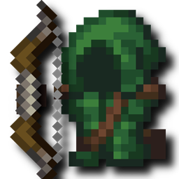RPG SeriesSix builds from weapons and class books.</a>
  <a class="feature-card" href="#feature-astral-dimension">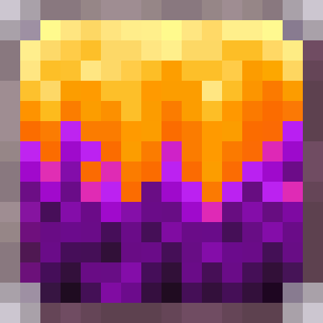Astral DimensionTwo realms and a multi-boss Void journey.</a>
  <a class="feature-card" href="#feature-better-party">Better PartyRoles, shared XP, and a group HUD.</a>
  <a class="feature-card" href="#feature-the-sift">The SiftAwaken an Ancient City portal and explore a strange realm.</a>
  <a class="feature-card" href="#feature-better-archeology">Better ArcheologyBrush fossils and identify ancient artifacts.</a>
  <a class="feature-card" href="#feature-penchant">PenchantEnchantments grow as gear is used.</a>
  <a class="feature-card" href="#feature-xaeros-world-map">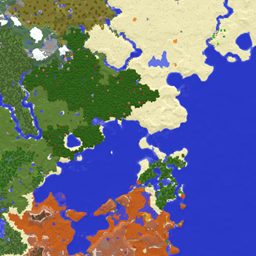Xaero's World MapA map of the terrain you have explored.</a>
  <a class="feature-card" href="#feature-alexs-caves">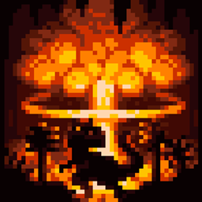Alex's CavesRare biomes below the Overworld.</a>
  <a class="feature-card" href="#feature-better-nether">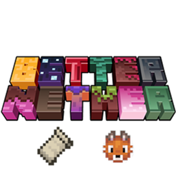Better NetherNew Nether terrain, life, and loot.</a>
  <a class="feature-card" href="#feature-better-end">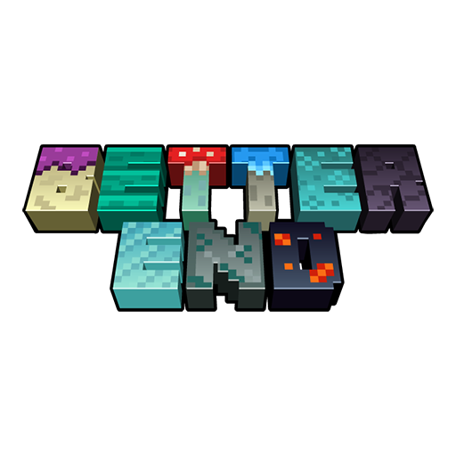Better EndNew End biomes, resources, and creatures.</a>
  <a class="feature-card" href="#feature-starcatcher">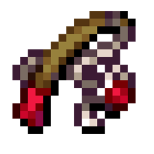StarcatcherCondition-based fishing and collecting.</a>
  <a class="feature-card" href="#feature-chrono-dawn">Chrono DawnA time-locked dimension and boss progression.</a>
  <a class="feature-card" href="#feature-farmers-delight">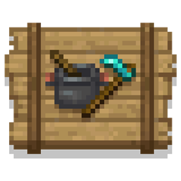Farmer's DelightPrepare, cook, and serve better meals.</a>
  <a class="feature-card" href="#feature-alchemia">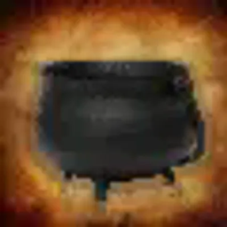AlchemiaDiscover potion effects through ingredients.</a>
  <a class="feature-card" href="#feature-sophisticated-backpacks">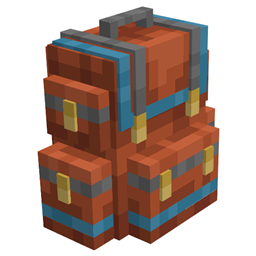Sophisticated BackpacksPortable storage with useful upgrades.</a>
  <a class="feature-card" href="#feature-toms-simple-storage">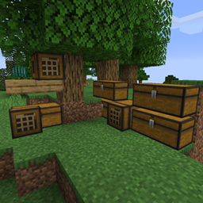Tom's Simple StorageSearch connected containers together.</a>
  <a class="feature-card" href="#feature-market-board">Market BoardA shared player marketplace.</a>

<section class="feature-detail">
<h3 id="feature-iourus-races" class="feature-heading">Iourus Races</h3>

- **Identity:** The installed build offers Human, Elf, Dwarf, Orc, Goblin, Melfork, and Draconic races.
- **Mechanics:** Each race changes attributes, passive strengths, and drawbacks; the choice affects play beyond appearance.
- **Progression:** Race is saved with the character, while class remains a separate equipment choice.
- **Decision:** Read each race's in-game traits before confirming. An ordinary player cannot freely replace a selected race.

**Choosing a race**

1. At the selection screen, compare every race's listed strengths, weaknesses, attributes, and passive traits. The installed build offers seven options.
2. Choose for the playstyle you want to keep. The author describes elves as mobile, orcs as combat-focused, dwarves as resilient, and humans as versatile; inspect the game for the exact current traits.
3. After confirming, build an equipment-based class around that foundation. A class can change with gear, but an ordinary player cannot freely replace a confirmed race.

A race affects survival and combat beyond appearance. Resetting one requires an administrator, so read the full selection before committing.

<strong>Quick tip</strong> Pick for lasting traits; you can change class gear later.

Mechanics source: <a href="https://modrinth.com/mod/iourus-races">official mod page</a>.

</section>

<section class="feature-detail">
<h3 id="feature-rpg-series" class="feature-heading">RPG Series</h3>

- **Classes:** Archer, Paladin, Priest, Rogue, Warrior, and Wizard are equipment-based playstyles in this pack.
- **Loadout:** Weapons and class books determine the abilities you can use; swapping them changes your active role.
- **Spellcasting:** Spell Engine supplies the ability bar, cooldowns, and rune costs for applicable skills.
- **Growth:** Specialized weapons, armor, and spell books deepen each archetype rather than locking your character to one class.

**Building a class loadout**

1. Choose an archetype: Archer for ranged play, Paladin for protection, Priest for healing, Rogue for mobile melee, Warrior for heavy melee, or Wizard for magic.
2. Pair its weapon with a class book. Use a Spell Binding Table to make books, then equip one in the Curios spell-book slot.
3. Hold the compatible weapon to reveal Spell Engine abilities. Follow the keys shown on the ability bar and carry runes for spells that consume them. Bypass Spell Hotbar is unbound in this profile; assign it in Controls if you want a manual override for the ordinary hotbar.
4. Add class armor, skill nodes, and accessories that reinforce the same role.

There is no permanent class-selection screen. If an ability fails, check the weapon, book, runes, target, and cooldown before changing the build.

<strong>Quick tip</strong> If the ability bar is empty, check both the class book and held weapon.

Mechanics source: <a href="https://modrinth.com/mod/wizards">official mod page</a>.

</section>

<section class="feature-detail">
<h3 id="feature-astral-dimension" class="feature-heading">Astral Dimension</h3>

- **Entry:** Build a Nether-shaped frame with at least ten Glowing Obsidian blocks and ignite it with Glint and Steel.
- **Exploration:** The Astral realm has ten biomes, dangerous Void Liquid, unusual creatures, and scattered structures; bring an Elytra and a safe return route.
- **Progression:** Astral Eyes, the Amethyst Sanctuary, Void materials, and the Void Egg lead to the Void Titan.
- **Next realm:** The later Setback dimension opens with Gloomy Obsidian and a Nanta Star, continuing the boss and gear progression.

**From the portal to the Void Titan**

1. Make the Glowing Obsidian portal, activate it with Glint and Steel, and mark your arrival point on Xaero's map. Void Liquid and broken terrain make flight and spare supplies valuable.
2. Explore the Fiery Forest for Burning Orbs. Their shards, four Glowstone Dust, and an Ender Pearl make an Astral Eye. Prepare at least four Eyes for the Amethyst Sanctuary.
3. At the Sanctuary, use the Eyes on the Postrum Eyes, defeat the four Amethyst Knights, and use their keys to reach Broken Amethyst Shards.
4. Mine Void Ore between Y -40 and -12 for Void Gems, and fight Void Menaces for four Void Fangs. Use these materials for a Void Pillar and Astral Altar, then place them at a Void Egg's portal to summon the Titan.
5. After the Titan, search the Tormented Mansion and its Void Visage encounter. The later Setback portal requires ten Gloomy Obsidian and a Nanta Star; enter with upgraded gear.

This pack contains an Astral Dimension 3.0 build ported to Minecraft 26.2. The public project page currently lists other game versions, so use the installed recipes and JEI for any details that differ. The two realms form a long expedition: establish a safe foothold, collect boss-gating materials, then tackle each structure in order.

<strong>Quick tip</strong> Set a map waypoint at the Astral portal before crossing broken terrain.

Mechanics source: <a href="https://www.curseforge.com/minecraft/mc-mods/astral-dimension">official mod page</a>.

</section>

<section class="feature-detail">
<h3 id="feature-better-party" class="feature-heading">Better Party</h3>

- **Groups:** Create public, invite-only, or password-protected parties with leader, officer, and member roles.
- **Cooperation:** Party chat, a live roster, member locator, and optional friendly-fire protection help groups travel and fight together.
- **Shared XP:** Nearby experience can be divided among eligible members when the server permits it.
- **Control:** Leaders set party rules within server limits; each player can adjust their own HUD.

**Playing as a group**

1. Open the party menu from its inventory button. Create or join a public, invite-only, or password-protected group.
2. Assign leader, officer, and member roles. The leader can adjust access and, when the server permits, friendly fire, nearby XP sharing, and the member locator.
3. Use `/p <message>` for party chat. Keep the live roster visible, and move or scale it in personal HUD settings if it covers combat.
4. Check the sharing radius before splitting up; members outside it may not receive XP.

Party membership can persist across restarts. Server rules set the limits, while each player controls only their own HUD layout.

<strong>Quick tip</strong> Set the roster where it stays visible without covering combat.

Mechanics source: <a href="https://modrinth.com/mod/better-party">official mod page</a>.

</section>

<section class="feature-detail">
<h3 id="feature-the-sift" class="feature-heading">Mielon's The Sift</h3>

- **Entry:** An Ancient City portal opens through a Singer's melody and eight Note Blocks on Sonorous Deepslate.
- **Exploration:** The Sift has ten biomes, living sculk, unfamiliar creatures, abandoned portals, and restorative Ichor.
- **Travel:** Temporary Rifts connect the realm and Overworld for five minutes; do not depend on one as a permanent return route.
- **Rewards:** Siftite upgrades Netherite gear, while Charoite changes enchanting choices.

**From Ancient City to first expedition**

1. Find an Ancient City with Sonorous Deepslate near its Reinforced Deepslate frame. Play a Goat Horn in the city center to summon a Singer and awaken the eight blocks.
2. Put a Note Block on each awakened block. Right-click to set notes 1 through 8, then left-click the blocks in this order: **1, 3, 7, 6, 5, 2, 4, 8**. The order played matters, not where the blocks stand.
3. Mark the portal and enter prepared for a long trip. Follow the mod's advancement tab for its creatures, materials, and Ichor. Ichor grants regeneration on contact but slows movement slightly.
4. Search abandoned portals for supplies and rare upgrade materials. Use Siftite with Netherite gear and a Siftite Upgrade Smithing Template; compare Charoite enchanting against ordinary lapis before spending levels.

Natural Rifts may appear after time in The Sift, but they close after five minutes. Keep a reliable route to the Ancient City portal and use a map marker before exploring farther. This pack uses a community NeoForge 26.2 port and requires NeoForge **26.2.0.90 or newer**; check JEI and in-game advancements if a port detail differs from the upstream guide.

<strong>Quick tip</strong> The portal melody is 1–3–7–6–5–2–4–8; mark your way home before chasing a Rift.

Mechanics source: <a href="https://modrinth.com/mod/mielons-the-sift">official mod page</a>.

</section>

<section class="feature-detail">
<h3 id="feature-better-archeology" class="feature-heading">Better Archeology</h3>

- **Sites:** New structures and fossil sites turn ordinary exploration into archeological expeditions.
- **Brushing:** Suspicious blocks and fossiliferous dirt can reveal artifact shards and fossil pieces.
- **Artifacts:** Combine shards into an unidentified artifact, then analyze it at an Archeology Table with a brush.
- **Rewards:** Identified artifacts can provide special enchantments; completed fossils can also serve as displays.

**From a dig site to an artifact**

1. Carry a brush while exploring ruins, old graves, and fossil sites. Look for suspicious blocks, pots, and fossiliferous dirt before breaking the surrounding terrain.
2. Brush promising blocks to collect finds. Fossil pieces come from fossiliferous dirt at their respective sites; artifact shards can come from pots and suspicious blocks.
3. Gather enough shards for an unidentified artifact. Use a brush at an Archeology Table to reveal the artifact, then inspect its effect and equipment requirements.
4. Assemble fossil pieces for a collection or display. Check JEI for the installed recipes before spending rare finds.

Bring spare brushes and mark promising sites on the world map so you can return after clearing your inventory. The mod adds structures to world generation, so search unexplored chunks for new sites in an existing world.

<strong>Quick tip</strong> Brush the dig site before mining through it; fragile clues may be lost when blocks are broken.

Mechanics source: <a href="https://www.curseforge.com/minecraft/mc-mods/better-archeology">official mod page</a> · <a href="https://github.com/Pandarix/BetterArcheology/wiki">author's guide</a>.

</section>

<section class="feature-detail">
<h3 id="feature-penchant" class="feature-heading">Penchant</h3>

- **Leveling:** Eligible enchantments begin at level one and improve as enchanted gear is used.
- **Progress:** Mining, attacking, or taking armor damage fills a separate bar for each enchantment. This pack's progression target is 40% of the original, so levels arrive about 2.5 times faster.
- **Limit:** A full bar raises that enchantment by one level until its maximum is reached.
- **Modules:** Per-world datapacks can also rework tables, bookshelves, durability, loot, and anvils.

**Growing an enchantment**

1. Enchant a tool, weapon, or armor piece. Eligible enchantments begin at level one.
2. Use it in ways that normally cost durability: mine, attack, or take armor damage. Each enchantment fills its own bar.
3. Hover the gear and hold `Left Ctrl` to inspect progress. A full bar raises one enchantment level and resets until the maximum is reached.
4. Check the world's Data Packs screen before relying on any optional table, bookshelf, durability, anvil, or loot changes.

**The pack's new-world modules.** Table Rework offers selectable enchantments with XP and bookshelf requirements and a one-lapis application cost. Bookshelf Placement counts shelves in a wider area and can use enchanted books stored nearby to reveal more choices. Durability Rework changes Mending and Unbreaking; No Anvil Books prevents books from being applied to gear in an anvil. Loot Rework and Guaranteed Drops alter where enchanted equipment appears. Existing worlds keep their saved module selection, and items without durability may not gain progress.

<strong>Quick tip</strong> Hover enchanted gear and hold `Left Ctrl` to see its individual progress bars.

Mechanics source: <a href="https://modrinth.com/mod/penchant">official mod page</a>.

</section>

<section class="feature-detail">
<h3 id="feature-xaeros-world-map" class="feature-heading">Xaero's World Map</h3>

- **Discovery:** The full-screen map records terrain that has been explored.
- **Navigation:** Pan and zoom to compare landmarks, terrain, and possible routes between known places.
- **Waypoints:** Mark important destinations and return points for later journeys.
- **Limit:** Unvisited space stays blank; the map does not reveal hidden terrain ahead of exploration.

**Planning a route**

1. Open the full-screen world map with `M`, then pan and zoom through terrain already explored.
2. Mark home, portals, bases, and important structures with waypoints. Compare known landmarks before choosing a route.
3. Keep coordinates visible with `N` when a precise return point matters, especially before entering a cave or another dimension.
4. Use Nature's Compass or Explorer's Compass to seek an undiscovered biome or structure. Blank map areas do not reveal them.

The map is a memory of travel, not a preview of unexplored land. It becomes more useful as paths and waypoints accumulate.

<strong>Quick tip</strong> Mark the return route with a waypoint before entering a new area.

Mechanics source: <a href="https://www.curseforge.com/minecraft/mc-mods/xaeros-world-map">official mod page</a>.

</section>

<section class="feature-detail">
<h3 id="feature-alexs-caves" class="feature-heading">Alex's Caves</h3>

- **Worlds below:** Six rare cave biomes have distinct creatures, materials, hazards, and equipment.
- **Discovery:** Underground Cabins contain Cave Tablets and a guide; translation leads to a Cave Codex and Cave Map.
- **Preparation:** Each biome asks for different supplies and tactics, from hazardous terrain to unusual creatures.
- **Rewards:** Exploration opens new resources, gear, and creature encounters rather than just another ore layer.

**Finding a rare cave**

1. Search the Overworld for an Underground Cabin. Its barrels contain Cave Tablets, and the Cave Compendium explains the discovery system.
2. Put a Cave Tablet and paper in the Spelunkery Table. Solve three translation levels, each with five guesses, to produce a Cave Codex; a failed or interrupted translation consumes the tablet. Craft the codex with paper into its Cave Biome Map.
3. Read the map before descending. Magnetic, Primordial, Toxic, Abyssal, Forlorn, and Candy caves have different creatures, hazards, and resources.
4. Bring supplies for the named cave. If equipped Alex's Caves gear grants a special ability, assign Alex's Caves Special Ability in Controls to activate it; this profile leaves it unbound.

Use the Cave Codex to unlock biome chapters in the Cave Compendium before spending it on a map. Each cave is a destination with its own rules rather than another ordinary ore layer.

<strong>Quick tip</strong> Read the Cave Codex before crafting it into a map.

Mechanics source: <a href="https://modrinth.com/mod/alexs-caves">official mod page</a>.

</section>

<section class="feature-detail">
<h3 id="feature-better-nether" class="feature-heading">Better Nether</h3>

- **Biomes:** New Nether landscapes include vegetation, materials, and vertical biome variation.
- **Encounters:** Creatures, dungeons, and rare cities add reasons to explore beyond a fortress.
- **Resources:** New plants, foods, tools, and blocks can be gathered or farmed.
- **Generation:** Terrain changes appear in newly generated chunks, leaving already visited terrain intact.

**Exploring the changed Nether**

1. Mark the portal and carry food, spare equipment, and a return route before crossing unfamiliar terrain.
2. Explore beyond fortresses. New biomes hold plants, materials, creatures, dungeons, and rare Nether Cities.
3. Bring home useful flora and resources for tools, building, and farms. Some materials can be grown or gathered repeatedly.
4. After a pack update, travel into new chunks to see new generation; visited terrain stays as it was.

Better Nether varies biomes vertically as well as across the map. Routes at different heights can expose different terrain and dangers.

<strong>Quick tip</strong> Mark your portal as soon as you arrive in unfamiliar terrain.

Mechanics source: <a href="https://modrinth.com/mod/betternether">official mod page</a>.

</section>

<section class="feature-detail">
<h3 id="feature-better-end" class="feature-heading">Better End</h3>

- **World generation:** The End gains many new biomes, varied island shapes, caves, and structures.
- **Exploration:** New plants, blocks, resources, and creatures distinguish the biomes.
- **Equipment:** End materials support new tools, armor, weapons, and building choices.
- **Existing worlds:** Travel into new chunks to find newly generated terrain.

**Exploring the changed End**

1. Prepare for the dragon and establish a safe route through the central island before leaving it.
2. Cross into unexplored islands and survey each biome for its terrain, plants, creatures, and resources.
3. Bring home new materials to explore their recipes and equipment options in the recipe interface.
4. Mark a return route before crossing large gaps or descending into caves.

Better End focuses on End exploration and resources. Its world generation changes newly visited areas; already generated chunks keep their existing terrain.

<strong>Quick tip</strong> Mark a return route while exploring the new islands.

Mechanics source: <a href="https://www.curseforge.com/minecraft/mc-mods/betterend-neoforge">official mod page</a>.

</section>

<section class="feature-detail">
<h3 id="feature-starcatcher" class="feature-heading">Starcatcher</h3>

- **Fish collection:** More than 100 fish have their own biome, weather, time, elevation, and other conditions.
- **Tackle:** Hooks, bobbers, and bait modify which catches are possible.
- **Fishing:** A skill-based minigame replaces passive waiting for many catches.
- **Long-term goals:** The catalogue, trophies, displays, aquariums, and tournaments reward varied catches.

**First catch and collection loop**

1. The current profile awards the guide on joining a world. If you still need a Starcatcher rod, fish once with a vanilla rod; the profile also awards the rod on that first catch.
2. Open the guide with `Ctrl + Space`. Read its help pages and a target fish's biome, dimension, weather, time, elevation, and other conditions.
3. Fit the rod with suitable hooks, bobbers, and bait. A Tackle Box stores fish and helps organize attachments.
4. Cast and follow the on-screen minigame. Press `Space` for **Minigame Hit**; different fish can change the pattern and difficulty.
5. Record the catch in the catalogue, then keep it, display it, cook it, or sell it. Trophies, secrets, and tournaments give longer goals.

This profile hides uncaught fish entries and shares catches with online FTB Team members. Changing location or tackle often matters more than repeated casts at one spot.

<strong>Quick tip</strong> Check fish conditions in the guide before changing bait or casting again.

Mechanics source: <a href="https://modrinth.com/mod/starcatcher">official mod page</a>.

</section>

<section class="feature-detail">
<h3 id="feature-chrono-dawn" class="feature-heading">Chrono Dawn</h3>

- **Entry:** Find Ancient Ruins in the Overworld, gather Clockstone, and activate a Clockstone portal with a Time Hourglass.
- **Travel rule:** The first crossing is one-way. Find the Forgotten Library and a Portal Stabilizer to enable travel back.
- **World:** Eleven time-themed biomes, slowed hostile mobs, new creatures, dungeons, and equipment fill the dimension.
- **Goal:** Four dungeon bosses supply a Chrono Aegis; the Time Guardian and Master Clock lead to the Time Tyrant.

**A safe first Chrono Dawn expedition**

1. Search taiga or dark forest for Ancient Ruins. For a directed search, mine Overworld Chronite Ore, craft a Time Compass, and follow it to the nearest ruins.
2. Gather Clockstone and build a portal frame at least 4 by 5 blocks; activate it with a Time Hourglass. Pack food, tools, and a way to survive in the dimension because entry initially has no return trip.
3. Read the Chronicle guidebook given on arrival. Find the Forgotten Library for the Portal Stabilizer recipe, then gather Enhanced Clockstone from a Desert Clock Tower and stabilize the portal for two-way travel.
4. Explore Guardian Vault, Clockwork Depths, Phantom Catacombs, and Entropy Crypt. Their bosses drop the four materials for a Chrono Aegis, which grants a timed advantage against the final boss.
5. Defeat the Time Guardian for the Master Clock Key, open the Master Clock, and face the Time Tyrant. Its Stasis Core fragments support later time-themed artifacts.

The dimension changes combat pacing because hostile mobs move slowly, but dungeon bosses still demand preparation. The guidebook and the installed JEI recipes are the best references while progressing; place a waypoint at the portal once return travel is unlocked.

<strong>Quick tip</strong> Treat the first portal crossing as a one-way expedition until you have a Portal Stabilizer.

Mechanics source: <a href="https://www.curseforge.com/minecraft/mc-mods/chrono-dawn">official mod page</a>.

</section>

<section class="feature-detail">
<h3 id="feature-farmers-delight" class="feature-heading">Farmer's Delight</h3>

- **Ingredients:** Crops and gathered foods broaden what can be prepared.
- **Preparation:** Knives and Cutting Boards turn raw ingredients into recipe components.
- **Cooking:** Stoves, skillets, and Cooking Pots handle different dishes and batch meals.
- **Serving:** Some cooked foods need containers, while feasts provide portions in the world.

**From harvest to meal**

1. Grow crops or gather ingredients, then inspect a desired dish in JEI for its workstation and serving container.
2. Use a Knife and Cutting Board for ingredients that need a cutting recipe.
3. Heat a Stove, Skillet, or Cooking Pot for the relevant dish. A pot can prepare several servings and may need bowls or other containers.
4. Serve the meal or place a feast for shared portions. Rich soil and crop systems can sustain the kitchen's ingredient supply.

Cooking is a chain of preparation, heat, and serving rather than a single crafting recipe. Similar dishes may need different stations, so follow the recipe display.

<strong>Quick tip</strong> Start with the finished dish in JEI and follow its required station backward.

Mechanics source: <a href="https://modrinth.com/mod/farmers-delight">official mod page</a>.

</section>

<section class="feature-detail">
<h3 id="feature-alchemia" class="feature-heading">Alchemia</h3>

- **Setup:** A vanilla cauldron over a lit campfire becomes an Alchemical Cauldron.
- **Brewing:** Each ingredient moves the mixture along a path on a radial map of potion effects.
- **Results:** Landing near an effect adds it; proximity affects potency, and a brew can carry multiple effects.
- **Discovery:** The map is generated per world, so memorized recipes from another world may not work.
- **Guide:** An Alchemist's Guide records discovered effects, ingredients, and paths for repeat brewing.

**Brewing by ingredient path**

1. Place a vanilla cauldron over a lit campfire to make an Alchemical Cauldron, then add water and ingredients.
2. Watch the radial map as each ingredient moves the potion along a path. Land near the desired effect; closeness affects potency.
3. Continue carefully to combine effects. The last effect added is generally the strongest.
4. Bottle the result with glass bottles; a full cauldron yields four bottles.
5. Craft an Alchemist's Guide with a book and an ingredient. It records discoveries and paths; select a saved recipe, then sneak-right-click the cauldron to repeat it.

The effect map is generated per world, so a recipe from another save may lead somewhere else. Experiment in small batches before brewing expedition supplies.

<strong>Quick tip</strong> Save a successful ingredient path in the Guide before brewing in bulk.

Mechanics source: <a href="https://modrinth.com/project/alchemia">official mod page</a>.

</section>

<section class="feature-detail">
<h3 id="feature-sophisticated-backpacks" class="feature-heading">Sophisticated Backpacks</h3>

- **Capacity:** Backpack tiers add storage and upgrade slots as materials improve.
- **Upgrades:** Modules can collect drops, filter contents, refill supplies, or add crafting and other utilities.
- **Placement:** A backpack can travel with you or be placed and connected to inventory automation.
- **Customization:** Dye colors and upgrade configurations help dedicate packs to different jobs.
- **Death rule:** A Sophisticated Backpack goes to the grave even when carried in the hotbar, offhand, armor, or Curios.

**Preparing a travel pack**

1. Obtain a backpack and upgrade its tier as you need more storage and upgrade slots.
2. Choose modules for the job: Pickup gathers drops, filters control contents, Refill maintains supplies, and Crafting adds a work surface.
3. Open the equipped pack with `V` and configure its upgrades before an expedition.
4. Dye separate packs for mining, building, or travel. A placed pack can also interact with hoppers and inventory automation.

Automation follows each upgrade's filter, so inspect settings before carrying valuable items. The pack's tier controls its available capacity and upgrade choices. After a death, recover the backpack from the grave; its equipped position does not exempt it.

<strong>Quick tip</strong> Configure Pickup and filter upgrades before your next loot run.

Mechanics source: <a href="https://modrinth.com/mod/sophisticated-backpacks">official mod page</a>.

</section>

<section class="feature-detail">
<h3 id="feature-toms-simple-storage" class="feature-heading">Tom's Simple Storage</h3>

- **Network:** Inventory Connectors link ordinary chests and other containers into one view.
- **Terminal:** A searchable interface displays and accesses items across connected inventories.
- **Crafting:** A crafting terminal can combine item access with recipe assembly.
- **Expansion:** Cables, filtered connectors, and wireless terminals extend the basic network.

**Building a storage network**

1. Put an Inventory Connector beside a group of ordinary containers and attach a Storage Terminal.
2. Add connectors and cables as the storage room grows. Items stay in physical containers while the terminal shows a searchable view.
3. Use the terminal to find and withdraw supplies. A Crafting Terminal combines storage access with recipe assembly.
4. Add filters to control connected inventories; a wireless terminal can extend access when built and configured.

Start with a few chests and confirm each appears in the terminal before expanding. The network organizes a base, while a backpack carries supplies away from it.

<strong>Quick tip</strong> Confirm each chest appears in the terminal before adding more cables.

Mechanics source: <a href="https://modrinth.com/mod/toms-storage">official mod page</a>.

</section>

<section class="feature-detail">
<h3 id="feature-market-board" class="feature-heading">Market Board</h3>

- **Listings:** Players offer items to other players through a shared board.
- **Trade:** Buyers search and sort offers; sellers manage listings and collect proceeds.
- **Currency:** A standard board uses one configured currency; Market Board Plus can support several registered currencies.
- **Limits:** Listing counts and accepted currencies are controlled by the server.

**Buying and selling with players**

1. Place a Market Board and right-click it to browse shared listings. Search and sort before buying, and check item quantities.
2. Sneak-right-click to manage your listings, remove an offer, or collect proceeds from a sale.
3. Confirm the configured currency and price before listing. The standard board uses one currency; Market Board Plus can accept several registered currencies.
4. Collect returned unsold goods when an offer expires, and leave inventory space for purchases and recovered items.

Boards of the same type share market data across the world. Listing limits, currencies, and expiration behavior follow server settings.

<strong>Quick tip</strong> Double-check currency, quantity, and price before posting a listing.

Mechanics source: <a href="https://www.curseforge.com/minecraft/mc-mods/market-board">official mod page</a>.

</section>

## Part II — Character and Core Systems

A character develops through several connected choices. Iourus Races supplies a lasting identity, while RPG Series class books and weapons define a role that can change with the loadout. Skill trees, spells, runes, and combat controls then refine how that role feels in play. Read equipment as a complete build: an armor set, a Curios accessory, or a weapon effect may matter more than one displayed armor or damage value.

Progress continues through enchantment use, exploration rewards, and specialized gear. Survival systems also shape the build: a party can rescue a downed player, graves protect recovery, and food or healing changes determine how long a fight remains sustainable. The entries below are quick references; Part I gives the full walkthrough for the featured systems.

<section class="core-category">
<h3>Races and racial traits</h3>

#### Iourus Races

- **Type:** Character foundation
- **Core mechanic:** Seven persistent identities alter strengths, weaknesses, attributes, and passive behavior.
- **Player guidance:** Compare the seven race descriptions before confirming a lasting choice.

A race changes the traits you carry through the whole playthrough. It does not lock you into a particular RPG class.

<a href="https://www.curseforge.com/minecraft/mc-mods/iourus-races">Official mod page</a>

Race selection sets permanent strengths, weaknesses, and passive traits before equipment begins to define the build. Consider exploration and survival effects as well as combat attributes, because the choice persists while class gear can change.

</section>

<section class="core-category">
<h3>Classes and playstyles</h3>

#### RPG classes

- **Type:** Flexible RPG class
- **Core mechanic:** Four RPG Series modules supply Archer, Paladin, Priest, Rogue, Warrior, and Wizard loadouts through class books, weapons, and spells.
- **Player guidance:** Equip a class book and a compatible weapon to form a loadout.

Archers, Paladins & Priests, Rogues & Warriors, and Wizards supply the six main playstyles. Changing their equipment changes the active role without replacing the character.

<a href="https://www.curseforge.com/minecraft/mc-mods/archers">Official mod page</a>

The RPG Series modules define classes through equipment rather than a permanent selection screen. Weapons, class books, spells, and matching armor work together, so compare a whole loadout before judging one item. The full starting sequence appears in Part I.

</section>

<section class="core-category">
<h3>Skill trees and character progression</h3>

#### Skill Tree (RPG Series)

- **Type:** Character progression
- **Core mechanic:** Specializes class and weapon abilities by spending earned skill points.
- **Player guidance:** Open the skill screen with T and inspect class and weapon prerequisites.

The RPG trees specialize the weapon and class book currently supporting the build. Plan a route through prerequisite nodes before spending points. This pack gives ordinary Arcane, Fire and Frost power nodes +4%, Priest Healing Power nodes +3%, and Rogue Attack Speed nodes +3%. Ordinary melee/ranged damage rewards grant +2%/+2%, including conditional weapon rewards. Warrior and Archer root/empowerment tooltips show the same 2% rewards. Paladin nodes retain their original bonuses. Class and weapon skill XP gains are 1.35 times their original rate.

<a href="https://www.curseforge.com/minecraft/mc-mods/skill-tree">Official mod page</a>

#### Pufferfish's Skills

- **Type:** Character progression
- **Core mechanic:** Provides the skill-tree interface and configurable progression framework.
- **Player guidance:** Use T to view the installed skill trees.

This mod supplies the common skill screen and progression framework. The other skill modules contribute the actual categories and nodes.

<a href="https://www.curseforge.com/minecraft/mc-mods/puffish-skills">Official mod page</a>

#### Adventurer Skills

- **Type:** Character progression
- **Core mechanic:** Adds Offensive, Defensive, Utilities and Companion paths.
- **Player guidance:** Choose one path within each combat or Companion branch; Utilities can be completed freely.

Offensive, Defensive and Companion alternatives lock at their first path nodes. You can develop different branches together. Utilities has no exclusions or specialties. Completion nodes grant stats without item gifts. Adventurer skill XP gains are 1.35 times their original rate.

Offensive offers melee, ranged and **Magistrate** casting. Ordinary physical damage nodes grant +2% melee or +3% ranged damage and attack speed +3%. Caster nodes grant +4% Arcane/Fire/Frost power, +3% spell haste or +2.5 critical points. Magistrate ends with +12% school power, +10 critical points and +5% spell haste. Martial Prowess grants +8% melee damage/+5% attack speed/+10% physical critical chance/+10% critical damage, without armor penetration; Hunter grants +5% ranged damage/+1 Luck/+5% movement/+5% jump, plus +10% armor penetration and +25% bow/crossbow projectile speed. Its later ordinary projectile node gives +5% penetration; Martial ordinary nodes give damage or attack speed. Magistrate excludes healing. The ranged path improves draw speed for bows and crossbows, projectile speed and damage. Bow icons mark ranged damage; Crossbows mark draw speed.

Defensive offers **Aegis** (+15% magic/+10% ranged resistance/+6% movement speed), **Colossus** (+6 hearts/+6% healing) and **Bulwark** (+2% resistance/+4% ranged resistance/+2 armor/+20% knockback resistance). These are their final-node bonuses.

**Companion** improves owned pets. Apple, Rabbit Foot, Leather Chestplate and Iron Horse Armor icons mark pet health, speed, resistance and knockback resistance respectively; the blue Pack Leader specialty uses steak. **Pack Leader** favors damage, speed and attack knockback; its final node grants +20% pet damage, +15% pet speed and +10% pet resistance. **Guardian Stead**, shown with Diamond Horse Armor, favors survival, ending with +10 pet hearts, +25% pet resistance and +30% knockback resistance. Ordinary pet resistance gives flat reduction; specialty resistance is a percentage. Added hearts need healing to fill.

Utilities provides stamina, fortune, experience and mobility. Each anvil node reduces remaining repair cost by 20%; discounts compound. Existing Adventurer allocations are refunded once after this overhaul, preserving category XP so you can choose new paths.

<a href="https://www.curseforge.com/minecraft/mc-mods/adventurer-skills-pufferfishs-skills">Official mod page</a>

The RPG Series trees specialize your current class and weapon, while Adventurer Skills supplies general combat, utility and pet progression. Both use Pufferfish's skill interface; press T to compare paths and prerequisites. The Orb of Oblivion refunds spent points in the RPG and Adventurer categories while preserving earned category experience. It also works when only Adventurer points have been spent.

</section>

<section class="core-category">
<h3>Abilities, spells, runes, and resources</h3>

#### Spell Engine

- **Type:** Spellcasting support
- **Core mechanic:** Connects class books and compatible weapons to the ability bar, targeting, costs, and cooldowns.
- **Player guidance:** Check the ability bar for a spell’s target, cost, and cooldown.

The equipped class book and weapon determine which abilities appear. A failed cast usually has a target, cooldown, or resource requirement.

<a href="https://www.curseforge.com/minecraft/mc-mods/spell-engine">Official mod page</a>

#### Runes

- **Type:** Spellcasting support
- **Core mechanic:** Adds craftable ammunition consumed by applicable class spells.
- **Player guidance:** Carry the rune type required by the equipped spells.

Runes are ammunition for applicable class abilities. Craft them before a long expedition so the spell bar stays useful.

<a href="https://www.curseforge.com/minecraft/mc-mods/runes">Official mod page</a>

Spellcasting depends on the complete equipped loadout, available runes, and each ability’s targeting and cooldown rules. Equip a compatible weapon and class book, then read the on-screen ability bar before combat; it reports why an attempted cast cannot fire.

</section>

<section class="core-category">
<h3>Combat controls and dodge rolling</h3>

#### Better Combat

- **Type:** Combat
- **Core mechanic:** Changes melee timing through animated attacks, combos, dual wielding, and weapon reach.
- **Player guidance:** Practice the timing and reach of the equipped weapon.

Attack sequences and dual wielding change the rhythm of a fight. Judge a weapon across a full combo rather than a single hit.

<a href="https://www.curseforge.com/minecraft/mc-mods/better-combat">Official mod page</a>

#### Combat Roll

- **Type:** Combat
- **Core mechanic:** Adds a dodge roll with attributes and enchantments that can support evasive builds.
- **Player guidance:** Press E to dodge away from a telegraphed hit.

Roll timing gives melee builds room to reposition. Attributes and enchantments can change how the roll performs.

<a href="https://www.curseforge.com/minecraft/mc-mods/combat-roll">Official mod page</a>

#### Target Dummy

- **Type:** Combat
- **Core mechanic:** Provides a safe target for comparing full attacks and damage sequences.
- **Player guidance:** Attack a dummy with the complete loadout equipped.

A repeatable target makes weapon and spell comparisons easier. Include cooldowns, passive effects, and full combos in the comparison.

<a href="https://www.curseforge.com/minecraft/mc-mods/target-dummy">Official mod page</a>

#### Floating Damage Indicators

- **Type:** Combat
- **Core mechanic:** Shows damage values during combat so loadouts are easier to compare.
- **Player guidance:** Compare several hits under the same conditions.

Color-coded values show damage during combat. One large number may hide slower attack timing or passive triggers.

<a href="https://www.curseforge.com/minecraft/mc-mods/floating-damage-indicators">Official mod page</a>

Combat combines attack timing, weapon reach, dodging, and visible damage feedback. Practice with a target dummy before entering a major encounter, keeping accessories, buffs, and ammunition consistent when comparing equipment.

</section>

<section class="core-category">
<h3>Weapons, armor, jewelry, and relics</h3>

#### Curios

- **Type:** Equipment
- **Core mechanic:** Provides the shared accessory panel and functional or cosmetic equipment slots.
- **Player guidance:** Open its panel with the inventory button; the direct key is unbound.

The ribbon switches between functional slots and purple vanity slots. Cosmetic items change appearance without granting their normal gameplay effects.

<a href="https://www.curseforge.com/minecraft/mc-mods/curios">Official mod page</a>

#### SimpleHats Lite

- **Type:** Equipment
- **Core mechanic:** Adds hats that can occupy functional or vanity Head, Face, and Hat slots.
- **Player guidance:** Use functional or purple vanity Head, Face, and Hat slots.

Vanity placement supports layered looks without replacing useful headgear. A functional slot still follows the hat's own gameplay effects.

<a href="https://www.curseforge.com/minecraft/mc-mods/simplehats-lite">Official mod page</a>

#### Arsenal

- **Type:** Equipment
- **Core mechanic:** Places legendary RPG weapons in valuable exploration and combat rewards.
- **Player guidance:** Look for its weapons in valuable boss and dungeon rewards.

These rare weapons carry built-in passive spells. Compare their effect and combat rhythm with the current class loadout.

<a href="https://www.curseforge.com/minecraft/mc-mods/arsenal-rpg-series">Official mod page</a>

#### Armory

- **Type:** Equipment
- **Core mechanic:** Adds class-oriented armor sets with distinct effects and set bonuses.
- **Player guidance:** Inspect class set bonuses before replacing an armor piece.

A full set can be stronger for a role than a mix of higher armor values. Upgrade materials come from later exploration and combat.

<a href="https://www.curseforge.com/minecraft/mc-mods/armory-rpg-series">Official mod page</a>

#### Jewelry

- **Type:** Equipment
- **Core mechanic:** Adds rings and necklaces with combat attributes for Curios slots.
- **Player guidance:** Equip matching rings and necklaces in Curios slots.

Gem and material tiers affect the available bonuses. Use jewelry to strengthen the attributes the chosen class actually uses.

<a href="https://www.curseforge.com/minecraft/mc-mods/jewelry">Official mod page</a>

#### Relics

- **Type:** Equipment
- **Core mechanic:** Adds trinkets whose passive or active effects can reshape a build.
- **Player guidance:** Read each active or passive effect before equipping it.

A relic can alter how a build plays rather than simply raising a stat. Valuable relics are often exploration rewards.

<a href="https://www.curseforge.com/minecraft/mc-mods/relics-rpg">Official mod page</a>

#### Artifacts

- **Type:** Equipment
- **Core mechanic:** Adds powerful accessories found through exploration, chests, and archaeology.
- **Player guidance:** Explore structures and archaeology sites for accessories.

Artifacts use pack balance: Power Glove gives +2 damage, Feral Claws +15% base attack speed, Vampiric Glove 10% life steal capped at two hearts per hit, and Running Shoes +20% sprint speed. Crystal Heart adds four hearts. Defensive necklace cooldowns are longer. Charm of Shrinking gives half size, 1.2x movement speed and refreshing Weakness I while active. Check each item's slot and drawbacks before equipping it.

<a href="https://www.curseforge.com/minecraft/mc-mods/artifacts">Official mod page</a>

#### Nameless Trinkets

- **Type:** Equipment
- **Core mechanic:** Adds craftable and lootable trinkets with varied abilities.
- **Player guidance:** Compare the slot and ability shown on each trinket.

Only one copy of each Nameless trinket can be active; duplicate equips are blocked and existing extras remain inactive. Different trinket types work together. The pack retains 42 trinkets and removes 12 relics, including both crowns, Dying Star, flight wings, Lunar Crest, Speed Force and the larger magnets. Titan's Mark gives +25% size/+10% attack damage, refreshing +10 maximum hearts and Resistance I for five seconds and Slowness I for a minute. Added hearts need healing to fill. Fractured Nullstone reduces magic damage by 25%; Rage Mind deals 1.15x damage to marked creature types. Vampire Blood gives 1.2x attack damage/1.1x movement speed and locks removal for two full Minecraft days worn (48,000 ticks); its timer persists. Shrinking Veil refreshes Weakness I for a minute. Missing Page affects eligible targets within five blocks. Effects can linger after removal. The Lunar Crest dedicated-server crash is repaired. Read each trinket's drawbacks before equipping it.

<a href="https://www.curseforge.com/minecraft/mc-mods/nameless-trinkets">Official mod page</a>

#### Scalar RPG Utils

- **Type:** Equipment
- **Core mechanic:** Turns materials into components for Curios gloves, necklaces, and rings.
- **Player guidance:** Use gathered materials for compatible Curios accessories.

Its gloves, necklaces, and rings create another equipment progression path. Compare their attributes with existing jewelry.

<a href="https://www.curseforge.com/minecraft/mc-mods/scalar-rpg-utils">Official mod page</a>

#### Tool Belt

- **Type:** Equipment
- **Core mechanic:** Stores eligible tools in a wearable belt with pouch upgrades and a radial selector.
- **Player guidance:** Wear the belt and use its radial selector for stored tools.

Pouch upgrades expand its capacity. Keep the most frequently swapped tools together for travel and building. The dedicated belt slot opens with `Shift + Q` and remains equipped after Better Revive death and respawn.

<a href="https://www.curseforge.com/minecraft/mc-mods/tool-belt">Official mod page</a>

#### Dedicated Elytra Slot

- **Type:** Equipment
- **Core mechanic:** Lets an Elytra occupy its own slot while a chestplate stays equipped.
- **Player guidance:** Equip an Elytra without removing the chestplate.

The separate slot preserves chest armor while travelling. Check the Elytra’s own durability before a long flight.

<a href="https://www.curseforge.com/minecraft/mc-mods/dedicated-elytra-slot">Official mod page</a>

#### Too Many Bows

- **Type:** Equipment
- **Core mechanic:** Adds bows with different ranged attributes and abilities.
- **Player guidance:** Compare draw speed, damage, and special behavior.

The bows are distinct ranged options rather than cosmetic variants. Test them with the ammunition used by the current build.

<a href="https://www.curseforge.com/minecraft/mc-mods/too-many-bows">Official mod page</a>

#### Arrow+

- **Type:** Equipment
- **Core mechanic:** Adds craftable arrow tiers with different damage values.
- **Player guidance:** Craft an arrow tier suited to the target.

Different arrow materials change ranged damage. Use JEI to check the installed recipes and requirements.

<a href="https://www.curseforge.com/minecraft/mc-mods/arrow">Official mod page</a>

#### All Arrows Infinity Fix

- **Type:** Equipment utility
- **Core mechanic:** Extends the Infinity enchantment to every arrow type.
- **Player guidance:** Pair an Infinity bow with the arrow type suited to your target.

One carried arrow can supply repeated shots when Infinity applies. Check special arrow effects and bow compatibility in the installed game.

<a href="https://www.curseforge.com/minecraft/mc-mods/all-arrows-infinity-fix">Official mod page</a>

#### Fletching Recipe

- **Type:** Equipment
- **Core mechanic:** Gives the fletching table recipes for ordinary and explosive arrows.
- **Player guidance:** Use the fletching table for its added arrow recipes.

The table now has a practical role in ammunition preparation. Check JEI for ordinary and explosive options.

<a href="https://www.curseforge.com/minecraft/mc-mods/fletching-recipe">Official mod page</a>

#### Shield Upgrades

- **Type:** Equipment
- **Core mechanic:** Adds specialized shields with different defensive strengths.
- **Player guidance:** Choose a shield for the expected encounter.

Specialized shields offer different defensive strengths. A new shield may be a sidegrade rather than a direct upgrade.

<a href="https://www.curseforge.com/minecraft/mc-mods/shield-upgrades">Official mod page</a>

#### Armor Quick Swap

- **Type:** Equipment
- **Core mechanic:** Exchanges armor pieces or complete worn sets through inventory and armor stands.
- **Player guidance:** Use the inventory or armor stand to change gear quickly.

Keep separate combat, travel, and utility sets when useful. The swap replaces the manual movement of several armor pieces.

<a href="https://www.curseforge.com/minecraft/mc-mods/armor-quick-swap">Official mod page</a>

Equipment is a network of class gear, accessory slots, weapons, ammunition, and utility items. Choose pieces that support the same role, then compare set bonuses, attack rhythm, and passive effects instead of relying on a single armor or damage value. Curios also offers a separate vanity layer for appearance; Part I explains that layer in detail.

</section>

<section class="core-category">
<h3>Enchanting and equipment improvement</h3>

#### Penchant

- **Type:** Equipment improvement
- **Core mechanic:** Levels eligible enchantments through use and can change enchanting through world modules.
- **Player guidance:** Hold Left Ctrl over enchanted gear to view progress.

Eligible enchantments grow as their item is used, with progression targets reduced to 40% in this pack. Its optional world modules also alter table, durability, loot, and anvil behavior as detailed in Part I.

<a href="https://www.curseforge.com/minecraft/mc-mods/penchant-reforged">Official mod page</a>

#### Easy Anvils

- **Type:** Equipment improvement
- **Core mechanic:** Makes repair, combining, and renaming less punitive.
- **Player guidance:** Use anvils for repair, combining, and renaming.

The anvil workflow is more forgiving than vanilla. Penchant’s world settings can still affect enchanted books.

<a href="https://www.curseforge.com/minecraft/mc-mods/easy-anvils">Official mod page</a>

#### Universal Enchants

- **Type:** Equipment improvement
- **Core mechanic:** Broadens which equipment can accept compatible enchantments.
- **Player guidance:** Check the item tooltip for new compatible enchantments.

This mod broadens where existing enchantments may be applied. Server settings determine the final combinations.

<a href="https://www.curseforge.com/minecraft/mc-mods/universal-enchants">Official mod page</a>

#### DarkSmithing

- **Type:** Equipment improvement
- **Core mechanic:** Adds custom ways to craft smithing templates.
- **Player guidance:** Look up smithing-template recipes in JEI.

Custom template crafting creates another route to equipment decoration. The installed recipes determine material costs.

<a href="https://www.curseforge.com/minecraft/mc-mods/darksmithing">Official mod page</a>

#### Elytra Trims

- **Type:** Equipment improvement
- **Core mechanic:** Extends trim and dye decoration to Elytra.
- **Player guidance:** Decorate Elytra with supported trims and dyes.

This extends visual customization to flight gear. Decoration does not by itself change the Elytra’s travel mechanics.

<a href="https://www.curseforge.com/minecraft/mc-mods/elytra-trims">Official mod page</a>

#### Naturally Trimmed

- **Type:** Equipment improvement
- **Core mechanic:** Places trims on some generated mob, loot, and trade equipment.
- **Player guidance:** Look for decorated equipment in generated loot and trades. The pack safely handles short trade pools.

Some found gear arrives with a trim already applied. The trim primarily changes its appearance.

<a href="https://www.curseforge.com/minecraft/mc-mods/naturally-trimmed">Official mod page</a>

#### Armor Trim Item Fix

- **Type:** Equipment improvement
- **Core mechanic:** Shows applied trim patterns on inventory icons.
- **Player guidance:** Inspect trimmed gear in the inventory.

Its item icon shows the applied pattern more clearly. This helps identify decorated equipment without equipping it.

<a href="https://www.curseforge.com/minecraft/mc-mods/armor-trim-item-fix">Official mod page</a>

#### Enchantments collection

- **Type:** Equipment improvement
- **Core mechanic:** Adds focused enchantment effects for movement, combat, armor, shields, and arrows.
- **Player guidance:** Read each tooltip for its trigger, level, and eligible slot.

The collection adds movement, attack, defense, and arrow effects, including extra jumps and gravity-free shots. Max Protection and Toughness add further armor choices.

<a href="https://www.curseforge.com/minecraft/mc-mods/ice-enchantments">Official mod page</a>

Penchant makes using enchanted gear a progression loop, while the supporting mods expand compatibility, repair, smithing, trim visuals, and specialized effects. Read tooltips for precise triggers and equipment rules, and check the current world’s Penchant data packs before relying on its optional changes.

</section>

<section class="core-category">
<h3>Death, revival, graves, and respawning</h3>

#### PlayerRevive

- **Type:** Survival and recovery
- **Core mechanic:** Gives teammates a short downed window in which they can intervene.
- **Player guidance:** Watch for a teammate’s short downed window.

A downed player can still be rescued before normal death handling completes. With Better Revive X PlayerRevive installed, this is the first rescue window; bleeding out or giving up passes the player to Better Revive's grave and longer revival window.

<a href="https://www.curseforge.com/minecraft/mc-mods/playerrevive">Official mod page</a>

#### Better Revive

- **Type:** Survival and recovery
- **Core mechanic:** Stores inventory, equipped Curios, and experience in a protected grave while retaining the hotbar, armor, and offhand.
- **Player guidance:** Accept a teammate's revive request, or respawn and use the Grave Compass to return to your grave.

Teammates can throw a Revive Potion near the grave or start the Life Pulse minigame; the downed player must accept. On respawn, your hotbar, armor, offhand, and Tool Belt slot stay equipped. The Grave Compass takes the last hotbar slot and moves its previous item into inventory. Each death keeps a separate grave. The compass targets the newest active one, switches to the next newest after collection, and stays on the newest if you collect an older grave first. Curios and Sophisticated Backpacks go to the grave. Each grave defaults to 5 minutes, though a world's saved timer can differ. Better Revive X PlayerRevive prevents repeated bleed-out loops.

<a href="https://www.curseforge.com/minecraft/mc-mods/better-revive">Official mod page</a> · <a href="https://www.curseforge.com/minecraft/mc-mods/better-revive-x-playerrevive">PlayerRevive integration</a> · <a href="https://www.curseforge.com/minecraft/mc-mods/better-revive-x-curios">Curios integration</a>

#### Better Respawn

- **Type:** Survival and recovery
- **Core mechanic:** Usually returns players near a death site, subject to spawn and dimension rules.
- **Player guidance:** Expect a nearby return only when its spawn rules allow it.

A death site may become the respawn area. Spawn points, dimensions, and End travel can change the result.

<a href="https://www.curseforge.com/minecraft/mc-mods/better-respawn">Official mod page</a>

#### Spread Spawnpoints

- **Type:** Multiplayer utility
- **Core mechanic:** Assigns new players initial spawnpoints using the server's chosen pattern.
- **Player guidance:** Your first arrival may be away from other players; coordinate a meeting point.

Operators can choose vanilla, random, grid, or spring placement. The active pattern depends on the world's settings.

<a href="https://modrinth.com/mod/spreadspawnpoints">Official mod page</a>

#### Charm of Undying: Reborn

- **Type:** Survival and recovery
- **Core mechanic:** Uses a Totem of Undying equipped in the Curios Charm slot.
- **Player guidance:** Equip a Totem in the Curios Charm slot before danger.

The charm consumes the totem when it saves the player. Restock it after activation.

<a href="https://www.curseforge.com/minecraft/mc-mods/charm-of-undying-reborn">Official mod page</a>

#### Harder Natural Healing

- **Type:** Survival and recovery
- **Core mechanic:** Changes the speed and hunger cost of natural recovery.
- **Player guidance:** Carry enough food and healing for the journey.

Natural recovery no longer follows the usual vanilla pace. Server settings control its exact speed and hunger cost.

<a href="https://www.curseforge.com/minecraft/mc-mods/harder-natural-healing">Official mod page</a>

Recovery happens in stages: PlayerRevive gives teammates the first rescue window; if that ends, Better Revive protects most inventory and experience in a grave and allows another revival attempt. Hotbar items, armor, and offhand equipment return to you, while equipped Curios go into the grave. Tool Belt's separate slot remains equipped, and Sophisticated Backpacks always remain in the grave. Better Respawn can change the return point after final death. Prepare totems, food, and group support before dangerous trips, then follow the Grave Compass if you respawn with a grave still active.

</section>

<section class="core-category">
<h3>Parties and multiplayer cooperation</h3>

#### PVP Flagging

- **Type:** Multiplayer combat
- **Core mechanic:** Retains 50% of player-to-player damage without flagging.
- **Player guidance:** Join a Better Party with Friendly Fire off to protect party members.

Everyone can fight by default. Allowed player-to-player hits retain 50% damage, including standard player-cast spells. Better Party controls party friendly fire; vanilla combat permissions still apply. Tested PvE damage is unchanged. This local replacement has no flag commands, cooldowns, zones or indicators.

<a href="https://www.curseforge.com/minecraft/mc-mods/pvp-flagging">Official mod page</a>

#### Better Party

- **Type:** Multiplayer
- **Core mechanic:** Adds group roles, nearby XP sharing, private chat, friendly-fire rules, and a live HUD.
- **Player guidance:** Open the party menu from its inventory button or use /p for private chat.

Groups can share nearby experience and show a live roster. Turn party Friendly Fire off to protect members from melee, arrows and standard spells. Allowed PvP hits retain 50% damage. Roles, friendly-fire rules, and visibility depend on the party’s settings and server policy.

<a href="https://www.curseforge.com/minecraft/mc-mods/better-party">Official mod page</a>

</section>

## Part III — Adventure and Challenge

Exploration is a chain of decisions rather than a list of places to visit. A map shows terrain already explored, compasses seek chosen targets, and waypoints or activated travel points protect the return trip. Mark home, check the current dimension, and carry the food, runes, arrows, and recovery items that the chosen build uses. A discovered structure or rare biome can begin an encounter with its own rules, so scout before activating unfamiliar blocks or summoning items.

World generation, seasons, creatures, bosses, and multiplayer events can overlap in the same journey. Newly generated chunks reveal new terrain after a pack update, while familiar explored areas retain their older layout. Read the local cues, record a retreat route, and prepare for the destination rather than carrying every possible tool. The categories below show which mod supplies each kind of travel, threat, or reward.

<section class="core-category">
<h3>Travel, maps, compasses, and teleportation</h3>

#### Waystones

- **Type:** Travel and navigation
- **Core mechanic:** Adds discoverable and craftable travel points that must be activated before they can be selected as destinations.
- **Player guidance:** Activate a new point before treating it as a return destination.

A discovered point only becomes useful after activation. Keep a known point near home before crossing dimensions or travelling far.

<a href="https://www.curseforge.com/minecraft/mc-mods/waystones">Official mod page</a>

#### Bifrost Teleport

- **Type:** Travel and navigation
- **Core mechanic:** Adds named-marker teleportation using mythic weapons and cinematic Bifrost effects.
- **Player guidance:** Name and confirm a marker before travelling to it.

Named markers support deliberate routes between known places. Check the destination and return path before using a mythic weapon to travel.

<a href="https://github.com/Valhaimerd/mods-server/blob/main/mods/bifrost-teleport-0.4.3-alpha-neoforge-mc26.2.jar">Pack-distributed JAR</a>

#### Explorer's Compass

- **Type:** Travel and navigation
- **Core mechanic:** Searches for vanilla and modded structures through an item interface.
- **Player guidance:** Select the structure to search for, then plan a route around obstacles.

The compass supplies direction and distance, not a safe path. Check the dimension before walking toward the target.

<a href="https://www.curseforge.com/minecraft/mc-mods/explorers-compass">Official mod page</a>

#### Nature's Compass

- **Type:** Travel and navigation
- **Core mechanic:** Searches for vanilla and modded biomes and displays information about the selected result.
- **Player guidance:** Select a biome target and reset the search when plans change.

Biome searching narrows the destination but leaves the trip itself unexplored. Mark a return point before following the needle.

<a href="https://www.curseforge.com/minecraft/mc-mods/natures-compass">Official mod page</a>

#### Xaero's Map Multiplayer

- **Type:** Travel and navigation
- **Core mechanic:** Adds multiplayer-oriented features to Xaero's maps.
- **Player guidance:** Use its shared map features when travelling with a group.

Coordinate landmarks and waypoints with the party before separating. Each player should still keep a personal return route.

<a href="https://www.curseforge.com/minecraft/mc-mods/xaeros-maps-multiplayer-plus">Official mod page</a>

#### Xaero's World Map

- **Type:** Travel and navigation
- **Core mechanic:** Builds a full-screen map from terrain the player has explored.
- **Player guidance:** Press M to inspect known terrain and mark a return route.

The map records explored ground and leaves new areas blank. Pan and zoom to compare landmarks, then use coordinates to confirm the route.

<a href="https://www.curseforge.com/minecraft/mc-mods/xaeros-world-map">Official mod page</a>

Travel tools serve different jobs: maps preserve routes you have explored, compasses seek a selected destination, and teleport systems shorten a known return trip. Mark home before setting out, verify the current dimension, and remember that a direction or waypoint does not guarantee a safe path.

</section>

<section class="core-category">
<h3>Integrated world and dimension expansions</h3>

#### Alex's Caves

- **Type:** World expansion
- **Core mechanic:** Adds six rare underground cave biomes with distinct environments, hazards, creatures, materials, and progression.
- **Player guidance:** Find an Underground Cabin and follow its Cave Tablet toward a Codex.

A Codex explains a cave biome's resources and hazards; an extra Codex with paper can lead to a matching Cave Map. Prepare for that cave's particular risks.

<a href="https://www.curseforge.com/minecraft/mc-mods/alexs-caves">Official mod page</a>

#### Better Nether

- **Type:** World expansion
- **Core mechanic:** Expands Nether terrain, biomes, vegetation, structures, creatures, and exploration rewards.
- **Player guidance:** Mark the portal before exploring new Nether terrain.

The denser landscape changes navigation as well as the materials and encounters. Carry supplies for a return trip through unfamiliar structures.

<a href="https://www.curseforge.com/minecraft/mc-mods/betternether-neoforge">Official mod page</a>

#### Better End

- **Type:** World expansion
- **Core mechanic:** Adds End biomes, island terrain, caves, plants, mobs, materials, and structures.
- **Player guidance:** Explore newly generated End chunks and mark a return route between islands.

Distinct biomes and resources make outer-island travel more varied. Check the recipe interface for ways to use new End materials.

<a href="https://www.curseforge.com/minecraft/mc-mods/betterend-neoforge">Official mod page</a>

#### Biomes O' Plenty

- **Type:** World expansion
- **Core mechanic:** Adds more than 50 biomes plus matching plants and blocks.
- **Player guidance:** Search newly generated Overworld terrain for its plants and blocks.

Its biomes add materials as well as scenery. Explore beyond old chunks after a pack update to find new generation.

<a href="https://www.curseforge.com/minecraft/mc-mods/biomes-o-plenty">Official mod page</a>

#### Terralith

- **Type:** World expansion
- **Core mechanic:** Rebuilds Overworld terrain around almost 100 realistic and light-fantasy biomes made from vanilla blocks.
- **Player guidance:** Travel into new chunks to see its terrain shapes.

It reshapes Overworld exploration with large natural and fantasy landscapes. Most of its terrain uses familiar vanilla blocks.

<a href="https://www.curseforge.com/minecraft/mc-mods/terralith">Official mod page</a>

#### William Wythers' Overhauled Overworld

- **Type:** World expansion
- **Core mechanic:** Reinterprets vanilla biomes with larger, more realistic, and atmospheric terrain.
- **Player guidance:** Watch how familiar biomes change in scale and atmosphere.

The mod reinterprets existing terrain rather than adding a separate destination list. Use map landmarks to orient yourself in broader landscapes.

<a href="https://www.curseforge.com/minecraft/mc-mods/william-wythers-overhauled-overworld">Official mod page</a>

#### Dungeons Dimensions: Nether

- **Type:** World expansion
- **Core mechanic:** Brings Minecraft Dungeons-inspired detail and encounters to the Nether.
- **Player guidance:** Treat Nether structures as active encounters.

Its dungeon-inspired additions give the dimension more places to explore. Carry a portal route and combat supplies before entering unfamiliar sites.

<a href="https://www.curseforge.com/minecraft/mc-mods/dungeons-dimensions-nether">Official mod page</a>

#### Nullscape

- **Type:** World expansion
- **Core mechanic:** Reworks End terrain and island generation.
- **Player guidance:** Expect End islands and terrain to differ from vanilla routes.

Generation changes the ground between major End destinations. Keep bridging supplies and a safe return plan.

<a href="https://www.curseforge.com/minecraft/mc-mods/nullscape">Official mod page</a>

#### Clear End City

- **Type:** World expansion
- **Core mechanic:** Adds cinematic End structures, void gardens, crashed citadels, and new loot locations.
- **Player guidance:** Look for its structures during outer-End exploration.

The added sites make the End more than a short End City search. Keep unique finds until their uses are clear.

<a href="https://www.curseforge.com/minecraft/mc-mods/clear-end-city">Official mod page</a>

#### Serene Seasons

- **Type:** World expansion
- **Core mechanic:** Adds seasonal color, temperature, and environmental changes.
- **Player guidance:** Check the current season when crops or temperatures change.

A known biome can behave differently over the year. Adjust farming plans before assuming light or hydration is the only issue.

<a href="https://www.curseforge.com/minecraft/mc-mods/serene-seasons">Official mod page</a>

#### Abyssal Ocean

- **Type:** World expansion
- **Core mechanic:** Generates rare, extremely deep offshore ocean regions that become darker toward bedrock.
- **Player guidance:** Prepare for depth and darkness before entering its rare ocean regions.

These offshore areas can extend far below ordinary ocean terrain. Bring a reliable ascent and return route.

<a href="https://www.curseforge.com/minecraft/mc-mods/abyssal-ocean">Official mod page</a>

Terrain, biome, structure, and dimension mods overlap to create the landscape of a journey. Existing chunks keep their earlier generation, so travel into new terrain to find newly added features. Prepare for each dimension’s hazards and progression rather than assuming a familiar biome contains familiar enemies.

</section>

<section class="core-category">
<h3>Fishing and collection systems</h3>

#### Starcatcher

- **Type:** Fishing and collection
- **Core mechanic:** Reworks fishing around more than 100 collectible fish, condition-based catches, a skill minigame, rod attachments, trophies, and tournaments.
- **Player guidance:** Open the guide with Ctrl + Space; use Space for a minigame hit.

Species depend on conditions such as biome, weather, time, and dimension. Check the catalogue before using a rare first catch.

<a href="https://www.curseforge.com/minecraft/mc-mods/starcatcher">Official mod page</a>

Starcatcher turns fishing into a location and conditions puzzle with gear, a minigame, and a growing catalogue. Read its guide and check weather, biome, time, and dimension before changing equipment or repeatedly casting in one spot.

</section>

<section class="core-category">
<h3>Companions, pets, villagers, and settlements</h3>

#### Companions: Dogfolk

- **Type:** Companions and settlements
- **Core mechanic:** Adds dogfolk companions.
- **Player guidance:** Observe a companion's behavior before taking it into danger.

Dogfolk adds another kind of travelling ally. Keep its safety in mind when crossing difficult terrain or starting a boss encounter.

<a href="https://www.curseforge.com/minecraft/mc-mods/companions-dogfolk">Official mod page</a>

#### Wild Pets

- **Type:** Companions and settlements
- **Core mechanic:** Makes polar bears, pandas, and foxes tameable; tamed bears can also be ridden.
- **Player guidance:** Check each species' taming and riding behavior in play.

Tameable wildlife gives exploration a companion goal. Bring safe transport and supplies before moving a new pet far from its home biome.

<a href="https://www.curseforge.com/minecraft/mc-mods/wild-pets">Official mod page</a>

#### Animal Pen

- **Type:** Companions and settlements
- **Core mechanic:** Stores groups of farm animals in a single block to simplify husbandry and reduce entity load.
- **Player guidance:** Use the pen for a compact group of farm animals.

One block can simplify husbandry and reduce loose entities around a base. Confirm the animals and output before changing an established farm.

<a href="https://www.curseforge.com/minecraft/mc-mods/animalpen">Official mod page</a>

#### Compact Villagers

- **Type:** Companions and settlements
- **Core mechanic:** Lets players carry villagers and trade through compact booths.
- **Player guidance:** Move villagers carefully and set up trade booths where needed.

Portable villagers can make trading more accessible. Protect valuable traders before experimenting with placement.

<a href="https://www.curseforge.com/minecraft/mc-mods/compact-villagers">Official mod page</a>

#### Name Tag Upgrade

- **Type:** Companions and settlements
- **Core mechanic:** Allows on-the-go renaming and adds convenience improvements to name-tag use.
- **Player guidance:** Carry the tool when renaming companions away from base.

On-the-go naming is useful during exploration and animal care. Confirm the target before applying a name.

<a href="https://www.curseforge.com/minecraft/mc-mods/name-tag-upgrade">Official mod page</a>

#### Pet Status

- **Type:** Companions and settlements
- **Core mechanic:** Exposes useful health and status information for owned pets.
- **Player guidance:** Use Shift + R to check an owned pet before travelling.

Health and location information helps find a missing companion. An unloaded pet may show its last known position rather than live status.

<a href="https://www.curseforge.com/minecraft/mc-mods/pet-status">Official mod page</a>

#### Iron Wolf Armor

- **Type:** Companions and settlements
- **Core mechanic:** Adds protective equipment for wolves.
- **Player guidance:** Equip protection before bringing wolves into combat.

The armor helps a wolf survive hazards that would quickly harm an unprotected pet. It does not replace watching the pet's health.

<a href="https://www.curseforge.com/minecraft/mc-mods/iron-wolf-armor">Official mod page</a>

#### Pet Vault

- **Type:** Companions and settlements
- **Core mechanic:** Stores, summons, and manages owned pets and mounts through the Keeper's Locket radial menu.
- **Player guidance:** Equip the Keeper's Locket in a Curios Necklace slot; press R for its menu.

Register an owned pet, then left-click its slice to store or summon it. Right-clicking a summoned pet unregisters it instead.

<a href="https://www.curseforge.com/minecraft/mc-mods/pet-vault">Official mod page</a>

These mods add animals to tame, companions to manage, and more ways to protect or trade with settlements. Pet Vault handles storage and summoning, while Pet Status supplies a quick health and location check; villagers and other social creatures use their own interaction rules.

</section>

<section class="core-category">
<h3>Bosses and major encounters</h3>

#### World Bosses

- **Type:** Boss encounter
- **Core mechanic:** Adds shrine-based encounters summoned through rituals, with multiplayer scaling, changing attack patterns, and shared reward caches.
- **Player guidance:** Prepare the shrine area and a group recovery route before a ritual.

Encounters can scale with the party and change attack patterns. Check the shared reward cache before leaving the arena.

<a href="https://www.curseforge.com/minecraft/mc-mods/world-bosses">Official mod page</a>

#### Bosslike Ender Dragon

- **Type:** Boss encounter
- **Core mechanic:** Reworks the dragon into a multi-phase fight that scales with the number of players and becomes stronger after previous victories.
- **Player guidance:** Watch the current phase and pillar cues.

The dragon can grow stronger after previous victories and with more players. Follow the live telegraphs rather than a vanilla fight script.

<a href="https://www.curseforge.com/minecraft/mc-mods/bosslike-ender-dragon">Official mod page</a>

#### Gateway of Doom

- **Type:** Boss encounter
- **Core mechanic:** Opens four themed Gateways with timed waves, 20 custom mobs, and Runeroot, Reaper, Voidwing, or Azure Ronin as the final boss.
- **Player guidance:** Find a Gateway Key in dimension-appropriate loot, throw it on open ground, and watch the wave timer and boss bar.

The new wave AI periodically shares pressure among nearby players and can switch toward an attacker; bosses also consider distance and damage dealt. This pack's repack excludes players downed by PlayerRevive or Better Revive from target selection, so active teammates can draw aggro. Finish the timed waves and final boss for the encounter reward; Hell Wards can prevent new Gateways from opening near a base.

<a href="https://www.curseforge.com/minecraft/mc-mods/gateway-of-doom">Official mod page</a>

Major fights range from shrines and dragon phases to timed waves. Scout the arena, set a retreat and respawn route, and carry recovery supplies before triggering a ritual or summoning item. Follow the live boss bar and arena cues when multiple mods affect the same encounter.

</section>

<section class="core-category">
<h3>Invasions and wave events</h3>

#### Invasion

- **Type:** Event and defense
- **Core mechanic:** Starts increasingly difficult Nexus-defense events whose attackers can build, dig, and adapt to the terrain.
- **Player guidance:** Build a defense site away from valuable storage before placing a Nexus.

Attackers can bridge, dig, and build toward the objective. Leave a fallback path and test the encounter with repair supplies ready.

<a href="https://www.curseforge.com/minecraft/mc-mods/invasion-mod-unofficial">Official mod page</a>

#### Illager Invasion

- **Type:** Event and defense
- **Core mechanic:** Adds new illager combat and support roles to raids and places others in structures.
- **Player guidance:** Expect more roles in raids and structure fights.

The new illagers change how a group encounter develops. Identify support enemies before focusing only on damage dealers.

<a href="https://www.curseforge.com/minecraft/mc-mods/illager-invasion">Official mod page</a>

#### It Takes a Pillage

- **Type:** Event and defense
- **Core mechanic:** Adds pillager encampments, fortresses, patrol threats, and related rewards.
- **Player guidance:** Scout camps and fortresses before closing in.

New pillager locations add threats during ordinary exploration. Mark an exit and clear the perimeter before collecting rewards.

<a href="https://www.curseforge.com/minecraft/mc-mods/it-takes-a-pillage">Official mod page</a>

Invasion centers on a defended Nexus, while the illager mods expand raids and hostile outposts. Choose a prepared defense site with clear sight lines and a fallback route; some attackers can alter the terrain, so valuable storage should sit outside the likely combat area.

</section>

<section class="core-category">
<h3>Dangerous nights and environmental threats</h3>

#### Withered Lands

- **Type:** Environmental threat
- **Core mechanic:** Makes exploration more hostile through wither-themed enemies, behaviors, encounters, and rewards.
- **Player guidance:** Approach its themed structures and enemies cautiously.

Its creatures and rewards belong to a wider hostile ecosystem. Use Jade to identify unfamiliar targets before entering a site.

<a href="https://www.curseforge.com/minecraft/mc-mods/withered-lands">Official mod page</a>

#### The Graveyard

- **Type:** Environmental threat
- **Core mechanic:** Adds graveyard-themed locations, enemies, atmosphere, and adventure rewards.
- **Player guidance:** Light and scout a graveyard location before entering.

These structures are adventure sites with connected enemies and loot. Keep a retreat route rather than treating them as scenery.

<a href="https://www.curseforge.com/minecraft/mc-mods/the-graveyard-unofficial-port">Official mod page</a>

#### Blood Moon

- **Type:** Environmental threat
- **Core mechanic:** Replaces every fourth full moon with an Overworld event that strengthens hostile mobs, increases phantom pressure, and prevents sleeping through the night.
- **Player guidance:** Shelter or leave the Overworld; a bed cannot skip the event.

Hostile pressure rises during the special night. Plan a safe return before dark rather than relying on sleep.

<a href="https://www.curseforge.com/minecraft/mc-mods/blood-moon-updated">Official mod page</a>

#### The Darkness Will Find You

- **Type:** Environmental threat
- **Core mechanic:** Adds a progression-based Deep Dark curse that can make night, sleep, dark dimensions, sculk spread, and hostile events increasingly dangerous until the player pursues its protection and resolution systems.
- **Player guidance:** Read the curse's current effects and clues.

The threat can grow with progression and make familiar dark places more dangerous. Follow its protection and resolution path before treating the effects as permanent background difficulty.

<a href="https://www.curseforge.com/minecraft/mc-mods/the-darkness-will-find-you">Official mod page</a>

#### Armored Foes

- **Type:** Environmental threat
- **Core mechanic:** Lets more hostile mob families spawn wearing visible equipment and makes illagers equip armor during raids.
- **Player guidance:** Inspect visible enemy gear before engaging.

Equipped mobs may survive longer or deal more damage than expected. Raids can include armored illagers as well.

<a href="https://www.curseforge.com/minecraft/mc-mods/armored-foes">Official mod page</a>

#### Somnora

- **Type:** Environmental threat
- **Core mechanic:** Replaces the instant night skip with accelerated world time, including visible sky and weather progression, multiplayer-aware sleeping, plant growth, and configurable ambience.
- **Player guidance:** Expect sleep to advance the world rather than instantly skip time.

The sky, weather, and plants can continue changing while players sleep. A failed sleep during another event may have a different cause.

<a href="https://www.curseforge.com/minecraft/mc-mods/somnora">Official mod page</a>

Night hazards can come from a moon event, a growing curse, stronger equipped enemies, or the surrounding structure. Blood Moons cannot be slept through, while ordinary sleep can still advance time under Somnora. Read current messages and effects before assuming two dangerous nights follow the same rules.

</section>

<section class="core-category">
<h3>Structures and dungeons</h3>

#### Better Archeology

- **Type:** Archeology and exploration
- **Core mechanic:** Adds dig sites, fossils, and artifacts to the world.
- **Player guidance:** Bring a brush and inspect suspicious blocks before clearing a structure.

Its fossil and artifact route is explained in the [featured guide](#feature-better-archeology). New sites appear in unexplored terrain.

<a href="https://www.curseforge.com/minecraft/mc-mods/better-archeology">Official mod page</a>

#### Dungeons and Taverns

- **Type:** Structures and exploration
- **Core mechanic:** Adds taverns, ruins, camps, and dungeons throughout the world.
- **Player guidance:** Mark an entrance before descending into a new site.

The collection adds several kinds of Overworld exploration stop. Clear one area at a time and keep unusual loot.

<a href="https://www.curseforge.com/minecraft/mc-mods/dungeon-and-taverns">Official mod page</a>

#### Dungeons and Taverns overhauls

- **Type:** Structures and exploration
- **Core mechanic:** A collection of standalone structure updates: DnT Ancient City Overhaul, DnT Mineshaft Overhaul, DnT Pillager Outpost Overhaul, and DnT Stronghold Overhaul.
- **Player guidance:** Recheck familiar landmark types for changed layouts.

The installed modules update ancient cities, mineshafts, outposts, and strongholds. An old route through one of these structures may no longer apply.

<a href="https://www.curseforge.com/minecraft/mc-mods/dnt-ancient-city-overhaul">Official mod page</a>

#### Awesome Dungeon collection

- **Type:** Structures and exploration
- **Core mechanic:** Adds dungeon structures across the Overworld, End, and Ocean through Awesome Dungeon, Awesome Dungeon End Edition, and Awesome Dungeon Ocean Edition.
- **Player guidance:** Identify the dimension and dungeon theme before entering.

The collection spreads sites across the Overworld, End, and Ocean. Bring equipment suited to that location rather than one generic dungeon kit.

<a href="https://www.curseforge.com/minecraft/mc-mods/awesome-dungeon-neoforge">Official mod page</a>

#### Epic Structures collection

- **Type:** Structures and exploration
- **Core mechanic:** Adds distinct villages, dungeons, igloos, witch huts, and jungle temples through five installed modules.
- **Player guidance:** Expect unfamiliar layouts at familiar structure types; scout entrances and carry a map marker.

The standalone Villages edition adds its towns separately from vanilla villages. Dungeons vary in size and rarity, large igloos can hide underground pieces, and the temple and hut modules reshape their own sites. The replacing Villages edition is not installed.

Official pages: <a href="https://modrinth.com/datapack/epic-structures-villages-standalone-edition">Villages</a> · <a href="https://modrinth.com/datapack/epic-structures-dungeons">Dungeons</a> · <a href="https://modrinth.com/datapack/epic-structures-igloo">Igloos</a> · <a href="https://modrinth.com/datapack/epic-structures-witch-huts">Witch Huts</a> · <a href="https://modrinth.com/datapack/epic-structures-jungle-temples">Jungle Temples</a>

#### When Dungeons Arise collection

- **Type:** Structures and exploration
- **Core mechanic:** When Dungeons Arise adds large, hostile dungeons and structures; Seven Seas extends the collection with ships and other ocean vessels.
- **Player guidance:** Scout the whole site and mark a safe return route before entering or boarding.

These sites can be much larger than a vanilla dungeon, with enemies and loot spread across several areas. Explore in stages and leave room to carry rewards back.

<a href="https://www.curseforge.com/minecraft/mc-mods/when-dungeons-arise">When Dungeons Arise</a> · <a href="https://www.curseforge.com/minecraft/mc-mods/when-dungeons-arise-seven-seas">Seven Seas</a>

#### Hellish Trials

- **Type:** Nether structures and combat
- **Core mechanic:** Generates trial chambers in the Nether with trial spawners, vaults, Breezes, and wind-charge hazards.
- **Player guidance:** Bring fire protection and supplies for repeated combat before opening a vault.

The chambers turn a Nether detour into a sustained trial rather than a quick loot stop. Watch the room's spawners and terrain before committing to a fight.

<a href="https://www.curseforge.com/minecraft/mc-mods/hellish-trials">Official mod page</a>

#### Moog's structure collection

- **Type:** Structures and exploration
- **Core mechanic:** Adds exploration sites across dimensions through Moog's Bountiful Structures, Moog's End Structures, Moog's Nether Structures, Moog's Ocean Structures, Moog's Temples Reimagined, and Moog's Voyager Structures.
- **Player guidance:** Use maps and landmarks to track the many site types.

Its modules place structures across several dimensions and biomes. Keep an exit route when a site overlaps other hostile content.

<a href="https://www.curseforge.com/minecraft/mc-mods/mbs-moogs-bountiful-structures">Official mod page</a>

#### Sky Village-Islands

- **Type:** Structure expansion
- **Core mechanic:** Adds floating village islands linked by bridges.
- **Player guidance:** Explore new terrain and prepare a safe route up.

New village layouts and mostly vanilla chest loot appear in newly generated chunks.

<a href="https://www.curseforge.com/minecraft/mc-mods/sky-village-islands">Official mod page</a>

#### Towns and Towers

- **Type:** Structures and exploration
- **Core mechanic:** Expands villages, pillager outposts, and ships while keeping a vanilla-like style.
- **Player guidance:** Revisit villages and outposts for expanded layouts.

Settlements and ships keep a familiar style while offering new places to explore. Check for services as well as loot.

<a href="https://www.curseforge.com/minecraft/mc-mods/towns-and-towers">Official mod page</a>

#### Explorify

- **Type:** Structures and exploration
- **Core mechanic:** Adds lightweight exploration structures designed to blend with vanilla generation.
- **Player guidance:** Treat small sites as useful landmarks on longer routes.

Its lightweight structures blend into ordinary terrain. Mark them on the map when they help navigate a region.

<a href="https://www.curseforge.com/minecraft/mc-mods/explorify">Official mod page</a>

#### ATi Structures

- **Type:** Structures and exploration
- **Core mechanic:** Places fantasy and medieval structures above and below ground, with custom loot in the installed main edition.
- **Player guidance:** Check chests and guarded rooms rather than assuming familiar blocks mean familiar rewards.

This main edition replaces the Vanilla Edition in the pack. Its structures share much of the same layout, but this edition keeps the author's custom loot and encounters.

<a href="https://modrinth.com/datapack/ati-structures-fabricforge">Official mod page</a>

#### Much More Dungeons

- **Type:** Structures and exploration
- **Core mechanic:** Adds more dungeon layouts and exploration targets.
- **Player guidance:** Carry spare light and a return marker into deeper layouts.

More dungeon destinations increase the chance of finding rewards off a planned route. Keep inventory space for unknown items.

<a href="https://www.curseforge.com/minecraft/mc-mods/much-more-dungeons">Official mod page</a>

#### Towers of Chambers

- **Type:** Structures and exploration
- **Core mechanic:** Turns trial chambers into large, vertical combat towers.
- **Player guidance:** Prepare for a vertical trial-chamber fight.

Height changes both retreat and enemy approach. Secure each level before climbing farther.

<a href="https://www.curseforge.com/minecraft/mc-mods/towers-of-chambers">Official mod page</a>

#### Underground Villages

- **Type:** Structures and exploration
- **Core mechanic:** Generates functioning villages below ground.
- **Player guidance:** Search below ground for functioning settlements.

These villages bring trade and shelter into caves. Check their entrances and protect villagers from nearby hostile spawns.

<a href="https://www.curseforge.com/minecraft/mc-mods/underground-villages">Official mod page</a>

#### Stoneholm

- **Type:** Structures and settlements
- **Core mechanic:** Adds sprawling underground villages with halls, rooms, and villagers.
- **Player guidance:** Search below ground for connected settlement corridors and secure a route back to the surface.

Stoneholm is a separate installed mod from Underground Villages, so both can generate different subterranean settlements.

<a href="https://modrinth.com/mod/underground-village-stoneholm">Official mod page</a>

#### Ocean Lily Pad Village

- **Type:** Structures and exploration
- **Core mechanic:** Generates villages built across the ocean surface.
- **Player guidance:** Approach the surface settlement by a safe water route.

The village's ocean placement changes how players arrive and leave. Keep a boat or other return option nearby.

<a href="https://www.curseforge.com/minecraft/mc-mods/ocean-lily-pad-village">Official mod page</a>

#### Antique Trading Ship

- **Type:** Structures and exploration
- **Core mechanic:** Places a discoverable villager trading ship in ocean biomes.
- **Player guidance:** Inspect the ship and its traders before unloading cargo.

A travelling trade destination can be useful during ocean exploration. Compare offers before spending rare materials.

<a href="https://www.curseforge.com/minecraft/mc-mods/antique-trading-ship">Official mod page</a>

#### Hopo Better Underwater Ruins

- **Type:** Structures and exploration
- **Core mechanic:** Replaces small underwater ruins with larger and more interesting sites.
- **Player guidance:** Bring air and light for larger ruins.

The expanded sites reward a deliberate underwater search. Keep a surface marker so exploration does not become a navigation problem.

<a href="https://www.curseforge.com/minecraft/mc-mods/hopo-better-underwater-ruins">Official mod page</a>

#### Improved Village Placement

- **Type:** Structures and exploration
- **Core mechanic:** Chooses terrain that produces more natural village layouts.
- **Player guidance:** Look for villages fitted more naturally to their terrain.

The mod changes where settlements sit in the landscape. Approach paths and nearby hazards still vary by biome.

<a href="https://www.curseforge.com/minecraft/mc-mods/improved-village-placement">Official mod page</a>

#### Yggdrasil

- **Type:** Structures and exploration
- **Core mechanic:** Places large and small themed structures with lore and rewards across the world.
- **Player guidance:** Treat the larger sites as expeditions; mark your entry point and read clues before taking rare loot.

Its several mega structures offer longer exploration than an ordinary ruin. Keep inventory space and a return route when following a structure deeper.

<a href="https://modrinth.com/datapack/yggdrasil-structure">Official mod page</a>

#### Gazebos

- **Type:** Structures and exploration
- **Core mechanic:** Adds village gazebos that contain small spell libraries.
- **Player guidance:** Check village gazebos for spell libraries.

A small structure can be a useful magical resource. Revisit settled areas when assembling a new class loadout.

<a href="https://www.curseforge.com/minecraft/mc-mods/gazebos">Official mod page</a>

Structure mods, including the new Epic Structures modules, ATi Structures, Stoneholm, and Yggdrasil, provide destinations rather than a fixed linear route. Mark the entrance, identify a retreat path, and keep unknown keys, maps, templates, and named components until their use is clear. A familiar building can still contain enemies and rewards from other installed mods.

</section>

<section class="core-category">
<h3>Creatures and hostile mobs</h3>

#### Shroomcraft

- **Type:** Creatures and encounters
- **Core mechanic:** Adds mushroom creatures, crops, colorful shroomwood, and connected survival content.
- **Player guidance:** Identify creatures and crops before using them.

Its mushrooms connect combat, cultivation, food, and building. Not every unusual mushroom creature is hostile or decorative.

<a href="https://www.curseforge.com/minecraft/mc-mods/shroomcrafted">Official mod page</a>

#### Alex's Mobs

- **Type:** Creatures and encounters
- **Core mechanic:** Adds a large roster of real and fantasy creatures with distinct behaviors and rewards.
- **Player guidance:** Watch a new creature before approaching or attacking.

The roster mixes real and fantasy behavior. Some animals have useful interactions or rewards beyond simple drops.

<a href="https://www.curseforge.com/minecraft/mc-mods/alexs-mobs">Official mod page</a>

#### More Axolotl Variants Mod

- **Type:** Creature variety
- **Core mechanic:** Adds more visual variants of axolotls.
- **Player guidance:** Look for new axolotl appearances while exploring water habitats.

The variants make collected axolotls easier to distinguish. The installed More Axolotl Variants API supplies the underlying variant support.

<a href="https://www.curseforge.com/minecraft/mc-mods/mavm">Official mod page</a>

#### Animal Garden collection

- **Type:** Creatures and encounters
- **Core mechanic:** Adds the Animal Garden: Bull Shark, Animal Garden: Capybara, Animal Garden: Fennec Fox, Animal Garden: Harp Seal, Animal Garden: Hippopotamus, Animal Garden: Lion, Animal Garden: Narwhal, Animal Garden: Owl, Animal Garden: Prairie Dog, Animal Garden: Red Panda, Animal Garden: Red River Hog, Animal Garden: Spotted Hyena, Animal Garden: Springhare, and Animal Garden: Yellow Mongoose wildlife modules.
- **Player guidance:** Observe wildlife before trying to tame or fight it.

The modules add many species with different habitats and behavior. Treat each encounter on its own terms.

<a href="https://www.curseforge.com/minecraft/mc-mods/animal-garden-capybara">Official mod page</a>

#### Ender Zoology

- **Type:** Creatures and encounters
- **Core mechanic:** Adds hostile mobs designed to feel like extensions of the vanilla roster.
- **Player guidance:** Prepare for unfamiliar hostile variants in their habitats.

These enemies extend the ordinary mob roster without replacing it. Watch their attack pattern before closing distance.

<a href="https://www.curseforge.com/minecraft/mc-mods/ender-zoology">Official mod page</a>

#### Lullaby's Mobs

- **Type:** Creatures and encounters
- **Core mechanic:** Adds additional custom hostile creatures.
- **Player guidance:** Identify new hostile creatures with Jade.

Added mobs can change the danger of a familiar route. Keep space to retreat until their behavior is known.

<a href="https://www.curseforge.com/minecraft/mc-mods/lullabys-mobs">Official mod page</a>

#### Mutants and Zombies

- **Type:** Creatures and encounters
- **Core mechanic:** Adds stronger mutant zombie enemies.
- **Player guidance:** Avoid treating mutant zombies like ordinary undead.

Stronger variants may require more room and supplies. Clear nearby small enemies before committing to the fight.

<a href="https://www.curseforge.com/minecraft/mc-mods/mutants-and-zombies">Official mod page</a>

#### Moblets

- **Type:** Creatures and encounters
- **Core mechanic:** Adds small and baby variants of existing mobs.
- **Player guidance:** Expect small variants of familiar mobs.

A smaller model does not necessarily make an encounter harmless. Check its name and behavior before approaching.

<a href="https://www.curseforge.com/minecraft/mc-mods/moblets">Official mod page</a>

#### Mounts and Monsters

- **Type:** Creatures and encounters
- **Core mechanic:** Adds rideable creatures and new monsters.
- **Player guidance:** Identify whether a new creature is rideable or hostile.

The mod expands both travel and combat encounters. Secure a safe area before experimenting with a mount.

<a href="https://www.curseforge.com/minecraft/mc-mods/mounts-monsters">Official mod page</a>

#### Craftable Creatures Evolution

- **Type:** Creatures and encounters
- **Core mechanic:** Makes mobs and mob spawners obtainable through crafting-based progression.
- **Player guidance:** Inspect crafting progression before producing mobs or spawners.

Its recipe path can create encounters as well as resources. Build an enclosed test area first.

<a href="https://www.curseforge.com/minecraft/mc-mods/craftable-creatures-evolution">Official mod page</a>

#### Ribbits

- **Type:** Creatures and encounters
- **Core mechanic:** Adds social frog-like villagers to swamps.
- **Player guidance:** Approach swamp settlements as social encounters.

These frog-like villagers add interaction to swamp exploration. Look for trade or community behavior before attacking.

<a href="https://www.curseforge.com/minecraft/mc-mods/ribbits">Official mod page</a>

#### Guard Ribbits

- **Type:** Creatures and encounters
- **Core mechanic:** Adds armed protectors for Ribbit settlements.
- **Player guidance:** Recognize armed Ribbits as settlement protectors.

Their role is to defend the local group. Avoid drawing hostile mobs into the village.

<a href="https://www.curseforge.com/minecraft/mc-mods/guard-ribbits">Official mod page</a>

#### Guard Villagers

- **Type:** Creatures and encounters
- **Core mechanic:** Adds armed defenders to ordinary villages.
- **Player guidance:** Let defenders handle threats around a settlement when possible.

Armed villagers change the way raids and night attacks unfold. Help them without blocking their route.

<a href="https://www.curseforge.com/minecraft/mc-mods/guard-villagers">Official mod page</a>

#### Goblin Traders

- **Type:** Creatures and encounters
- **Core mechanic:** Adds wandering goblins with unusual trades.
- **Player guidance:** Check the offered trade before spending rare items.

Wandering goblins are merchants rather than ordinary enemies. Their unusual offers may suit a specialized build.

<a href="https://www.curseforge.com/minecraft/mc-mods/goblin-traders">Official mod page</a>

#### Party Creepers

- **Type:** Creatures and encounters
- **Core mechanic:** Replaces destructive creeper damage with a decorative party-style explosion.
- **Player guidance:** Watch the altered explosion before assuming ordinary creeper damage.

Their party-style effect changes a familiar threat. Give them room until the local behavior is clear.

<a href="https://www.curseforge.com/minecraft/mc-mods/party-creepers">Official mod page</a>

Observe unfamiliar creatures before approaching; Jade identifies them and JEI lists known drops.

</section>

## Part IV — Survival and Creation

Survival turns collected resources into repeatable systems. Gathering provides materials, farms and kitchens turn them into supplies, storage keeps the result accessible, and building or logistics makes the base easier to use. Start with a reliable food and storage loop, then add specialized workstations, transport, and faster construction when the need appears. The right tool depends on whether the job is portable, local to a base, or shared with other players.

Recipes and workstations matter more here than memorizing long item lists. Use JEI to inspect the desired output and its actual station, then test a small batch before building an entire production line. Controls that affect bulk actions are noted where they help: OneKeyMiner uses `C`, Effortless Building opens its radial menu with Alt, and an equipped backpack opens with V.

<section class="core-category">
<h3>Resource gathering and repetitive actions</h3>

#### OneKeyMiner

- **Type:** Gathering utility
- **Core mechanic:** Adds vein mining, crop harvesting, and automatic replanting.
- **Player guidance:** Hold C for a short trial and watch tool durability.

A chain still consumes the relevant tool’s durability and follows server limits. Stop before the tool reaches a risky threshold.

<a href="https://www.curseforge.com/minecraft/mc-mods/onekeyminer">Official mod page</a>

OneKeyMiner makes repeated mining and farming actions faster, but it still spends tool durability and follows server limits. Try a short chain first, especially near valuable blocks or a tool close to breaking.

</section>

<section class="core-category">
<h3>Farming, food, and cooking</h3>

#### Farmer's Delight

- **Type:** Food and farming
- **Core mechanic:** Expands farming, cooking tools, food preparation, meals, and kitchen-centered survival.
- **Player guidance:** Inspect a desired meal in JEI for its station and serving container.

Preparation, heating, and serving may be separate steps. Follow the station shown by the recipe instead of assuming a crafting-grid result.

<a href="https://www.curseforge.com/minecraft/mc-mods/farmers-delight">Official mod page</a>

#### Expanded Delight

- **Type:** Food and farming
- **Core mechanic:** Extends Farmer's Delight with additional crops, blocks, workstations, and functionality. Check JEI for each recipe's exact preparation station rather than assuming a new ingredient uses the vanilla cooking loop.
- **Player guidance:** Use JEI to identify its crops and workstation recipes.

The addition broadens Farmer's Delight's kitchen loop. Check the exact station instead of treating every new ingredient as a crafting-grid recipe.

<a href="https://www.curseforge.com/minecraft/mc-mods/expanded-delight">Official mod page</a>

#### Kaleidoscope Cookery

- **Type:** Food and farming
- **Core mechanic:** Adds more ingredients and recipes around the cooking loop.
- **Player guidance:** Look up chopping, milling, cooking, and steaming recipes separately.

Its stations add another preparation path alongside Farmer's Delight. Similar dishes can require different tools.

<a href="https://www.curseforge.com/minecraft/mc-mods/kaleidoscope-cookery">Official mod page</a>

#### Better Rotten Flesh

- **Type:** Food and farming
- **Core mechanic:** Adds useful ways to process and consume rotten flesh and new zombie-feeding behavior.
- **Player guidance:** Process rotten flesh before treating it as ordinary food.

The mod gives a poor resource more uses. Test zombie-related interactions away from livestock and villagers.

<a href="https://www.curseforge.com/minecraft/mc-mods/better-rotten-flesh">Official mod page</a>

#### Universal Bone Meal

- **Type:** Food and farming
- **Core mechanic:** Makes bone meal work on a wider range of plants.
- **Player guidance:** Confirm a plant accepts bone meal before spending it.

More crops can be accelerated, but the item does not override every growth condition. Season and light can still matter.

<a href="https://www.curseforge.com/minecraft/mc-mods/universal-bone-meal">Official mod page</a>

#### No Crop Destruction

- **Type:** Food and farming
- **Core mechanic:** Prevents farmland and crops from being trampled during normal play.
- **Player guidance:** Keep farm paths organized even with trampling protection.

Ordinary movement is less likely to ruin planted land. Good lighting and crop conditions remain necessary.

<a href="https://www.curseforge.com/minecraft/mc-mods/no-crop-destruction">Official mod page</a>

Food production now has several steps: grow or gather ingredients, prepare them at the proper station, cook them, and serve them. Farmer’s Delight and its additions do not make every workstation interchangeable, so inspect the desired dish in JEI and follow the recipe display.

</section>

<section class="core-category">
<h3>Potions and alchemy</h3>

#### Alchemia

- **Type:** Potion and healing
- **Core mechanic:** Reimagines potion brewing as a simplified, Potion Craft-inspired alchemy system.
- **Player guidance:** Build an Alchemical Cauldron and record successful ingredient paths.

Each ingredient shifts the mixture on a radial effect map. Bottle the result only after confirming the intended effect and keep a record of successful paths.

<a href="https://www.curseforge.com/minecraft/mc-mods/alchemia-potion-crafting">Official mod page</a>

#### FF Bandage

- **Type:** Potion and healing
- **Core mechanic:** Adds a consumable bandage crafted from 2 paper and 1 stick. It restores 1 or 2 hearts, depending on the mod's configuration, as a small direct-healing option.
- **Player guidance:** Carry a few for small, immediate healing needs.

A bandage offers direct recovery without a full potion setup. Its healing amount follows the installed configuration.

<a href="https://www.curseforge.com/minecraft/mc-mods/ffbandage">Official mod page</a>

#### Potion Time Stacker

- **Type:** Potion and healing
- **Core mechanic:** Lets repeated potion effects extend their remaining duration.
- **Player guidance:** Watch the active effect timer after drinking another potion.

Repeated effects can extend their duration. Server settings control the cap and splash behavior.

<a href="https://www.curseforge.com/minecraft/mc-mods/potion-time-stacker">Official mod page</a>

#### Potions Stack

- **Type:** Potion and healing
- **Core mechanic:** Allows ordinary potions to stack in small groups.
- **Player guidance:** Group identical potions to save inventory space.

Stacks require matching item data. This improves carrying capacity without changing what a potion does.

<a href="https://www.curseforge.com/minecraft/mc-mods/potions-stack">Official mod page</a>

Alchemia’s cauldron uses ingredient paths to discover effects, while ordinary potions and support mods handle a separate brewing and inventory loop. Record successful recipes, inspect the finished bottle, and watch actual effect timers when repeated potion use stacks duration.

</section>

<section class="core-category">
<h3>Building and decoration</h3>

#### Macaw's building collection

- **Type:** Building
- **Core mechanic:** Adds coordinated bridges, doors, fences, furniture, decorations, lights, paintings, paths, roofs, stairs, trapdoors, and windows.
- **Player guidance:** Search JEI by module or material before choosing a block family.

The modules coordinate doors, bridges, furniture, roofs, windows, and more. Choose a palette first to avoid browsing every variant at once.

<a href="https://www.curseforge.com/minecraft/mc-mods/macaws-bridges">Official mod page</a>

#### Display Delight

- **Type:** Building
- **Core mechanic:** Displays supported meals in 3D, with food recoverable for eating.
- **Player guidance:** Hold an original edible bowl or bottled meal and press C + right-click to display it. With an empty main hand, right-click to retrieve one food; C + right-click takes all food from a plate. C is the pack's Sneak key.

The pack's repaired port returns the original edible meal from a bowl display and leaves an empty plate after its last food is taken. Display Delight's creative-list food items are display blocks and place with ordinary right-click; displays for missing add-ons remain decorative.

<a href="https://www.curseforge.com/minecraft/mc-mods/display-delight">Official mod page</a>

#### Functional Sculptures

- **Type:** Building
- **Core mechanic:** Adds a collection of craftable statues, monuments, and memorials for decorative builds.
- **Player guidance:** Choose a monument that fits the build's scale.

Craftable statues and memorials add focal points. Test a piece in a small area before repeating it across a base.

<a href="https://www.curseforge.com/minecraft/mc-mods/functional-statues">Official mod page</a>

#### Armor Statues

- **Type:** Building
- **Core mechanic:** Unlocks detailed posing and customization for armor stands.
- **Player guidance:** Use its interface to pose an armor stand precisely.

Rotation, visibility, and alignment change the display without changing worn combat gear. Save a working pose before complex edits.

<a href="https://www.curseforge.com/minecraft/mc-mods/armor-statues">Official mod page</a>

#### Stoneworks

- **Type:** Building
- **Core mechanic:** Adds building variants for vanilla stone families.
- **Player guidance:** Search stone variants by the base material.

The added shapes make a coherent palette easier to build. Check stonecutter or crafting routes in JEI.

<a href="https://www.curseforge.com/minecraft/mc-mods/stoneworks">Official mod page</a>

#### Effortless Building

- **Type:** Building
- **Core mechanic:** Adds tools for placing and editing large shapes and repeated structures quickly.
- **Player guidance:** Hold Alt for the radial menu and inspect the shape preview.

Survival placement spends matching blocks, while server rules can limit range and size. Be careful near storage, redstone, and irreplaceable blocks.

<a href="https://www.curseforge.com/minecraft/mc-mods/effortless-building">Official mod page</a>

#### Pro Placer

- **Type:** Building
- **Core mechanic:** Improves precise placement, reach-based building, and bridging.
- **Player guidance:** Use it for precise single-block placement and bridging.

It complements bulk building when a large shape is too much. Test its reach and placement behavior before working over a drop.

<a href="https://www.curseforge.com/minecraft/mc-mods/pro-placer">Official mod page</a>

#### Stonecutting Upgrade

- **Type:** Building
- **Core mechanic:** Expands the stonecutter interface, remembers recipes, and supports quick material refills.
- **Player guidance:** Use the refill controls in the stonecutter interface when materials are available.

The interface remembers recipes and offers a larger selection area. Its refill controls can prepare one item or a stack from materials you already have.

<a href="https://www.curseforge.com/minecraft/mc-mods/stonecutting-upgrade">Official mod page</a>

#### Arcane Lanterns

- **Type:** Building
- **Core mechanic:** Uses catalysts to give lanterns different magical area effects.
- **Player guidance:** Read a catalyst's effect before placing the lantern.

Some area effects help farms or movement; others affect nearby entities. Test the radius away from shared paths.

<a href="https://www.curseforge.com/minecraft/mc-mods/arcane-lanterns">Official mod page</a>

#### Barricades

- **Type:** Building
- **Core mechanic:** Adds defensive barricades, contact-damage obstacles, and resettable traps.
- **Player guidance:** Try a trap's contact and reset behavior in a safe area.

Defensive blocks can affect traffic as well as enemies. Leave a clear route for allies.

<a href="https://www.curseforge.com/minecraft/mc-mods/barricades">Official mod page</a>

This category ranges from small block families and furniture to large shape placement. Prototype a section before using Effortless Building at scale; hold Alt for its radial menu and inspect the preview before confirming a placement near storage or redstone.

</section>

<section class="core-category">
<h3>Storage and inventory management</h3>

#### Sophisticated Backpacks

- **Type:** Storage
- **Core mechanic:** Adds upgradeable portable storage with functional upgrade slots.
- **Player guidance:** Press V to open an equipped pack and choose upgrades for its job.

A pack travels with the player and can also work as a placed container. Its upgrades add utilities rather than simply more slots. Sophisticated Backpacks are stored in Better Revive graves on death, even when equipped or carried on the hotbar.

<a href="https://www.curseforge.com/minecraft/mc-mods/sophisticated-backpacks">Official mod page</a>

#### Tom's Simple Storage

- **Type:** Storage
- **Core mechanic:** Joins ordinary containers into one searchable storage network.
- **Player guidance:** Connect containers to a terminal and test the searchable network.

A terminal searches connected inventories while the items remain in their containers. Test capacity and connections before expanding the network.

<a href="https://www.curseforge.com/minecraft/mc-mods/toms-storage">Official mod page</a>

#### Linked Chests

- **Type:** Storage
- **Core mechanic:** Lets separate chests share an inventory.
- **Player guidance:** Label and test the ordered dye channel before storing valuables.

Chests with matching colors share inventory even when separated. A personal channel and portable pouch add different access options.

<a href="https://www.curseforge.com/minecraft/mc-mods/linked-chests">Official mod page</a>

#### Easy Shulker Boxes

- **Type:** Storage
- **Core mechanic:** Allows shulker boxes to be used directly from the inventory.
- **Player guidance:** Open a packed shulker from inventory when checking supplies.

This saves repeated placement while travelling. It does not link distant storage or increase the box's capacity.

<a href="https://www.curseforge.com/minecraft/mc-mods/easy-shulker-boxes">Official mod page</a>

Portable storage, connected base storage, linked inventories, and inventory shortcuts solve different problems. A backpack travels with the player, Tom’s indexes connected containers, Linked Chests share a channel, and shulker access remains a local convenience. Label channels and test transfers with expendable items first.

</section>

<section class="core-category">
<h3>Item transport and logistics</h3>

#### Golden Hopper

- **Type:** Logistics
- **Core mechanic:** Adds a hopper with configurable filtering behavior.
- **Player guidance:** Place a real filter item before trusting the route.

Its filter uses inventory space, so capacity and direction both matter. Test with expendable items first.

<a href="https://www.curseforge.com/minecraft/mc-mods/golden-hopper">Official mod page</a>

#### Hopper Gadgetry

- **Type:** Logistics
- **Core mechanic:** Adds more capable hopper controls and item-routing tools.
- **Player guidance:** Compare the filter, duct, and chute needed for the route.

Some pieces push, collect, or move items downward in different ways. Check direction before connecting a valuable store.

<a href="https://www.curseforge.com/minecraft/mc-mods/hopper-gadgetry">Official mod page</a>

#### Sophisticated Inventory Interactions

- **Type:** Logistics
- **Core mechanic:** Brings search, sorting, and transfer controls to eligible container screens.
- **Player guidance:** Test sorting or transfer controls on a small container.

Supported screens gain faster inventory actions. A filtered transfer still depends on destination contents.

<a href="https://www.curseforge.com/minecraft/mc-mods/sophisticated-inventory-interactions">Official mod page</a>

#### Sophisticated Item Actions

- **Type:** Logistics
- **Core mechanic:** Finds nearby inventories containing an item and supports direct restocking or depositing.
- **Player guidance:** Use a small test stack before depositing or restocking.

Nearby-inventory search can save time at a large base. Bulk actions should be checked for the intended filter and target.

<a href="https://www.curseforge.com/minecraft/mc-mods/sophisticated-item-actions">Official mod page</a>

Hoppers and ducts route physical items, while Sophisticated controls act through inventory screens or nearby containers. Choose filters and directions deliberately, and test bulk transfer with disposable stacks before connecting valuable storage.

</section>

<section class="core-category">
<h3>Vehicles and travel equipment</h3>

#### Seaworthy Boats

- **Type:** Travel equipment
- **Core mechanic:** Gives boats health and armor, then adds faster and tougher reinforcement tiers plus a shipyard repair loop.
- **Player guidance:** Watch boat health and use a Shipyard for repair.

Reinforcement can make a boat tougher and faster. Return to shore before damage strands an ocean journey.

<a href="https://www.curseforge.com/minecraft/mc-mods/seaworthy-boats">Official mod page</a>

#### Vehicle Upgrade

- **Type:** Travel equipment
- **Core mechanic:** Improves mount and vehicle behavior, including swimming, terrain handling, rider inventory access, mounted mining, and reduced wandering.
- **Player guidance:** Test a mount's new handling near the base.

Swimming, terrain movement, and rider interactions can change. Server configuration decides which conveniences are active.

<a href="https://www.curseforge.com/minecraft/mc-mods/vehicle-upgrade">Official mod page</a>

Seaworthy Boats gives boats a repair and reinforcement path, while Vehicle Upgrade changes how several mounts and vehicles behave. Check a boat’s condition before crossing a large ocean and test mount handling locally before depending on it during an expedition.

</section>

<section class="core-category">
<h3>Trading and multiplayer economy</h3>

#### Market Board

- **Type:** Multiplayer economy
- **Core mechanic:** Provides a shared multiplayer marketplace where players can list, buy, remove, and collect proceeds from item sales.
- **Player guidance:** Verify the item, quantity, and currency before posting a listing.

Sales are asynchronous player listings. Collect the proceeds through the board’s management screen after an item sells.

<a href="https://www.curseforge.com/minecraft/mc-mods/market-board">Official mod page</a>

Market Board turns surplus items into asynchronous player listings. Browse comparable offers, verify the item, quantity, and server currency, then collect proceeds through the board’s management interface. Creature traders remain separate direct interactions.

</section>

## Part V — Interface and Reference

The interface is most useful when each layer has a clear job. Jade identifies a block or creature in front of you; JEI answers what an item makes or where it is used; tooltips explain the gear and food already in hand. Keep the permanent HUD for information needed while moving, such as position, health, and the party roster. Turning on every panel at once can cover the view during combat or building.

This section lists the installed information, recipe, and display tools as a quick reference. Use the mouse actions visible in JEI for recipes and uses, and consult Part VI before adding a shortcut that may conflict with another mod. Arrange HUD elements for the current GUI scale and resolution, then revisit the layout when a server scoreboard or larger party changes the available screen space.

<section class="core-category">
<h3>Information overlays and tooltips</h3>

#### AppleSkin

- **Type:** Information interface
- **Core mechanic:** Visualizes hunger, saturation, exhaustion, and the food value of held items without changing those mechanics.
- **Player guidance:** Read the hunger and saturation preview before eating.

AppleSkin shows food value without changing the hunger rules. Compare meals before a long fight or expedition.

<a href="https://www.curseforge.com/minecraft/mc-mods/appleskin">Official mod page</a>

#### Jade

- **Type:** Information interface
- **Core mechanic:** Identifies the block or entity being looked at and displays relevant state information in an on-screen overlay.
- **Player guidance:** Aim at a target; use Numpad 1 for the overlay toggle if needed.

Its target overlay reports a block or entity’s identity and available state. Open mod settings if a keyboard lacks the recommended numpad controls.

<a href="https://www.curseforge.com/minecraft/mc-mods/jade">Official mod page</a>

#### Effect Insights

- **Type:** Information interface
- **Core mechanic:** Adds readable descriptions to potion and food effects, including active effects viewed from the inventory.
- **Player guidance:** Read effect details before relying on a food or potion.

The tooltip explains status effects in a familiar place. Confirm duration and strength on the actual item.

<a href="https://www.curseforge.com/minecraft/mc-mods/effect-insights">Official mod page</a>

#### Enchantment Insights

- **Type:** Information interface
- **Core mechanic:** Adds enchantment descriptions, levels, and optional technical details to tooltips and enchanting hints.
- **Player guidance:** Inspect unfamiliar enchantments on the current item.

Descriptions and level information help compare gear. Technical details can be expanded when a rule is unclear.

<a href="https://www.curseforge.com/minecraft/mc-mods/enchantment-insights">Official mod page</a>

#### Food Effect Tooltips

- **Type:** Information interface
- **Core mechanic:** Shows the status effects supplied by a food before it is eaten.
- **Player guidance:** Read food effects before eating an unfamiliar meal.

A status effect may matter as much as hunger restoration. Compare the tooltip with AppleSkin's hunger preview.

<a href="https://www.curseforge.com/minecraft/mc-mods/food-effect-tooltips-forge">Official mod page</a>

#### Floating Damage Indicators

- **Type:** Information interface
- **Core mechanic:** Displays configurable, color-coded damage numbers for dealt and received damage.
- **Player guidance:** Compare several hits under the same conditions.

Color-coded values show damage during combat. One large number may hide slower attack timing or passive triggers.

<a href="https://www.curseforge.com/minecraft/mc-mods/floating-damage-indicators">Official mod page</a>

#### Controlling

- **Type:** Information interface
- **Core mechanic:** Adds keybind search, conflict filtering, and a view of currently available keys to the Controls screen.
- **Player guidance:** Search Controls for an action or a conflicting key.

The conflict view helps explain a shortcut that does nothing. Leave unnecessary bindings unbound.

<a href="https://www.curseforge.com/minecraft/mc-mods/controlling">Official mod page</a>

Each information layer answers a different question: Jade identifies what is in front of you, item tooltips explain held gear, and food and effect helpers reveal costs or benefits before use. Keep only the overlays needed for the current task and use Controlling when a shortcut conflicts.

</section>

<section class="core-category">
<h3>Recipe and loot information</h3>

#### Just Enough Items

- **Type:** Recipe and loot reference
- **Core mechanic:** Provides searchable item, recipe, and usage views.
- **Player guidance:** Left-click an item for recipes and right-click it for uses.

Use the search field to narrow the item list and the recipe transfer button when available. A transfer places owned ingredients but never creates missing ones.

<a href="https://www.curseforge.com/minecraft/mc-mods/jei">Official mod page</a>

#### JEI Trades

- **Type:** Recipe and loot reference
- **Core mechanic:** Adds villager trade information to the recipe browser.
- **Player guidance:** Inspect registered villager offers before travelling to trade.

Trade information appears beside the broader recipe reference. Actual offers still depend on the world and villager.

<a href="https://www.curseforge.com/minecraft/mc-mods/jei-trades">Official mod page</a>

#### Just Enough Filters

- **Type:** Recipe and loot reference
- **Core mechanic:** Adds more ways to filter the item browser.
- **Player guidance:** Narrow a large JEI item list by the needed property.

Filtering makes exploration mods easier to browse. Clear the filter when a known item seems to disappear.

<a href="https://www.curseforge.com/minecraft/mc-mods/just-enough-filters">Official mod page</a>

#### Universal Enchantment Info

- **Type:** Recipe reference
- **Core mechanic:** Adds enchantment descriptions, maximum levels, applicable items, incompatibilities, and availability flags to JEI.
- **Player guidance:** Use JEI's recipe action on an enchanted book for its details, or its uses action on equipment to inspect applicable enchantments.

This client-only reference explains existing enchantments; it does not change their effects or compatibility rules. Its panels can scroll when an enchantment has many applicable items.

<a href="https://modrinth.com/mod/uei">Official mod page</a>

#### Advanced Loot Info

- **Type:** Recipe and loot reference
- **Core mechanic:** Shows detailed loot-table and trade information in the recipe browser.
- **Player guidance:** Review loot and trade information while planning a target.

The installed ALI 2.4.0 and ALICompat 1.3.0 extend the loot reference to supported third-party systems. Advanced Core Info 1.5.0 supplies their shared data support. Actual results still depend on the world's registered loot tables.

<a href="https://www.curseforge.com/minecraft/mc-mods/advanced-loot-info">Official mod page</a>

#### Advanced Worldgen Info

- **Type:** Recipe and loot reference
- **Core mechanic:** Shows where world-generation features and resources can appear.
- **Player guidance:** Check where a configured resource or feature can appear.

AWI 1.3.2 runs on clients and servers with ALI and ACI. Initial collection can take several minutes; the pack owner reports about eight minutes for ALI. Wait for collection to finish before using its data.

<a href="https://www.curseforge.com/minecraft/mc-mods/advanced-worldgen-info">Official mod page</a>

#### Show My Recipes

- **Type:** Recipe and loot reference
- **Core mechanic:** Unlocks crafting recipes in the recipe book so players can discover what is available.
- **Player guidance:** Browse the recipe book for discoverable crafts.

The book becomes a broader reminder of available crafting paths. Use JEI when the exact workstation or ingredient relationship is unclear.

<a href="https://www.curseforge.com/minecraft/mc-mods/show-my-recipes">Official mod page</a>

JEI is the main planning tool for items and recipes; left-click an item for its recipe and right-click it for uses. Its companion mods add trade, loot, filtering, and generation information. The cheat, edit, and developer shortcuts remain unbound in the recommended profile.

</section>

<section class="core-category">
<h3>HUD changes and customization</h3>

#### Hovering Hotbar

- **Type:** HUD
- **Core mechanic:** Raises the hotbar from the screen edge with a configurable offset and optional experience-level placement.
- **Player guidance:** Use Up Arrow or Down Arrow to adjust its position.

The offset can free space near the bottom of the screen. Recheck it after changing GUI scale.

<a href="https://www.curseforge.com/minecraft/mc-mods/hovering-hotbar">Official mod page</a>

#### Overflowing Bars

- **Type:** HUD
- **Core mechanic:** Compresses health, armor, and armor-toughness values beyond vanilla limits into layered bars with readable counters.
- **Player guidance:** Read the layers and counters when stats exceed vanilla limits.

RPG gear can push health or armor past the ordinary bar. Extra layers represent capacity, not a separate resource.

<a href="https://www.curseforge.com/minecraft/mc-mods/overflowing-bars">Official mod page</a>

#### Paper Doll

- **Type:** HUD
- **Core mechanic:** Adds a configurable, action-aware player model to the HUD.
- **Player guidance:** Place its player model before arranging the coordinate panel.

Action-based visibility can show the model during movement and gliding. Scale it so it does not cover tooltips or combat cues.

<a href="https://www.curseforge.com/minecraft/mc-mods/paper-doll">Official mod page</a>

A readable HUD keeps position and character status near the left edge and the party roster on the right. Arrange Paper Doll first, then place Coordinates Display beneath it with Ctrl + N; open Better Party from its inventory button to adjust its roster. Recheck spacing after a GUI-scale or resolution change.

</section>

<section class="core-category">
<h3>Cosmetic and animation changes</h3>

#### Emotecraft

- **Type:** Social animation
- **Core mechanic:** Plays character emotes and organizes favorites in a quick-select wheel.
- **Player guidance:** Client installs include 328 emotes from twelve SPEmotes packs automatically, each in its own folder. Bundled translations provide English names and descriptions when the game language is English. Press `G`, open All Emotes, and assign favorites to wheel slots. Add personal custom files to the instance's `emotes` folder, outside the installer's `Mods Server Pack` subfolder; pack repairs can replace files within that subfolder. Existing wheel assignments are preserved.

Includes the client-only Borrow Their Emote add-on: assign Borrow Emote in Controls, then use that combination while looking at an emoting player and stop crouching to join. Borrow Emote is currently unbound; Reverse Sound uses `Left Ctrl`. Other players need compatible emote support to see the animation; the main mod is also installed on the server for sharing.

<a href="https://modrinth.com/mod/emotecraft">Emotecraft</a> | <a href="https://modrinth.com/mod/emotecraft-borrow-their-emote">Borrow Their Emote</a> | <a href="https://modrinth.com/resourcepack/spemotes-translations">Translations</a>

#### Armor Hider

- **Type:** Client-side cosmetic display
- **Core mechanic:** Hides selected armor pieces and elytra on your client without unequipping them or removing their protection.
- **Player guidance:** Press `K` to open Armor Hider, then choose the pieces and whether to affect yourself or all players.

Helmets start hidden for all players in this mod's default settings. Choose Off to restore normal visibility; your settings do not change what another player's client renders.

<a href="https://www.curseforge.com/minecraft/mc-mods/wades-armor-hider">Official mod page</a>

#### Auras

- **Type:** Client-side cosmetic equipment customization
- **Core mechanic:** Collect Norse-inspired runes and apply their colored auras to tools, weapons, or armor in place of the enchantment glint.
- **Player guidance:** Explore loot chests for rune colors. Hold a discharged rune while collecting XP to recharge it.

A second rune of the same type and a different color creates a two-color fade; a different type replaces the current aura. Looted emblems adjust the aura's look or speed. This JAR is distributed from `mod store` for clients because it crashes the server when installed there.

<a href="https://www.curseforge.com/minecraft/mc-mods/auras">Official mod page</a>

#### SimpleHats Lite

- **Type:** Cosmetic
- **Core mechanic:** Wear hats in functional or cosmetic Curios Head, Face, or Hat slots; the pack's fix allows layered vanity looks. Grab bags and dyes add variants.
- **Player guidance:** Use functional or purple vanity Head, Face, and Hat slots.

Vanity placement supports layered looks without replacing useful headgear. A functional slot still follows the hat's own gameplay effects.

<a href="https://www.curseforge.com/minecraft/mc-mods/simplehats-lite">Official mod page</a>

#### Distinct Potions

- **Type:** Cosmetic
- **Core mechanic:** Gives potion categories clearer names, colors, and bottle appearances so they are easier to distinguish.
- **Player guidance:** Compare potion names and bottle appearances before use.

Visual differences help distinguish categories in a crowded inventory. Read the effect tooltip for the actual result.

<a href="https://www.curseforge.com/minecraft/mc-mods/distinct-potions">Official mod page</a>

#### Punchy

- **Type:** Client-side animation feature
- **Core mechanic:** Adds fluid first-person hand and held-item animations with in-hand physics.
- **Player guidance:** Tune the visual settings in the mod's in-game configuration screen if an animation obscures an action.

Punchy changes presentation on each player's client without changing server combat rules. Its local 26.2 repair and the revised Modded Swords x Punchy! mappings are client-only extras. RPG weapons follow the animated hands; skills keep their original Spell Engine motions, then return to Punchy. Press `I` to inspect the held item. Client installs enable Punchy's Better Combat compatibility automatically and back up existing configs; other settings are preserved. Remove old RPG item blacklist entries to use the mappings.

<a href="https://modrinth.com/mod/punchy-fpa">Official mod page</a>

#### Quick Skin

- **Type:** Cosmetic
- **Core mechanic:** Adds in-game skin, model, and cape management without returning to the launcher.
- **Player guidance:** Adjust the skin, model, or cape in game.

Appearance changes no longer require a launcher round trip. Preview the result before returning to play.

<a href="https://www.curseforge.com/minecraft/mc-mods/quick-skin">Official mod page</a>

#### PatPat

- **Type:** Cosmetic
- **Core mechanic:** Adds a friendly player-to-player and player-to-creature pat interaction.
- **Player guidance:** Use the recommended `Grave Accent` binding while looking at a supported player or creature.

The interaction is social and cosmetic. It leaves the usual use action available outside that context.

<a href="https://www.curseforge.com/minecraft/mc-mods/patpat">Official mod page</a>

#### Kingdom Cats Replacer

- **Type:** Cosmetic
- **Core mechanic:** Replaces vanilla cat visuals with seven animated models while preserving vanilla cat behavior.
- **Player guidance:** Expect new cat models while keeping vanilla cat behavior.

The visual variants make tamed cats easier to recognize. Care and interaction rules remain familiar.

<a href="https://www.curseforge.com/minecraft/mc-mods/cute-cats">Official mod page</a>

Cosmetic mods change how characters and items look and how players interact socially. Auras customizes the enchantment glint on equipment, SimpleHats Lite can use vanity Curios slots, and Punchy adds first-person animation on the client. Skin, potion, cat, and pat effects have their own visual roles.

</section>

<section class="core-category">
<h3>Optional client features</h3>

#### AmbientSounds

- **Type:** Optional client audio
- **Core mechanic:** Adds environmental soundscapes that respond to surroundings and biomes.
- **Player guidance:** Use its client sound settings when an ambient layer is too loud.

This client-store extra changes atmosphere only. It does not need to be installed on the dedicated server.

<a href="https://www.curseforge.com/minecraft/mc-mods/ambientsounds">Official mod page</a>

#### Sound Physics Remastered

- **Type:** Optional client audio
- **Core mechanic:** Changes sound attenuation, absorption, and reverberation through surrounding blocks.
- **Player guidance:** Listen for the changed acoustic cues in caves and enclosed rooms; tune the client audio settings to taste.

The effect depends on the space around a sound. It is a client-store extra rather than a new gameplay system or server dependency.

<a href="https://www.curseforge.com/minecraft/mc-mods/sound-physics-remastered">Official mod page</a>

#### Coordinates Display

- **Type:** Optional client feature
- **Core mechanic:** Shows the player's coordinates and related navigation information on a configurable HUD.
- **Player guidance:** Use `N` to toggle the display, `Ctrl + N` to change its position, and `Ctrl + Y` to open its GUI for other display options.

Choose a compact mode that preserves the navigation details you use. Reposition it after changing GUI scale.

<a href="https://www.curseforge.com/minecraft/mc-mods/coordinates-display">Official mod page</a>

#### Iris

- **Type:** Optional client feature
- **Core mechanic:** Enables shader-pack support.
- **Player guidance:** Manage shader packs in Video Settings; the reload shortcut is unbound in this profile.

Shaders change rendering rather than world mechanics. Disable a pack first when investigating a visual problem.

<a href="https://www.curseforge.com/minecraft/mc-mods/irisshaders">Official mod page</a>

#### Sodium

- **Type:** Optional client feature
- **Core mechanic:** Replaces the renderer to improve frame rate and reduce rendering stutter.
- **Player guidance:** Use its video options when adjusting performance.

The renderer can improve frame rate and reduce stutter. Pair settings with the display and shader workload actually in use.

<a href="https://www.curseforge.com/minecraft/mc-mods/sodium">Official mod page</a>

These client-side options affect navigation, rendering, ambience, and acoustics. Configure coordinates for useful detail, manage shaders through Iris, and adjust AmbientSounds and Sound Physics Remastered in client settings.

</section>

## Part VI — Keybinds and Configuration

These tables reflect the copied `options.txt` profile. `C` is assigned to both Sneak and OneKeyMiner's hold action, while `B` opens Advancements and the Better Party shortcut is unbound. Resolve any overlap you dislike in **Options → Controls → Key Binds**. To clear a binding, click it and press **Esc**; Minecraft will show **Unbound**.

### Essential keybinds and conflict resolution

Follow the categories from top to bottom. A blank **Recommended key** means **Unbound**. The copied profile uses `T` for skills, `M` for the world map, `N` for coordinates, and `G` for the emote wheel. Better Party and Curios open from inventory buttons.

#### LibTooltips

| Action | Recommended key |
|---|---|
| Expand Tooltip | `Left Shift` |

#### Starcatcher keybinds

| Action | Recommended key |
|---|---|
| Minigame Hit | `Space` |
| Open Guide | `Ctrl + Space` |
| Toggle Tournament Overlay | `Tab` |

#### Movement

| Action | Recommended key |
|---|---|
| Fly using Magma Wings | `Space` |
| Jump | `Space` |
| Roll | `E` |
| Sneak | `C` |
| Sprint | `Left Shift` |
| Strafe Left | `A` |
| Strafe Right | `D` |
| Walk Backward | `S` |
| Walk Forward | `W` |

#### Miscellaneous

| Action | Recommended key |
|---|---|
| Advancements | `B` |
| Alex's Caves Special Ability |  |
| Quick Actions |  |
| Take Screenshot |  |
| Toggle Cinematic Camera |  |
| Toggle Fullscreen | `Equals (=)` |
| Toggle GUI | `Minus (-)` |
| Toggle Perspective | `0` |
| Toggle Spectator Shader Effects |  |

#### Multiplayer keybinds

| Action | Recommended key |
|---|---|
| Friends Screen |  |
| List Players | `;` |
| Open Chat | `Enter` |
| Open Command | `/` |
| Social Interactions Screen | `'` |

#### Gameplay

| Action | Recommended key |
|---|---|
| Attack/Destroy | `Left Mouse Button` |
| Chain Mining Key (Hold) | `C` |
| Open Config Menu | `Ctrl + C` |
| Pick Block | `Middle Mouse Button` |
| Use Item/Place Block | `Right Mouse Button` |
| [Tom's Simple Storage] Open Terminal |  |

#### Inventory

| Action | Recommended key |
|---|---|
| Drop Selected Item | `Z` |
| Hotbar Slot 1 | `1` |
| Hotbar Slot 2 | `2` |
| Hotbar Slot 3 | `3` |
| Hotbar Slot 4 | `4` |
| Hotbar Slot 5 | `5` |
| Hotbar Slot 6 | `6` |
| Hotbar Slot 7 | `7` |
| Hotbar Slot 8 | `8` |
| Hotbar Slot 9 | `9` |
| Open Pet Status | `Shift + R` |
| Open/Close Inventory | `Tab` |
| Swap Item With Off Hand | `F` |

#### Creative Mode

| Action | Recommended key |
|---|---|
| Load Hotbar Activator |  |
| Save Hotbar Activator |  |

#### Spectator

| Action | Recommended key |
|---|---|
| Highlight Players |  |
| Select On Hotbar |  |

#### Debug

| Action | Recommended key |
|---|---|
| Toggle Overlay | `F1` |
| Debug Modifier Key |  |
| Clear Chat |  |
| Copy Data |  |
| Copy Location |  |
| Cycle Spectator |  |
| Debug Crash |  |
| Debug Options | `F12` |
| Dump Dynamic Textures |  |
| Dump Version Info |  |
| Game Mode Switcher |  |
| Reload Chunks |  |
| Reload Resource Packs |  |
| Show Advanced Tooltips | `F2` |
| Show Chunk Boundaries | `F3` |
| Show Hitboxes | `F4` |
| Start/Stop Profiling |  |
| Toggle Lost Focus Pause | `F5` |
| Profiling Chart | `F6` |
| FPS Charts | `F7` |
| Network Charts | `F8` |
| Lightmap Texture | `F9` |

#### Puffish Skills

| Action | Recommended key |
|---|---|
| Open Skill Tree | `T` |

#### PatPat

| Action | Recommended key |
|---|---|
| Pat Entity | `Grave Accent` |

#### Jade

| Action | Recommended key |
|---|---|
| Narrate Target |  |
| Open Config |  |
| Show Details |  |
| Show Overlay |  |
| Show Recipes |  |
| Show Uses |  |
| Toggle Fluid |  |
| Use Profile #0 |  |
| Use Profile #1 |  |
| Use Profile #2 |  |
| Use Profile #3 |  |

#### Iris

| Action | Recommended key |
|---|---|
| Reload Shaders |  |
| Shaderpack Selection Screen |  |
| Toggle Shaders |  |
| Wireframe (SP only) |  |

#### Coordinates Display

| Action | Recommended key |
|---|---|
| Change HUD Position | `Ctrl + N` |
| Copy Current Position as /tp Command |  |
| Copy Current Position to Clipboard | `Ctrl + H` |
| Cycle Display Mode (hold Shift to go back) |  |
| Mark a Position |  |
| Open Coordinates GUI | `Ctrl + Y` |
| Send Current Position in Chat | `Y` |
| Toggle 3D Compass Rendering | `H` |
| Toggle HUD | `N` |

#### Xaero's World Map keybinds

| Action | Recommended key |
|---|---|
| Open Server Settings |  |
| Open Settings |  |
| Open World Map | `M` |
| Quick Manual Confirmation |  |
| Toggle Chunk Claims |  |
| Toggle Dimension |  |
| Toggle Tracked Players |  |
| Zoom In (alternative) |  |
| Zoom Out (alternative) |  |

#### Effortless Building

| Action | Recommended key |
|---|---|
| Open Modifier Settings |  |
| Open Radial Menu | `Alt` |
| Redo |  |
| Undo |  |

#### Spell Engine

| Action | Recommended key |
|---|---|
| Bypass Spell Hotbar |  |
| Spell Hotbar Slot 1 |  |
| Spell Hotbar Slot 2 |  |
| Spell Hotbar Slot 3 |  |
| Spell Hotbar Slot 4 |  |
| Spell Hotbar Slot 5 |  |
| Spell Hotbar Slot 6 |  |
| Spell Hotbar Slot 7 |  |
| Spell Hotbar Slot 8 |  |
| Spell Hotbar Slot 9 |  |
| Tooltip Spell Details |  |

#### Artifacts

| Action | Recommended key |
|---|---|
| Activate Helium Flamingo |  |
| Toggle Charm of Shrinking |  |
| Toggle Charm of Sinking |  |
| Toggle Night Vision Goggles |  |
| Toggle Scarf of Invisibility |  |
| Toggle Universal Attractor |  |

#### Better Combat

| Action | Recommended key |
|---|---|
| Feint |  |
| Toggle Mine with Weapons |  |

#### Better Party

| Action | Recommended key |
|---|---|
| Open Party Menu |  |

#### Curios

| Action | Recommended key |
|---|---|
| Open/Close Curios Inventory |  |

#### Hovering Hotbar

| Action | Recommended key |
|---|---|
| Move Hotbar Down | `Down Arrow` |
| Move Hotbar Up | `Up Arrow` |

#### Iourus Races

| Action | Recommended key |
|---|---|
| Open Race Menu |  |

#### Item Interactions

| Action | Recommended key |
|---|---|
| Toggle Item Held By Cursor Tooltip |  |
| Toggle Item Storage Tooltip |  |

#### JEI — Cheat Mode

| Action | Recommended key |
|---|---|
| Cheat 1 Item |  |
| Cheat 1 Item |  |
| Cheat 1 Stack |  |
| Cheat 1 Stack |  |
| Toggle Cheat Mode |  |

#### JEI — Dev Tools

| Action | Recommended key |
|---|---|
| Copy Recipe ID to Clipboard |  |

#### JEI — Edit Mode

| Action | Recommended key |
|---|---|
| Hide Ingredient |  |
| Hide Ingredient (With Wildcard) |  |
| Toggle Hide Ingredients Mode |  |

#### JEI — Hovering over Config Button

| Action | Recommended key |
|---|---|
| Toggle Cheat Mode |  |

#### JEI — Hovering with Mouse

| Action | Recommended key |
|---|---|
| Add/Remove Bookmark |  |
| Craft Bookmarked Recipe (Many) |  |
| Craft Bookmarked Recipe (One) |  |
| Quick Move Ghost Item |  |
| Share Item to Chat |  |
| Show Recipe |  |
| Show Recipe | `Left Mouse Button` |
| Show Uses |  |
| Show Uses | `Right Mouse Button` |

#### JEI — Overlays

| Action | Recommended key |
|---|---|
| Next Page | `Mouse Wheel Down` |
| Previous Page | `Mouse Wheel Up` |
| Select Search Bar | `Ctrl + F` |
| Show/Hide Bookmarked Ingredients |  |
| Show/Hide JEI Overlays |  |

#### JEI — Recipes

| Action | Recommended key |
|---|---|
| Close Recipes GUI |  |
| Next Recipe |  |
| Next Recipe Category |  |
| Next Recipe Page | `Mouse Wheel Down` |
| Pause Recipe Ingredient Cycling |  |
| Previous Recipe |  |
| Previous Recipe Category |  |
| Previous Recipe Page | `Mouse Wheel Up` |

#### JEI — Search Filter

| Action | Recommended key |
|---|---|
| Clear Search Filter |  |
| Next Search |  |
| Previous Search |  |

<h4 id="keybind-penchant">Penchant</h4>

| Action | Recommended key |
|---|---|
| Show Enchantment Progress | `Left Ctrl` |

#### Pet Vault keybinds

| Action | Recommended key |
|---|---|
| Open Pet Vault | `R` |
| Unsummon All Pets |  |

#### Pro Placer

| Action | Recommended key |
|---|---|
| Toggle Fast Block Placement |  |

#### Sophisticated Backpacks

| Action | Recommended key |
|---|---|
| Open Backpack | `V` |
| Run Inventory Interaction Upgrades |  |
| Swap Tool Based on Current Block/Entity |  |
| Switch Upgrade in the 1st Slot On/Off |  |
| Switch Upgrade in the 2nd Slot On/Off |  |
| Switch Upgrade in the 3rd Slot On/Off |  |
| Switch Upgrade in the 4th Slot On/Off |  |
| Switch Upgrade in the 5th Slot On/Off |  |

#### Sophisticated Mods

| Action | Recommended key |
|---|---|
| Sort Storage/Backpack |  |
| Transfer to Inventory |  |
| Transfer to Storage |  |

#### Sophisticated Item Actions

| Action | Recommended key |
|---|---|
| Deposit Item into Storages |  |
| Highlight Storage with Item |  |
| Restock Item from Storages |  |

#### Tool Belt

| Action | Recommended key |
|---|---|
| Cycle Tool Left |  |
| Cycle Tool Right |  |
| Open Belt Slot Inventory | `Shift + Q` |
| Swap Tool | `Q` |

#### Emotecraft

| Action | Recommended key |
|---|---|
| Open Emote Wheel | `G` |
| Stop Playing Emote |  |

#### Armor Hider

| Action | Recommended key |
|---|---|
| Open Armor Hider Menu | `K` |

#### Emotecraft: Borrow Their Emote

| Action | Recommended key |
|---|---|
| Borrow Emote |  |
| Reverse Sound | `Left Ctrl` |

#### Vectors

| Action | Recommended key |
|---|---|
| Open Vectors |  |

#### Punchy!

| Action | Recommended key |
|---|---|
| Inspect | `I` |
| Open Punchy Menu |  |

#### Punchy Triggerable Animations

| Action | Recommended key |
|---|---|
| Sword Inspect Old (`sword_inspect_old`) |  |
| Sword Inspect Rework (`sword_inspect_rework`) |  |
| Punchy Sword Inspect Old (`punchy_sword_inspect_old`) |  |
| Punchy Sword Inspect Rework (`punchy_sword_inspect_rework`) |  |

#### Chiseled Bookshelf Visualizer

| Action | Recommended key |
|---|---|
| Enable/Disable the Visualizer |  |

Client installs and repairs apply Vectors' **Maximum Performance** preset, including its rendering distances, particle/weather limits, and expensive-effect reduction. Adaptive quality and automatic render-distance adjustment remain off for this preset. Existing config files are backed up and unrelated interface settings are preserved. Open Vectors is unbound; reach its settings through the in-game mod menu or assign a shortcut. Server installs and `--check` do not change this client setting.

### Alphabetical mod index

- [Abyssal Ocean](#abyssal-ocean)
- [Advanced Loot Info](#advanced-loot-info)
- [Advanced Worldgen Info](#advanced-worldgen-info)
- [Adventurer Skills](#adventurer-skills)
- [Alchemia](#alchemia)
- [Alex's Caves](#alexs-caves)
- [Alex's Mobs](#alexs-mobs)
- [All Arrows Infinity Fix](#all-arrows-infinity-fix)
- [AmbientSounds](#ambientsounds)
- [Animal Garden collection](#animal-garden-collection)
- [Animal Pen](#animal-pen)
- [Antique Trading Ship](#antique-trading-ship)
- [AppleSkin](#appleskin)
- [Arcane Lanterns](#arcane-lanterns)
- [Armor Hider](#armor-hider)
- [Armor Quick Swap](#armor-quick-swap)
- [Armor Statues](#armor-statues)
- [Armor Trim Item Fix](#armor-trim-item-fix)
- [Armored Foes](#armored-foes)
- [Armory](#armory)
- [Arrow+](#arrow)
- [Arsenal](#arsenal)
- [Artifacts](#artifacts-1)
- [Astral Dimension](#feature-astral-dimension)
- [ATi Structures](#ati-structures)
- [Auras](#auras)
- [Awesome Dungeon collection](#awesome-dungeon-collection)
- [Barricades](#barricades)
- [Better Archeology](#feature-better-archeology)
- [Better Combat](#better-combat-1)
- [Better End](#better-end)
- [Better Nether](#better-nether)
- [Better Party](#better-party-1)
- [Better Respawn](#better-respawn)
- [Better Revive](#better-revive)
- [Better Rotten Flesh](#better-rotten-flesh)
- [Bifrost Teleport](#bifrost-teleport)
- [Biomes O' Plenty](#biomes-o-plenty)
- [Blood Moon](#blood-moon)
- [Bosslike Ender Dragon](#bosslike-ender-dragon)
- [Charm of Undying: Reborn](#charm-of-undying-reborn)
- [Chrono Dawn](#feature-chrono-dawn)
- [Clear End City](#clear-end-city)
- [Combat Roll](#combat-roll)
- [Compact Villagers](#compact-villagers)
- [Companions: Dogfolk](#companions-dogfolk)
- [Controlling](#controlling)
- [Coordinates Display](#coordinates-display-1)
- [Craftable Creatures Evolution](#craftable-creatures-evolution)
- [Curios](#curios-1)
- [DarkSmithing](#darksmithing)
- [Dedicated Elytra Slot](#dedicated-elytra-slot)
- [Display Delight](#display-delight)
- [Distinct Potions](#distinct-potions)
- [Dungeons and Taverns](#dungeons-and-taverns)
- [Dungeons and Taverns overhauls](#dungeons-and-taverns-overhauls)
- [Dungeons Dimensions: Nether](#dungeons-dimensions-nether)
- [Easy Anvils](#easy-anvils)
- [Easy Shulker Boxes](#easy-shulker-boxes)
- [Effect Insights](#effect-insights)
- [Effortless Building](#effortless-building-1)
- [Elytra Trims](#elytra-trims)
- [Emotecraft](#emotecraft)
- [Enchantment Insights](#enchantment-insights)
- [Enchantments collection](#enchantments-collection)
- [Ender Zoology](#ender-zoology)
- [Epic Structures collection](#epic-structures-collection)
- [Expanded Delight](#expanded-delight)
- [Explorer's Compass](#explorers-compass)
- [Explorify](#explorify)
- [Farmer's Delight](#farmers-delight)
- [FF Bandage](#ff-bandage)
- [Fletching Recipe](#fletching-recipe)
- [Floating Damage Indicators](#floating-damage-indicators-1)
- [Food Effect Tooltips](#food-effect-tooltips)
- [Functional Sculptures](#functional-sculptures)
- [Gateway of Doom](#gateway-of-doom)
- [Gazebos](#gazebos)
- [Goblin Traders](#goblin-traders)
- [Golden Hopper](#golden-hopper)
- [Guard Ribbits](#guard-ribbits)
- [Guard Villagers](#guard-villagers)
- [Harder Natural Healing](#harder-natural-healing)
- [Hellish Trials](#hellish-trials)
- [Hopo Better Underwater Ruins](#hopo-better-underwater-ruins)
- [Hopper Gadgetry](#hopper-gadgetry)
- [Hovering Hotbar](#hovering-hotbar-1)
- [Illager Invasion](#illager-invasion)
- [Improved Village Placement](#improved-village-placement)
- [Invasion](#invasion)
- [Iourus Races](#iourus-races-1)
- [Iris](#iris-1)
- [Iron Wolf Armor](#iron-wolf-armor)
- [It Takes a Pillage](#it-takes-a-pillage)
- [Jade](#jade-1)
- [JEI Trades](#jei-trades)
- [Jewelry](#jewelry)
- [Just Enough Filters](#just-enough-filters)
- [Just Enough Items](#just-enough-items)
- [Kaleidoscope Cookery](#kaleidoscope-cookery)
- [Kingdom Cats Replacer](#kingdom-cats-replacer)
- [Linked Chests](#linked-chests)
- [Lullaby's Mobs](#lullabys-mobs)
- [Macaw's building collection](#macaws-building-collection)
- [Market Board](#market-board)
- [Mielon's The Sift](#feature-the-sift)
- [Moblets](#moblets)
- [Moog's structure collection](#moogs-structure-collection)
- [More Axolotl Variants Mod](#more-axolotl-variants-mod)
- [Mounts and Monsters](#mounts-and-monsters)
- [Much More Dungeons](#much-more-dungeons)
- [Mutants and Zombies](#mutants-and-zombies)
- [Name Tag Upgrade](#name-tag-upgrade)
- [Nameless Trinkets](#nameless-trinkets)
- [Naturally Trimmed](#naturally-trimmed)
- [Nature's Compass](#natures-compass)
- [No Crop Destruction](#no-crop-destruction)
- [Nullscape](#nullscape)
- [Ocean Lily Pad Village](#ocean-lily-pad-village)
- [OneKeyMiner](#onekeyminer)
- [Overflowing Bars](#overflowing-bars)
- [Paper Doll](#paper-doll)
- [Party Creepers](#party-creepers)
- [PatPat](#patpat-1)
- [Penchant](#penchant)
- [Pet Status](#pet-status)
- [Pet Vault](#pet-vault)
- [PlayerRevive](#playerrevive)
- [Potion Time Stacker](#potion-time-stacker)
- [Potions Stack](#potions-stack)
- [Pro Placer](#pro-placer-1)
- [Pufferfish's Skills](#pufferfishs-skills)
- [Punchy](#punchy)
- [PVP Flagging](#pvp-flagging)
- [Quick Skin](#quick-skin)
- [Relics](#relics)
- [Ribbits](#ribbits)
- [RPG classes](#rpg-classes)
- [Runes](#runes)
- [Scalar RPG Utils](#scalar-rpg-utils)
- [Seaworthy Boats](#seaworthy-boats)
- [Serene Seasons](#serene-seasons)
- [Shield Upgrades](#shield-upgrades)
- [Show My Recipes](#show-my-recipes)
- [Shroomcraft](#shroomcraft)
- [SimpleHats Lite](#simplehats-lite-1)
- [Skill Tree (RPG Series)](#skill-tree-rpg-series)
- [Sky Village-Islands](#sky-village-islands)
- [Sodium](#sodium)
- [Somnora](#somnora)
- [Sophisticated Backpacks](#sophisticated-backpacks-1)
- [Sophisticated Inventory Interactions](#sophisticated-inventory-interactions)
- [Sophisticated Item Actions](#sophisticated-item-actions-1)
- [Sound Physics Remastered](#sound-physics-remastered)
- [Spell Engine](#spell-engine-1)
- [Spread Spawnpoints](#spread-spawnpoints)
- [Starcatcher](#starcatcher)
- [Stonecutting Upgrade](#stonecutting-upgrade)
- [Stoneholm](#stoneholm)
- [Stoneworks](#stoneworks)
- [Target Dummy](#target-dummy)
- [Terralith](#terralith)
- [The Darkness Will Find You](#the-darkness-will-find-you)
- [The Graveyard](#the-graveyard)
- [Tom's Simple Storage](#toms-simple-storage)
- [Too Many Bows](#too-many-bows)
- [Tool Belt](#tool-belt-1)
- [Towers of Chambers](#towers-of-chambers)
- [Towns and Towers](#towns-and-towers)
- [Underground Villages](#underground-villages)
- [Universal Bone Meal](#universal-bone-meal)
- [Universal Enchantment Info](#universal-enchantment-info)
- [Universal Enchants](#universal-enchants)
- [Vehicle Upgrade](#vehicle-upgrade)
- [Waystones](#waystones)
- [When Dungeons Arise collection](#when-dungeons-arise-collection)
- [Wild Pets](#wild-pets)
- [William Wythers' Overhauled Overworld](#william-wythers-overhauled-overworld)
- [Withered Lands](#withered-lands)
- [World Bosses](#world-bosses)
- [Xaero's Map Multiplayer](#xaeros-map-multiplayer)
- [Xaero's World Map](#xaeros-world-map)
- [Yggdrasil](#yggdrasil)

### Gameplay-tag index

#### Combat

- [Better Combat](#better-combat-1)
- [Combat Roll](#combat-roll)
- [Floating Damage Indicators](#floating-damage-indicators-1)
- [Target Dummy](#target-dummy)

#### Character

- [Distinct Potions](#distinct-potions)
- [Iourus Races](#iourus-races-1)
- [Kingdom Cats Replacer](#kingdom-cats-replacer)
- [PatPat](#patpat-1)
- [Quick Skin](#quick-skin)
- [RPG classes](#rpg-classes)
- [SimpleHats Lite](#simplehats-lite-1)

#### Skills

- [Adventurer Skills](#adventurer-skills)
- [Pufferfish's Skills](#pufferfishs-skills)
- [Skill Tree (RPG Series)](#skill-tree-rpg-series)

#### Magic

- [Alchemia](#alchemia)
- [FF Bandage](#ff-bandage)
- [Potions Stack](#potions-stack)
- [Potion Time Stacker](#potion-time-stacker)
- [Runes](#runes)
- [Spell Engine](#spell-engine-1)

#### Equipment

- [All Arrows Infinity Fix](#all-arrows-infinity-fix)
- [Auras](#auras)
- [Armor Quick Swap](#armor-quick-swap)
- [Armor Trim Item Fix](#armor-trim-item-fix)
- [Armory](#armory)
- [Arrow+](#arrow)
- [Arsenal](#arsenal)
- [Artifacts](#artifacts-1)
- [Curios](#curios-1)
- [DarkSmithing](#darksmithing)
- [Dedicated Elytra Slot](#dedicated-elytra-slot)
- [Easy Anvils](#easy-anvils)
- [Elytra Trims](#elytra-trims)
- [Enchantments collection](#enchantments-collection)
- [Fletching Recipe](#fletching-recipe)
- [Jewelry](#jewelry)
- [Nameless Trinkets](#nameless-trinkets)
- [Naturally Trimmed](#naturally-trimmed)
- [Penchant](#penchant)
- [Relics](#relics)
- [Scalar RPG Utils](#scalar-rpg-utils)
- [Shield Upgrades](#shield-upgrades)
- [SimpleHats Lite](#simplehats-lite-1)
- [Tool Belt](#tool-belt-1)
- [Too Many Bows](#too-many-bows)
- [Universal Enchants](#universal-enchants)

#### Bosses

- [Astral Dimension](#feature-astral-dimension)
- [Chrono Dawn](#feature-chrono-dawn)
- [Bosslike Ender Dragon](#bosslike-ender-dragon)
- [Gateway of Doom](#gateway-of-doom)
- [World Bosses](#world-bosses)

#### Events

- [Armored Foes](#armored-foes)
- [Blood Moon](#blood-moon)
- [Illager Invasion](#illager-invasion)
- [Invasion](#invasion)
- [It Takes a Pillage](#it-takes-a-pillage)
- [Somnora](#somnora)
- [The Darkness Will Find You](#the-darkness-will-find-you)
- [The Graveyard](#the-graveyard)
- [Withered Lands](#withered-lands)

#### World Generation

- [Abyssal Ocean](#abyssal-ocean)
- [Alex's Caves](#alexs-caves)
- [Astral Dimension](#feature-astral-dimension)
- [Better End](#better-end)
- [Better Nether](#better-nether)
- [Biomes O' Plenty](#biomes-o-plenty)
- [Chrono Dawn](#feature-chrono-dawn)
- [Clear End City](#clear-end-city)
- [Dungeons Dimensions: Nether](#dungeons-dimensions-nether)
- [Mielon's The Sift](#feature-the-sift)
- [Nullscape](#nullscape)
- [Serene Seasons](#serene-seasons)
- [Sky Village-Islands](#sky-village-islands)
- [Terralith](#terralith)
- [William Wythers' Overhauled Overworld](#william-wythers-overhauled-overworld)
- [Yggdrasil](#yggdrasil)

#### Structures

- [Antique Trading Ship](#antique-trading-ship)
- [Astral Dimension](#feature-astral-dimension)
- [ATi Structures](#ati-structures)
- [Awesome Dungeon collection](#awesome-dungeon-collection)
- [Better Archeology](#feature-better-archeology)
- [Chrono Dawn](#feature-chrono-dawn)
- [Dungeons and Taverns](#dungeons-and-taverns)
- [Dungeons and Taverns overhauls](#dungeons-and-taverns-overhauls)
- [Epic Structures collection](#epic-structures-collection)
- [Explorify](#explorify)
- [Gazebos](#gazebos)
- [Hellish Trials](#hellish-trials)
- [Hopo Better Underwater Ruins](#hopo-better-underwater-ruins)
- [Improved Village Placement](#improved-village-placement)
- [Moog's structure collection](#moogs-structure-collection)
- [Much More Dungeons](#much-more-dungeons)
- [Ocean Lily Pad Village](#ocean-lily-pad-village)
- [Sky Village-Islands](#sky-village-islands)
- [Stoneholm](#stoneholm)
- [Towers of Chambers](#towers-of-chambers)
- [Towns and Towers](#towns-and-towers)
- [Underground Villages](#underground-villages)
- [When Dungeons Arise collection](#when-dungeons-arise-collection)
- [Yggdrasil](#yggdrasil)

#### Creatures

- [Alex's Mobs](#alexs-mobs)
- [Animal Garden collection](#animal-garden-collection)
- [Craftable Creatures Evolution](#craftable-creatures-evolution)
- [Ender Zoology](#ender-zoology)
- [Gateway of Doom](#gateway-of-doom)
- [Goblin Traders](#goblin-traders)
- [Guard Ribbits](#guard-ribbits)
- [Guard Villagers](#guard-villagers)
- [Lullaby's Mobs](#lullabys-mobs)
- [Moblets](#moblets)
- [More Axolotl Variants Mod](#more-axolotl-variants-mod)
- [Mounts and Monsters](#mounts-and-monsters)
- [Mutants and Zombies](#mutants-and-zombies)
- [Party Creepers](#party-creepers)
- [Ribbits](#ribbits)
- [Shroomcraft](#shroomcraft)

#### Companions

- [Animal Pen](#animal-pen)
- [Compact Villagers](#compact-villagers)
- [Companions: Dogfolk](#companions-dogfolk)
- [Iron Wolf Armor](#iron-wolf-armor)
- [Name Tag Upgrade](#name-tag-upgrade)
- [Pet Status](#pet-status)
- [Pet Vault](#pet-vault)
- [Wild Pets](#wild-pets)

#### Farming & Food

- [Better Rotten Flesh](#better-rotten-flesh)
- [Expanded Delight](#expanded-delight)
- [Farmer's Delight](#farmers-delight)
- [Kaleidoscope Cookery](#kaleidoscope-cookery)
- [No Crop Destruction](#no-crop-destruction)
- [Universal Bone Meal](#universal-bone-meal)
- [Starcatcher](#starcatcher)

#### Building

- [Arcane Lanterns](#arcane-lanterns)
- [Armor Statues](#armor-statues)
- [Barricades](#barricades)
- [Display Delight](#display-delight)
- [Effortless Building](#effortless-building-1)
- [Functional Sculptures](#functional-sculptures)
- [Macaw's building collection](#macaws-building-collection)
- [Pro Placer](#pro-placer-1)
- [Stonecutting Upgrade](#stonecutting-upgrade)
- [Stoneworks](#stoneworks)

#### Storage

- [Easy Shulker Boxes](#easy-shulker-boxes)
- [Golden Hopper](#golden-hopper)
- [Hopper Gadgetry](#hopper-gadgetry)
- [Linked Chests](#linked-chests)
- [Sophisticated Backpacks](#sophisticated-backpacks-1)
- [Sophisticated Inventory Interactions](#sophisticated-inventory-interactions)
- [Sophisticated Item Actions](#sophisticated-item-actions-1)
- [Tom's Simple Storage](#toms-simple-storage)

#### Travel

- [Bifrost Teleport](#bifrost-teleport)
- [Explorer's Compass](#explorers-compass)
- [Mielon's The Sift](#feature-the-sift)
- [Nature's Compass](#natures-compass)
- [Seaworthy Boats](#seaworthy-boats)
- [Stoneholm](#stoneholm)
- [Vehicle Upgrade](#vehicle-upgrade)
- [Waystones](#waystones)
- [Xaero's Map Multiplayer](#xaeros-map-multiplayer)
- [Xaero's World Map](#xaeros-world-map)

#### Multiplayer

- [Better Party](#better-party-1)
- [Better Respawn](#better-respawn)
- [Spread Spawnpoints](#spread-spawnpoints)
- [Better Revive](#better-revive)
- [Charm of Undying: Reborn](#charm-of-undying-reborn)
- [Emotecraft](#emotecraft)
- [Harder Natural Healing](#harder-natural-healing)
- [Market Board](#market-board)
- [PlayerRevive](#playerrevive)

#### Controls

- [Armor Hider](#armor-hider)
- [Advanced Loot Info](#advanced-loot-info)
- [Advanced Worldgen Info](#advanced-worldgen-info)
- [Emotecraft](#emotecraft)
- [JEI Trades](#jei-trades)
- [Just Enough Filters](#just-enough-filters)
- [Just Enough Items](#just-enough-items)
- [OneKeyMiner](#onekeyminer)
- [Show My Recipes](#show-my-recipes)
- [Universal Enchantment Info](#universal-enchantment-info)

#### HUD

- [AppleSkin](#appleskin)
- [Controlling](#controlling)
- [Coordinates Display](#coordinates-display-1)
- [Effect Insights](#effect-insights)
- [Enchantment Insights](#enchantment-insights)
- [Floating Damage Indicators](#floating-damage-indicators-1)
- [Food Effect Tooltips](#food-effect-tooltips)
- [Hovering Hotbar](#hovering-hotbar-1)
- [Iris](#iris-1)
- [Jade](#jade-1)
- [Overflowing Bars](#overflowing-bars)
- [Paper Doll](#paper-doll)
- [Sodium](#sodium)

#### Audio and Atmosphere

- [AmbientSounds](#ambientsounds)
- [Sound Physics Remastered](#sound-physics-remastered)
