
26.2 · PLAYER FIELD GUIDE

# 26.2 RPG Series by Valhaimerd

A practical player guide to the RPG systems, exploration, survival loops, and tools that reshape this pack.

<strong>Author:</strong> Valhaimerd <strong>Pack:</strong> Minecraft 26.2 · NeoForge 26.2 <strong>Edition:</strong> October 2026 <strong>Distribution:</strong> 289 synchronized JARs · 4 optional client extras

Last audited: 2026-10-11 
Pack target: Minecraft 26.2 with NeoForge 26.2 
Current distribution: 289 synchronized JARs plus 4 optional client-store JARs

## About this handbook

This handbook is written for players who understand vanilla Minecraft but are new to this modpack. It prioritizes changed mechanics, controls, configuration, and relationships between systems rather than exhaustive lists of items, creatures, blocks, recipes, structures, or loot.

Libraries, APIs, compatibility bridges, and invisible server internals are omitted from the gameplay catalog. A support mod may still appear in the keybind reference when it exposes controls to players.

## How entries are organized

Each mod has one primary entry. Secondary topics link back to that entry instead of repeating it. Broad mods use an Integrated expansion type when they combine multiple substantial systems.

**Entry types:** Core system; Integrated expansion; Focused content; Utility; Interface feature; Optional client feature.

**Integrated-expansion subtypes:** Integrated world expansion; Integrated dimension expansion; Integrated adventure expansion; Integrated character-progression suite; Integrated survival or profession expansion; Integrated building expansion.

**Cross-reference tags:** Combat; Character; Skills; Magic; Equipment; Bosses; Events; World Generation; Structures; Creatures; Companions; Farming; Food; Building; Storage; Travel; Multiplayer; Controls; HUD.

## Table of Contents

<table class="toc-table">
  <tbody>
    <tr><td><a href="#alphabetical-mod-index">Alphabetical mod index</a></td><td>3</td></tr>
    <tr><td><a href="#gameplay-tag-index">Gameplay-tag index</a></td><td>4</td></tr>
    <tr><td><a href="#quick-reference">Quick Reference</a></td><td>5</td></tr>
    <tr class="toc-part"><td><a href="#part-i--keybinds-and-configuration">Part I — Keybinds and Configuration</a></td><td>6</td></tr>
    <tr class="toc-subsection"><td><a href="#essential-keybinds-and-conflict-resolution">Essential keybinds and conflict resolution</a></td><td>6</td></tr>
    <tr class="toc-part"><td><a href="#part-ii--featured-mechanics">Part II — Featured Mechanics</a></td><td>12</td></tr>
    <tr class="toc-part"><td><a href="#part-iii--character-and-core-systems">Part III — Character and Core Systems</a></td><td>20</td></tr>
    <tr class="toc-subsection"><td><a href="#races-and-racial-traits">Races and racial traits</a></td><td>20</td></tr>
    <tr class="toc-subsection"><td><a href="#classes-and-playstyles">Classes and playstyles</a></td><td>20</td></tr>
    <tr class="toc-subsection"><td><a href="#skill-trees-and-character-progression">Skill trees and character progression</a></td><td>20</td></tr>
    <tr class="toc-subsection"><td><a href="#abilities-spells-runes-and-resources">Abilities, spells, runes, and resources</a></td><td>21</td></tr>
    <tr class="toc-subsection"><td><a href="#combat-controls-and-dodge-rolling">Combat controls and dodge rolling</a></td><td>21</td></tr>
    <tr class="toc-subsection"><td><a href="#weapons-armor-jewelry-and-relics">Weapons, armor, jewelry, and relics</a></td><td>22</td></tr>
    <tr class="toc-subsection"><td><a href="#curios-slots-and-vanity-cosmetics">Curios slots and vanity cosmetics</a></td><td>22</td></tr>
    <tr class="toc-subsection"><td><a href="#enchanting-and-equipment-improvement">Enchanting and equipment improvement</a></td><td>25</td></tr>
    <tr class="toc-subsection"><td><a href="#penchant">Penchant</a></td><td>25</td></tr>
    <tr class="toc-subsection"><td><a href="#death-revival-graves-and-respawning">Death, revival, graves, and respawning</a></td><td>27</td></tr>
    <tr class="toc-subsection"><td><a href="#parties-and-multiplayer-cooperation">Parties and multiplayer cooperation</a></td><td>27</td></tr>
    <tr class="toc-part"><td><a href="#part-iv--adventure-and-challenge">Part IV — Adventure and Challenge</a></td><td>28</td></tr>
    <tr class="toc-subsection"><td><a href="#travel-maps-compasses-and-teleportation">Travel, maps, compasses, and teleportation</a></td><td>28</td></tr>
    <tr class="toc-subsection"><td><a href="#xaeros-world-map">Xaero's World Map</a></td><td>29</td></tr>
    <tr class="toc-subsection"><td><a href="#integrated-world-and-dimension-expansions">World and dimension expansions</a></td><td>29</td></tr>
    <tr class="toc-subsection"><td><a href="#alexs-caves">Alex's Caves</a></td><td>29</td></tr>
    <tr class="toc-subsection"><td><a href="#fishing-and-collection-systems">Fishing and collection systems</a></td><td>31</td></tr>
    <tr class="toc-subsection"><td><a href="#starcatcher">Starcatcher</a></td><td>31</td></tr>
    <tr class="toc-subsection"><td><a href="#companions-pets-villagers-and-settlements">Companions, pets, villagers, and settlements</a></td><td>32</td></tr>
    <tr class="toc-subsection"><td><a href="#pet-vault">Pet Vault</a></td><td>33</td></tr>
    <tr class="toc-subsection"><td><a href="#bosses-and-major-encounters">Bosses and major encounters</a></td><td>33</td></tr>
    <tr class="toc-subsection"><td><a href="#invasions-and-wave-events">Invasions and wave events</a></td><td>34</td></tr>
    <tr class="toc-subsection"><td><a href="#dangerous-nights-and-environmental-threats">Dangerous nights and environmental threats</a></td><td>34</td></tr>
    <tr class="toc-subsection"><td><a href="#structures-and-dungeons">Structures and dungeons</a></td><td>35</td></tr>
    <tr class="toc-subsection"><td><a href="#creatures-and-hostile-mobs">Creatures and hostile mobs</a></td><td>37</td></tr>
    <tr class="toc-part"><td><a href="#part-v--survival-and-creation">Part V — Survival and Creation</a></td><td>40</td></tr>
    <tr class="toc-subsection"><td><a href="#resource-gathering-and-repetitive-actions">Resource gathering and repetitive actions</a></td><td>40</td></tr>
    <tr class="toc-subsection"><td><a href="#farming-food-and-cooking">Farming, food, and cooking</a></td><td>40</td></tr>
    <tr class="toc-subsection"><td><a href="#potions-and-alchemy">Potions and alchemy</a></td><td>41</td></tr>
    <tr class="toc-subsection"><td><a href="#building-and-decoration">Building and decoration</a></td><td>42</td></tr>
    <tr class="toc-subsection"><td><a href="#storage-and-inventory-management">Storage and inventory management</a></td><td>44</td></tr>
    <tr class="toc-subsection"><td><a href="#item-transport-and-logistics">Item transport and logistics</a></td><td>46</td></tr>
    <tr class="toc-subsection"><td><a href="#vehicles-and-travel-equipment">Vehicles and travel equipment</a></td><td>46</td></tr>
    <tr class="toc-subsection"><td><a href="#trading-and-multiplayer-economy">Trading and multiplayer economy</a></td><td>47</td></tr>
    <tr class="toc-part"><td><a href="#part-vi--interface-and-reference">Part VI — Interface and Reference</a></td><td>48</td></tr>
    <tr class="toc-subsection"><td><a href="#information-overlays-and-tooltips">Information overlays and tooltips</a></td><td>48</td></tr>
    <tr class="toc-subsection"><td><a href="#recipe-and-loot-information">Recipe and loot information</a></td><td>49</td></tr>
    <tr class="toc-subsection"><td><a href="#hud-changes-and-customization">HUD changes and customization</a></td><td>51</td></tr>
    <tr class="toc-subsection"><td><a href="#cosmetic-and-animation-changes">Cosmetic and animation changes</a></td><td>52</td></tr>
    <tr class="toc-subsection"><td><a href="#optional-client-features">Optional client features</a></td><td>53</td></tr>
  </tbody>
</table>

## Quick Reference

Use this page to get a new character playable quickly. Controls begin in [Part I](#part-i--keybinds-and-configuration), followed by the featured systems in [Part II](#part-ii--featured-mechanics).

### Major systems that change how you play

- **Build an RPG character:** choose a lasting race, assemble a flexible weapon-and-book loadout, then grow it through skill trees, spells, runes, and gear. Start with [Choosing a class](#feature-rpg-series) and [Skill trees and character progression](#skill-trees-and-character-progression).
- **Connect gear and progression:** Curios holds pack-provided accessories and the cosmetic layer, while Penchant lets eligible enchantments grow as you use their gear. See [Curios slots and vanity cosmetics](#curios-slots-and-vanity-cosmetics) and [Penchant](#penchant).
- **Explore with intent:** use the explored-terrain map to plan routes, then follow the Cave Codex and Cave Map to find Alex's Caves. See [Xaero's World Map](#xaeros-world-map) and [Alex's Caves](#alexs-caves).
- **Build a collection loop:** Starcatcher makes fishing depend on location and fish conditions, with gear, a minigame, and a catalogue. See [Starcatcher](#starcatcher).
- **Bring companions safely:** Pet Vault stores and summons owned pets, while Pet Status helps check their health and last-known location. See [Pet Vault](#pet-vault).

### First ten minutes

1. Apply the recommended controls, resolving highlighted conflicts from the top of the Controls screen downward.
2. Compare the racial traits and choose the character's lasting race from the Iourus Races selection screen. Its direct menu key is unbound in this profile; assign one in Controls if you need a shortcut later.
3. Pick a class role, then equip its book and a compatible weapon together.
4. Use `T` to review the available skill categories before spending points; test a spell or attack with the complete loadout.
5. Before an expedition, use `M` to plan a route and `N` to keep coordinates visible. Use `G` for Alex's Caves special ability; in multiplayer, join or create a party with `B`.

### Your first controls

The recommended profile keeps `T` for the skill tree, `B` for the Better Party menu, `M` for the world map, `N` for the coordinate HUD, and `G` for Alex's Caves ability. The Iourus Races menu key is unbound; assign it in Controls if you need a direct shortcut. The full profile appears in [Part I's keybind reference](#essential-keybinds-and-conflict-resolution).

For everyday play, left-click an item in JEI to view its recipe and right-click it to view its uses; `V` opens the equipped backpack; use the button in the inventory screen to open Curios; and `E` performs a combat roll. These are reminders only. Use the single complete controls section when changing bindings.

### Screen layout

Place Paper Doll at the upper-left with Coordinates Display immediately below it, and keep Better Party as a vertical roster on the right. This keeps the center clear and prevents those three overlays from covering one another. See [HUD changes and customization](#hud-changes-and-customization) for the layout diagram and setup notes.

## Part I — Keybinds and Configuration

Several mods use the same default keys, so their actions can conflict. Open **Options → Controls → Key Binds** and apply the recommendations below. To clear a binding, click it and press **Esc**; Minecraft will show **Unbound**.

### Essential keybinds and conflict resolution

Follow the categories from top to bottom. A blank **Recommended key** means **Unbound**. Keep `T` for skills, `B` for parties, `M` for the world map, `N` for coordinates, and `G` for Alex's Caves. Open Curios with its inventory button.

#### LibTooltips

| Action | Recommended key |
|---|---|
| Expand Tooltip | `Left Shift` |

#### Starcatcher keybinds

| Action | Recommended key |
|---|---|
| Minigame Hit | `Space` |
| Open Guide | `Ctrl + Space` |
| Toggle Tournament Overlay | `Tab` |

#### Movement

| Action | Recommended key |
|---|---|
| Jump | `Space` |
| Roll | `E` |
| Sneak | `C` |
| Sprint | `Left Shift` |
| Strafe Left | `A` |
| Strafe Right | `D` |
| Walk Backward | `S` |
| Walk Forward | `W` |

#### Miscellaneous

| Action | Recommended key |
|---|---|
| Advancements | `L` |
| Alex's Caves Special Ability | `G` |
| Quick Actions |  |
| Take Screenshot |  |
| Toggle Cinematic Camera |  |
| Toggle Fullscreen | `Equals (=)` |
| Toggle GUI | `Minus (-)` |
| Toggle Perspective | `0` |
| Toggle Spectator Shader Effects |  |

#### Multiplayer keybinds

| Action | Recommended key |
|---|---|
| Friends Screen |  |
| List Players | `;` |
| Open Chat | `Enter` |
| Open Command | `/` |
| Social Interactions Screen | `'` |

#### Gameplay

| Action | Recommended key |
|---|---|
| Attack/Destroy | `Left Mouse Button` |
| Chain Mining Key (Hold) | `Grave Accent` |
| Open Config Menu | `Ctrl + Grave Accent` |
| Pick Block | `Middle Mouse Button` |
| Use Item/Place Block | `Right Mouse Button` |
| [Tom's Simple Storage] Open Terminal |  |

#### Inventory

| Action | Recommended key |
|---|---|
| Drop Selected Item | `Q` |
| Hotbar Slot 1 | `1` |
| Hotbar Slot 2 | `2` |
| Hotbar Slot 3 | `3` |
| Hotbar Slot 4 | `4` |
| Hotbar Slot 5 | `5` |
| Hotbar Slot 6 | `6` |
| Hotbar Slot 7 | `7` |
| Hotbar Slot 8 | `8` |
| Hotbar Slot 9 | `9` |
| Open Pet Status | `Shift + R` |
| Open/Close Inventory | `Tab` |
| Swap Item With Off Hand | `F` |

#### Creative Mode

| Action | Recommended key |
|---|---|
| Load Hotbar Activator |  |
| Save Hotbar Activator |  |

#### Spectator

| Action | Recommended key |
|---|---|
| Highlight Players |  |
| Select On Hotbar |  |

#### Debug

| Action | Recommended key |
|---|---|
| Toggle Overlay | `F1` |
| Debug Modifier Key |  |
| Clear Chat |  |
| Copy Data |  |
| Copy Location |  |
| Cycle Spectator |  |
| Debug Crash |  |
| Debug Options | `F12` |
| Dump Dynamic Textures |  |
| Dump Version Info |  |
| Game Mode Switcher |  |
| Reload Chunks |  |
| Reload Resource Packs |  |
| Show Advanced Tooltips | `F2` |
| Show Chunk Boundaries | `F3` |
| Show Hitboxes | `F4` |
| Start/Stop Profiling |  |
| Toggle Lost Focus Pause | `F5` |
| Profiling Chart | `F6` |
| FPS Charts | `F7` |
| Network Charts | `F8` |
| Lightmap Texture | `F9` |

#### Puffish Skills

| Action | Recommended key |
|---|---|
| Open Skill Tree | `T` |

#### PatPat

| Action | Recommended key |
|---|---|
| Pat Entity | `Right Mouse Button` |

#### Jade

| Action | Recommended key |
|---|---|
| Narrate Target |  |
| Open Config |  |
| Show Details |  |
| Show Overlay |  |
| Show Recipes |  |
| Show Uses |  |
| Toggle Fluid |  |
| Use Profile #0 |  |
| Use Profile #1 |  |
| Use Profile #2 |  |
| Use Profile #3 |  |

#### Iris

| Action | Recommended key |
|---|---|
| Reload Shaders | `Alt + R` |
| Shaderpack Selection Screen |  |
| Toggle Shaders |  |
| Wireframe (SP only) |  |

#### Coordinates Display

| Action | Recommended key |
|---|---|
| Change HUD Position | `Alt + N` |
| Copy Current Position as /tp Command |  |
| Copy Current Position to Clipboard |  |
| Cycle Display Mode (hold Shift to go back) | `Shift + N` |
| Mark a Position |  |
| Open Coordinates GUI | `Ctrl + N` |
| Send Current Position in Chat | `Y` |
| Toggle 3D Compass Rendering | `H` |
| Toggle HUD | `N` |

#### Xaero's World Map keybinds

| Action | Recommended key |
|---|---|
| Open Server Settings |  |
| Open Settings |  |
| Open World Map | `M` |
| Quick Manual Confirmation |  |
| Toggle Chunk Claims |  |
| Toggle Dimension |  |
| Toggle Tracked Players |  |
| Zoom In (alternative) |  |
| Zoom Out (alternative) |  |

#### Effortless Building

| Action | Recommended key |
|---|---|
| Open Modifier Settings |  |
| Open Radial Menu | `Alt` |
| Redo |  |
| Undo |  |

#### Spell Engine

| Action | Recommended key |
|---|---|
| Bypass Spell Hotbar | `Left Ctrl` |
| Spell Hotbar Slot 1 |  |
| Spell Hotbar Slot 2 |  |
| Spell Hotbar Slot 3 |  |
| Spell Hotbar Slot 4 |  |
| Spell Hotbar Slot 5 |  |
| Spell Hotbar Slot 6 |  |
| Spell Hotbar Slot 7 |  |
| Spell Hotbar Slot 8 |  |
| Spell Hotbar Slot 9 |  |
| Tooltip Spell Details |  |

#### Artifacts

| Action | Recommended key |
|---|---|
| Activate Helium Flamingo |  |
| Toggle Charm of Shrinking |  |
| Toggle Charm of Sinking |  |
| Toggle Night Vision Goggles |  |
| Toggle Scarf of Invisibility |  |
| Toggle Universal Attractor |  |

#### Better Combat

| Action | Recommended key |
|---|---|
| Feint |  |
| Toggle Mine with Weapons |  |

#### Better Party

| Action | Recommended key |
|---|---|
| Open Party Menu | `B` |

#### Curios

| Action | Recommended key |
|---|---|
| Open/Close Curios Inventory |  |

#### Hovering Hotbar

| Action | Recommended key |
|---|---|
| Move Hotbar Down | `Down Arrow` |
| Move Hotbar Up | `Up Arrow` |

#### Iourus Races

| Action | Recommended key |
|---|---|
| Open Race Menu |  |

#### Item Interactions

| Action | Recommended key |
|---|---|
| Toggle Item Held By Cursor Tooltip |  |
| Toggle Item Storage Tooltip |  |

#### JEI — Cheat Mode

| Action | Recommended key |
|---|---|
| Cheat 1 Item |  |
| Cheat 1 Item |  |
| Cheat 1 Stack |  |
| Cheat 1 Stack |  |
| Toggle Cheat Mode |  |

#### JEI — Dev Tools

| Action | Recommended key |
|---|---|
| Copy Recipe ID to Clipboard |  |

#### JEI — Edit Mode

| Action | Recommended key |
|---|---|
| Hide Ingredient |  |
| Hide Ingredient (With Wildcard) |  |
| Toggle Hide Ingredients Mode |  |

#### JEI — Hovering over Config Button

| Action | Recommended key |
|---|---|
| Toggle Cheat Mode |  |

#### JEI — Hovering with Mouse

| Action | Recommended key |
|---|---|
| Add/Remove Bookmark |  |
| Craft Bookmarked Recipe (Many) |  |
| Craft Bookmarked Recipe (One) |  |
| Quick Move Ghost Item |  |
| Share Item to Chat |  |
| Show Recipe |  |
| Show Recipe | `Left Mouse Button` |
| Show Uses |  |
| Show Uses | `Right Mouse Button` |

#### JEI — Overlays

| Action | Recommended key |
|---|---|
| Next Page | `Mouse Wheel Down` |
| Previous Page | `Mouse Wheel Up` |
| Select Search Bar | `Ctrl + F` |
| Show/Hide Bookmarked Ingredients |  |
| Show/Hide JEI Overlays |  |

#### JEI — Recipes

| Action | Recommended key |
|---|---|
| Close Recipes GUI |  |
| Next Recipe |  |
| Next Recipe Category |  |
| Next Recipe Page | `Mouse Wheel Down` |
| Pause Recipe Ingredient Cycling |  |
| Previous Recipe |  |
| Previous Recipe Category |  |
| Previous Recipe Page | `Mouse Wheel Up` |

#### JEI — Search Filter

| Action | Recommended key |
|---|---|
| Clear Search Filter |  |
| Next Search |  |
| Previous Search |  |

<h4 id="keybind-penchant">Penchant</h4>

| Action | Recommended key |
|---|---|
| Show Enchantment Progress | `Left Ctrl` |

#### Pet Vault keybinds

| Action | Recommended key |
|---|---|
| Open Pet Vault | `R` |
| Unsummon All Pets | `Ctrl + R` |

#### Pro Placer

| Action | Recommended key |
|---|---|
| Toggle Fast Block Placement |  |

#### Sophisticated Backpacks

| Action | Recommended key |
|---|---|
| Open Backpack | `V` |
| Run Inventory Interaction Upgrades |  |
| Swap Tool Based on Current Block/Entity |  |
| Switch Upgrade in the 1st Slot On/Off |  |
| Switch Upgrade in the 2nd Slot On/Off |  |
| Switch Upgrade in the 3rd Slot On/Off |  |
| Switch Upgrade in the 4th Slot On/Off |  |
| Switch Upgrade in the 5th Slot On/Off |  |

#### Sophisticated Mods

| Action | Recommended key |
|---|---|
| Sort Storage/Backpack |  |
| Transfer to Inventory |  |
| Transfer to Storage |  |

#### Sophisticated Item Actions

| Action | Recommended key |
|---|---|
| Deposit Item into Storages |  |
| Highlight Storage with Item |  |
| Restock Item from Storages |  |

#### Tool Belt

| Action | Recommended key |
|---|---|
| Cycle Tool Left |  |
| Cycle Tool Right |  |
| Open Belt Slot Inventory |  |
| Swap Tool | `Q` |

## Part II — Featured Mechanics

These systems change how you build a character, explore, survive, and manage your world. Choose a tile to jump to its mechanics below.

  <a class="feature-card" href="#feature-iourus-races">Iourus RacesLasting strengths, traits, and tradeoffs.</a>
  <a class="feature-card" href="#feature-rpg-series">RPG SeriesSix builds from weapons and class books.</a>
  <a class="feature-card" href="#feature-skill-trees">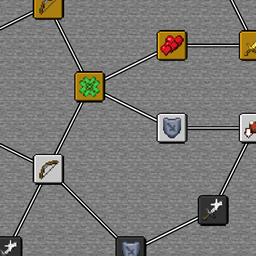Skill TreesRPG, Adventurer, and Stronger progression.</a>
  <a class="feature-card" href="#feature-better-party">Better PartyRoles, shared XP, and a group HUD.</a>
  <a class="feature-card" href="#feature-better-revive">Better ReviveRescue, graves, and item recovery.</a>
  <a class="feature-card" href="#feature-one-key-miner">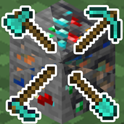OneKeyMinerVein mining, harvesting, and replanting.</a>
  <a class="feature-card" href="#feature-penchant">PenchantEnchantments grow as gear is used.</a>
  <a class="feature-card" href="#feature-xaeros-world-map">Xaero's World MapA map of the terrain you have explored.</a>
  <a class="feature-card" href="#feature-alexs-caves">Alex's CavesRare biomes below the Overworld.</a>
  <a class="feature-card" href="#feature-better-nether">Better NetherNew Nether terrain, life, and loot.</a>
  <a class="feature-card" href="#feature-stellarity">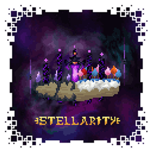StellarityA deeper End journey and progression.</a>
  <a class="feature-card" href="#feature-starcatcher">StarcatcherCondition-based fishing and collecting.</a>
  <a class="feature-card" href="#feature-curios">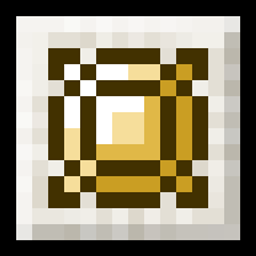CuriosAccessory slots and vanity layers.</a>
  <a class="feature-card" href="#feature-farmers-delight">Farmer's DelightPrepare, cook, and serve better meals.</a>
  <a class="feature-card" href="#feature-alchemia">AlchemiaDiscover potion effects through ingredients.</a>
  <a class="feature-card" href="#feature-sophisticated-backpacks">Sophisticated BackpacksPortable storage with useful upgrades.</a>
  <a class="feature-card" href="#feature-toms-simple-storage">Tom's Simple StorageSearch connected containers together.</a>
  <a class="feature-card" href="#feature-market-board">Market BoardA shared player marketplace.</a>

<section class="feature-detail">
<h3 id="feature-iourus-races" class="feature-heading">Iourus Races</h3>

- **Identity:** The installed build offers Human, Elf, Dwarf, Orc, Goblin, Melfork, and Draconic races.
- **Mechanics:** Each race changes attributes, passive strengths, and drawbacks; the choice affects play beyond appearance.
- **Progression:** Race is saved with the character, while class remains a separate equipment choice.
- **Decision:** Read each race's in-game traits before confirming. An ordinary player cannot freely replace a selected race.

**Choosing a race**

1. At the selection screen, compare every race's listed strengths, weaknesses, attributes, and passive traits. The installed build offers seven options.
2. Choose for the playstyle you want to keep. The author describes elves as mobile, orcs as combat-focused, dwarves as resilient, and humans as versatile; inspect the game for the exact current traits.
3. After confirming, build an equipment-based class around that foundation. A class can change with gear, but an ordinary player cannot freely replace a confirmed race.

A race affects survival and combat beyond appearance. Resetting one requires an administrator, so read the full selection before committing.

Mechanics source: <a href="https://modrinth.com/mod/iourus-races">official mod page</a>.

</section>

<section class="feature-detail">
<h3 id="feature-rpg-series" class="feature-heading">RPG Series</h3>

- **Classes:** Archer, Paladin, Priest, Rogue, Warrior, and Wizard are equipment-based playstyles in this pack.
- **Loadout:** Weapons and class books determine the abilities you can use; swapping them changes your active role.
- **Spellcasting:** Spell Engine supplies the ability bar, cooldowns, and rune costs for applicable skills.
- **Growth:** Specialized weapons, armor, and spell books deepen each archetype rather than locking your character to one class.

**Building a class loadout**

1. Choose an archetype: Archer for ranged play, Paladin for protection, Priest for healing, Rogue for mobile melee, Warrior for heavy melee, or Wizard for magic.
2. Pair its weapon with a class book. Use a Spell Binding Table to make books, then equip one in the Curios spell-book slot.
3. Hold the compatible weapon to reveal Spell Engine abilities. Follow the keys shown on the ability bar and carry runes for spells that consume them. Hold `Left Ctrl` when the ordinary hotbar needs priority.
4. Add class armor, skill nodes, and accessories that reinforce the same role.

There is no permanent class-selection screen. If an ability fails, check the weapon, book, runes, target, and cooldown before changing the build.

Mechanics source: <a href="https://modrinth.com/mod/wizards">official mod page</a>.

</section>

<section class="feature-detail">
<h3 id="feature-skill-trees" class="feature-heading">Skill Trees</h3>

- **Framework:** Pufferfish's Skills hosts the pack's separate progression trees.
- **Tracks:** RPG Series specializations, Adventurer Skills, and Stronger Skill Tree cover combat, survival, and gathering choices.
- **Points:** XP and tree rules unlock nodes with prerequisites; later choices build on earlier investments.
- **Limits:** Some bonuses apply only with a matching class or weapon, and some attributes depend on pack support.

**Spending points well**

1. Open the tree with `T` and compare its three progression tracks before buying a node.
2. Use RPG nodes for class and weapon specializations. Adventurer offers Offensive, Defensive, Utility, and Versatile choices; Stronger adds Combat, Mining, and Chopping Wood.
3. Read each prerequisite and effect, then build toward a path that supports your equipment.
4. Recheck the tree after changing class books or weapons. A bonus tied to one loadout may not help the next one.

Pufferfish's Skills displays the trees; the installed tree data decides point costs and available attributes. The on-screen node text is the final rule.

Mechanics source: <a href="https://modrinth.com/mod/skills">official mod page</a>.

</section>

<section class="feature-detail">
<h3 id="feature-better-party" class="feature-heading">Better Party</h3>

- **Groups:** Create public, invite-only, or password-protected parties with leader, officer, and member roles.
- **Cooperation:** Party chat, a live roster, member locator, and optional friendly-fire protection help groups travel and fight together.
- **Shared XP:** Nearby experience can be divided among eligible members when the server permits it.
- **Control:** Leaders set party rules within server limits; each player can adjust their own HUD.

**Playing as a group**

1. Open the party menu with `B` or its inventory button. Create or join a public, invite-only, or password-protected group.
2. Assign leader, officer, and member roles. The leader can adjust access and, when the server permits, friendly fire, nearby XP sharing, and the member locator.
3. Use `/p <message>` for party chat. Keep the live roster visible, and move or scale it in personal HUD settings if it covers combat.
4. Check the sharing radius before splitting up; members outside it may not receive XP.

Party membership can persist across restarts. Server rules set the limits, while each player controls only their own HUD layout.

Mechanics source: <a href="https://modrinth.com/mod/better-party">official mod page</a>.

</section>

<section class="feature-detail">
<h3 id="feature-better-revive" class="feature-heading">Better Revive</h3>

- **Downed state:** A revivable death gives teammates a timed rescue opportunity before ordinary respawn.
- **Rescue:** Revive Potions or the Life Pulse interaction can return a player if the downed player accepts.
- **Graves:** Inventory, equipment, experience, and supported mod slots are stored for later recovery.
- **Recovery:** A Grave Compass locates active graves; respawning ends the rescue chance but leaves the grave.

**Rescue and grave recovery**

1. When a revivable death occurs, watch the downed timer. A teammate must help before that window closes.
2. Throw a Revive Potion near the grave or try the Life Pulse interaction. The downed player must accept the offer. Higher potion tiers restore more health.
3. If you respawn, follow the Grave Compass back and right-click your grave to reclaim stored belongings and experience.
4. A Revive Scroll can return you near a distant active grave; it does not revive someone who is still downed.

The installed Curios bridge stores supported accessories in graves too. Rescue locks, timers, and grave protection follow server settings.

Mechanics source: <a href="https://modrinth.com/mod/better-revive">official mod page</a>.

</section>

<section class="feature-detail">
<h3 id="feature-one-key-miner" class="feature-heading">OneKeyMiner</h3>

- **Chain mining:** Breaking one block can clear adjacent matching blocks in a connected group.
- **Farming:** Matching crop harvests and nearby planting can be chained as well.
- **Costs:** Tools still lose durability and the action can depend on hunger or configured limits.
- **Control:** The chain action only runs while its assigned activation control is held.

**Mining and farming in chains**

1. Hold `Grave Accent` while breaking a small group of matching blocks to see how far the chain spreads.
2. Try the same action on mature crops. The mod can chain harvesting and nearby planting when the needed items are available.
3. Check hunger and tool durability before clearing a large vein or field. Chained work still spends normal resources.
4. Open its configuration with `Ctrl + Grave Accent` when you need to inspect block limits or tool-protection rules.

Test beside a safe patch first. Connected blocks may extend farther than the one break you intended, and server settings can stop a chain early.

Mechanics source: <a href="https://modrinth.com/mod/onekeyminer_nf">official mod page</a>.

</section>

<section class="feature-detail">
<h3 id="feature-penchant" class="feature-heading">Penchant</h3>

- **Leveling:** Eligible enchantments begin at level one and improve as enchanted gear is used.
- **Progress:** Mining, attacking, or taking armor damage fills a separate bar for each enchantment.
- **Limit:** A full bar raises that enchantment by one level until its maximum is reached.
- **Modules:** Per-world datapacks can also rework tables, bookshelves, durability, loot, and anvils.

**Growing an enchantment**

1. Enchant a tool, weapon, or armor piece. Eligible enchantments begin at level one.
2. Use it in ways that normally cost durability: mine, attack, or take armor damage. Each enchantment fills its own bar.
3. Hover the gear and hold `Left Ctrl` to inspect progress. A full bar raises one enchantment level and resets until the maximum is reached.
4. Check the world's Data Packs screen before relying on any optional table, bookshelf, durability, anvil, or loot changes.

**The pack's new-world modules.** Table Rework offers selectable enchantments with XP and bookshelf requirements and a one-lapis application cost. Bookshelf Placement counts shelves in a wider area and can use enchanted books stored nearby to reveal more choices. Durability Rework changes Mending and Unbreaking; No Anvil Books prevents books from being applied to gear in an anvil. Loot Rework and Guaranteed Drops alter where enchanted equipment appears. Existing worlds keep their saved module selection, and items without durability may not gain progress.

Mechanics source: <a href="https://modrinth.com/mod/penchant">official mod page</a>.

</section>

<section class="feature-detail">
<h3 id="feature-xaeros-world-map" class="feature-heading">Xaero's World Map</h3>

- **Discovery:** The full-screen map records terrain that has been explored.
- **Navigation:** Pan and zoom to compare landmarks, terrain, and possible routes between known places.
- **Waypoints:** Mark important destinations and return points for later journeys.
- **Limit:** Unvisited space stays blank; the map does not reveal hidden terrain ahead of exploration.

**Planning a route**

1. Open the full-screen world map with `M`, then pan and zoom through terrain already explored.
2. Mark home, portals, bases, and important structures with waypoints. Compare known landmarks before choosing a route.
3. Keep coordinates visible with `N` when a precise return point matters, especially before entering a cave or another dimension.
4. Use Nature's Compass or Explorer's Compass to seek an undiscovered biome or structure. Blank map areas do not reveal them.

The map is a memory of travel, not a preview of unexplored land. It becomes more useful as paths and waypoints accumulate.

Mechanics source: <a href="https://www.curseforge.com/minecraft/mc-mods/xaeros-world-map">official mod page</a>.

</section>

<section class="feature-detail">
<h3 id="feature-alexs-caves" class="feature-heading">Alex's Caves</h3>

- **Worlds below:** Six rare cave biomes have distinct creatures, materials, hazards, and equipment.
- **Discovery:** Underground Cabins contain Cave Tablets and a guide; translation leads to a Cave Codex and Cave Map.
- **Preparation:** Each biome asks for different supplies and tactics, from hazardous terrain to unusual creatures.
- **Rewards:** Exploration opens new resources, gear, and creature encounters rather than just another ore layer.

**Finding a rare cave**

1. Search the Overworld for an Underground Cabin. Its barrels contain Cave Tablets, and the Cave Compendium explains the discovery system.
2. Put a Cave Tablet and paper in the Spelunkery Table. Solve three translation levels, each with five guesses, to produce a Cave Codex; a failed or interrupted translation consumes the tablet. Craft the codex with paper into its Cave Biome Map.
3. Read the map before descending. Magnetic, Primordial, Toxic, Abyssal, Forlorn, and Candy caves have different creatures, hazards, and resources.
4. Bring supplies for the named cave. If equipped Alex's Caves gear grants a special ability, use `G` to activate it.

Use the Cave Codex to unlock biome chapters in the Cave Compendium before spending it on a map. Each cave is a destination with its own rules rather than another ordinary ore layer.

Mechanics source: <a href="https://modrinth.com/mod/alexs-caves">official mod page</a>.

</section>

<section class="feature-detail">
<h3 id="feature-better-nether" class="feature-heading">Better Nether</h3>

- **Biomes:** New Nether landscapes include vegetation, materials, and vertical biome variation.
- **Encounters:** Creatures, dungeons, and rare cities add reasons to explore beyond a fortress.
- **Resources:** New plants, foods, tools, and blocks can be gathered or farmed.
- **Generation:** Terrain changes appear in newly generated chunks, leaving already visited terrain intact.

**Exploring the changed Nether**

1. Mark the portal and carry food, spare equipment, and a return route before crossing unfamiliar terrain.
2. Explore beyond fortresses. New biomes hold plants, materials, creatures, dungeons, and rare Nether Cities.
3. Bring home useful flora and resources for tools, building, and farms. Some materials can be grown or gathered repeatedly.
4. After a pack update, travel into new chunks to see new generation; visited terrain stays as it was.

Better Nether varies biomes vertically as well as across the map. Routes at different heights can expose different terrain and dangers.

Mechanics source: <a href="https://modrinth.com/mod/betternether">official mod page</a>.

</section>

<section class="feature-detail">
<h3 id="feature-stellarity" class="feature-heading">Stellarity</h3>

- **End overhaul:** Terrain, biomes, structures, and outer-island exploration become a longer journey.
- **Combat:** The dragon encounter and additional bosses depart from the vanilla End progression.
- **Rewards:** New equipment, potions, and crafting materials come from End exploration and encounters.
- **Crafting:** The Altar of the Accursed unlocks after the dragon and crafts some late-game gear through world interactions.

**A longer End journey**

1. Prepare for a changed dragon encounter and bring supplies for more than one arena fight.
2. After the dragon, explore altered islands, End Cities, and structures for new materials, equipment, and clues.
3. Find the Altar of the Accursed. Some late-game gear is made by placing the right ingredients on it rather than using a crafting-grid recipe.
4. Keep unusual books and materials until their purpose is clear; some altar recipes do not appear in JEI. In the Hallow biome, placing certain items in the water can transform them into other materials.

The pack also has another dragon overhaul, so follow the boss mechanics visible in your world. Stellarity continues progression through End exploration and crafting.

Mechanics source: <a href="https://modrinth.com/datapack/stellarity">official mod page</a>.

</section>

<section class="feature-detail">
<h3 id="feature-starcatcher" class="feature-heading">Starcatcher</h3>

- **Fish collection:** More than 100 fish have their own biome, weather, time, elevation, and other conditions.
- **Tackle:** Hooks, bobbers, and bait modify which catches are possible.
- **Fishing:** A skill-based minigame replaces passive waiting for many catches.
- **Long-term goals:** The catalogue, trophies, displays, aquariums, and tournaments reward varied catches.

**First catch and collection loop**

1. The current profile awards the guide on joining a world. If you still need a Starcatcher rod, fish once with a vanilla rod; the profile also awards the rod on that first catch.
2. Open the guide with `Ctrl + Space`. Read its help pages and a target fish's biome, dimension, weather, time, elevation, and other conditions.
3. Fit the rod with suitable hooks, bobbers, and bait. A Tackle Box stores fish and helps organize attachments.
4. Cast and follow the on-screen minigame. Press `Space` for **Minigame Hit**; different fish can change the pattern and difficulty.
5. Record the catch in the catalogue, then keep it, display it, cook it, or sell it. Trophies, secrets, and tournaments give longer goals.

This profile hides uncaught fish entries and shares catches with online FTB Team members. Changing location or tackle often matters more than repeated casts at one spot.

Mechanics source: <a href="https://modrinth.com/mod/starcatcher">official mod page</a>.

</section>

<section class="feature-detail">
<h3 id="feature-curios" class="feature-heading">Curios</h3>

- **Slots:** The inventory panel groups accessory types added by the pack and other mods.
- **Compatibility:** Items are accepted by their configured slot types, so different headwear and trinkets have different homes.
- **Vanity:** The ribbon switches to purple cosmetic slots; those items change appearance without gameplay effects.
- **Layering:** SimpleHats Lite can occupy Head, Face, or Hat in functional or cosmetic mode while other headgear stays equipped.

**Functional gear and vanity layers**

1. Open Curios from the visible inventory button and inspect the labeled slots before placing a class book, belt, ring, hat, or trinket.
2. Equip items in functional slots when you want their attributes or effects. Some items support several slot types.
3. Use the ribbon above the slots to switch to the purple cosmetic layer. Items there change appearance without supplying gameplay effects.
4. Keep functional headgear in an ordinary Head slot, then layer SimpleHats Lite pieces across cosmetic Head, Face, and Hat slots.

Installed mods and pack configuration supply the slots and usable items. A hat in a purple slot is visual only; read tooltips to decide what stays equipped underneath.

Mechanics source: <a href="https://modrinth.com/mod/curios">official mod page</a>.

</section>

<section class="feature-detail">
<h3 id="feature-farmers-delight" class="feature-heading">Farmer's Delight</h3>

- **Ingredients:** Crops and gathered foods broaden what can be prepared.
- **Preparation:** Knives and Cutting Boards turn raw ingredients into recipe components.
- **Cooking:** Stoves, skillets, and Cooking Pots handle different dishes and batch meals.
- **Serving:** Some cooked foods need containers, while feasts provide portions in the world.

**From harvest to meal**

1. Grow crops or gather ingredients, then inspect a desired dish in JEI for its workstation and serving container.
2. Use a Knife and Cutting Board for ingredients that need a cutting recipe.
3. Heat a Stove, Skillet, or Cooking Pot for the relevant dish. A pot can prepare several servings and may need bowls or other containers.
4. Serve the meal or place a feast for shared portions. Rich soil and crop systems can sustain the kitchen's ingredient supply.

Cooking is a chain of preparation, heat, and serving rather than a single crafting recipe. Similar dishes may need different stations, so follow the recipe display.

Mechanics source: <a href="https://modrinth.com/mod/farmers-delight">official mod page</a>.

</section>

<section class="feature-detail">
<h3 id="feature-alchemia" class="feature-heading">Alchemia</h3>

- **Setup:** A vanilla cauldron over a lit campfire becomes an Alchemical Cauldron.
- **Brewing:** Each ingredient moves the mixture along a path on a radial map of potion effects.
- **Results:** Landing near an effect adds it; proximity affects potency, and a brew can carry multiple effects.
- **Discovery:** The map is generated per world, so memorized recipes from another world may not work.
- **Guide:** An Alchemist's Guide records discovered effects, ingredients, and paths for repeat brewing.

**Brewing by ingredient path**

1. Place a vanilla cauldron over a lit campfire to make an Alchemical Cauldron, then add water and ingredients.
2. Watch the radial map as each ingredient moves the potion along a path. Land near the desired effect; closeness affects potency.
3. Continue carefully to combine effects. The last effect added is generally the strongest.
4. Bottle the result with glass bottles; a full cauldron yields four bottles.
5. Craft an Alchemist's Guide with a book and an ingredient. It records discoveries and paths; select a saved recipe, then sneak-right-click the cauldron to repeat it.

The effect map is generated per world, so a recipe from another save may lead somewhere else. Experiment in small batches before brewing expedition supplies.

Mechanics source: <a href="https://modrinth.com/project/alchemia">official mod page</a>.

</section>

<section class="feature-detail">
<h3 id="feature-sophisticated-backpacks" class="feature-heading">Sophisticated Backpacks</h3>

- **Capacity:** Backpack tiers add storage and upgrade slots as materials improve.
- **Upgrades:** Modules can collect drops, filter contents, refill supplies, or add crafting and other utilities.
- **Placement:** A backpack can travel with you or be placed and connected to inventory automation.
- **Customization:** Dye colors and upgrade configurations help dedicate packs to different jobs.

**Preparing a travel pack**

1. Obtain a backpack and upgrade its tier as you need more storage and upgrade slots.
2. Choose modules for the job: Pickup gathers drops, filters control contents, Refill maintains supplies, and Crafting adds a work surface.
3. Open the equipped pack with `V` and configure its upgrades before an expedition.
4. Dye separate packs for mining, building, or travel. A placed pack can also interact with hoppers and inventory automation.

Automation follows each upgrade's filter, so inspect settings before carrying valuable items. The pack's tier controls its available capacity and upgrade choices.

Mechanics source: <a href="https://modrinth.com/mod/sophisticated-backpacks">official mod page</a>.

</section>

<section class="feature-detail">
<h3 id="feature-toms-simple-storage" class="feature-heading">Tom's Simple Storage</h3>

- **Network:** Inventory Connectors link ordinary chests and other containers into one view.
- **Terminal:** A searchable interface displays and accesses items across connected inventories.
- **Crafting:** A crafting terminal can combine item access with recipe assembly.
- **Expansion:** Cables, filtered connectors, and wireless terminals extend the basic network.

**Building a storage network**

1. Put an Inventory Connector beside a group of ordinary containers and attach a Storage Terminal.
2. Add connectors and cables as the storage room grows. Items stay in physical containers while the terminal shows a searchable view.
3. Use the terminal to find and withdraw supplies. A Crafting Terminal combines storage access with recipe assembly.
4. Add filters to control connected inventories; a wireless terminal can extend access when built and configured.

Start with a few chests and confirm each appears in the terminal before expanding. The network organizes a base, while a backpack carries supplies away from it.

Mechanics source: <a href="https://modrinth.com/mod/toms-storage">official mod page</a>.

</section>

<section class="feature-detail">
<h3 id="feature-market-board" class="feature-heading">Market Board</h3>

- **Listings:** Players offer items to other players through a shared board.
- **Trade:** Buyers search and sort offers; sellers manage listings and collect proceeds.
- **Currency:** A standard board uses one configured currency; Market Board Plus can support several registered currencies.
- **Limits:** Listing counts and accepted currencies are controlled by the server.

**Buying and selling with players**

1. Place a Market Board and right-click it to browse shared listings. Search and sort before buying, and check item quantities.
2. Sneak-right-click to manage your listings, remove an offer, or collect proceeds from a sale.
3. Confirm the configured currency and price before listing. The standard board uses one currency; Market Board Plus can accept several registered currencies.
4. Collect returned unsold goods when an offer expires, and leave inventory space for purchases and recovered items.

Boards of the same type share market data across the world. Listing limits, currencies, and expiration behavior follow server settings.

Mechanics source: <a href="https://www.curseforge.com/minecraft/mc-mods/market-board">official mod page</a>.

</section>

## Part III — Character and Core Systems

Build the character in layers: race sets the lasting foundation, the weapon-and-book loadout defines a flexible class, and skill trees, spells, gear stats, and accessories refine it. Enchanted equipment adds another progression loop as it is used. The sections below connect those choices without repeating each mod's full description.

### Races and racial traits

- **Iourus Races** — Adds Human, Elf, Dwarf, Orc, Goblin, Melfork, and Draconic as persistent character identities with different strengths, weaknesses, attributes, and passive behavior.

Race selection defines persistent character traits and belongs at the beginning of character setup. The direct race menu binding is unbound in this profile; assign one in Controls if needed, then read the in-game trait descriptions before confirming. Choose around the way you want to travel and fight, not a single displayed attribute: passive traits and weaknesses can matter outside combat. The seven races share the broader class and skill systems, so no race locks you to a particular archetype. Since a confirmed race is not freely changed by ordinary players, make this choice before long-term progression.

### Classes and playstyles

#### RPG classes

- **Type:** Integrated character-progression suite
- **Primary topic:** Classes and playstyles
- **Also affects:** Combat, Character, Skills, Magic, Equipment
- **Core idea:** Four installed RPG Series modules provide Archer, Paladin, Priest, Rogue, Warrior, and Wizard loadouts through weapons, class books, spells, and matching equipment.
- **Onboarding:** There is no permanent class-selection screen. Follow [Choosing a class](#feature-rpg-series) to assemble and test a loadout.

**Installed modules:** Archers; Paladins & Priests; Rogues & Warriors; Wizards.

### Skill trees and character progression

- **Skill Tree (RPG Series)** — Supplies class and weapon trees that modify spells, add passive combat effects, and turn gathered XP into skill points.
- **Pufferfish's Skills** — Provides the configurable progression framework and the `T` skill-tree screen used by the RPG trees.
- **Adventurer Skills** — Adds a rebalanced Pufferfish skill tree with Offensive, Defensive, Utility, and Versatile categories.
- **Stronger Skill Tree** — Adds Combat, Mining, and Chopping Wood categories.

Use `T` to inspect the available categories before spending points. The RPG tree specializes class books and weapons; Adventurer Skills and Stronger Skill Tree add separate category content to the same framework.

### Abilities, spells, runes, and resources

- **Spell Engine** — Connects equipped class books and compatible weapons to the visible ability hotbar, casting rules, targeting, costs, and cooldowns.
- **Runes** — Adds craftable ammunition consumed by class spells.

The installed RPG Series modules supply distinct class books, weapons, and progression options. The available class book, weapon, and skill-tree content determines the exact options in each loadout.

Equip a class book in its Curios slot, hold a compatible weapon, and use the keys displayed on the ability hotbar. Hold `Left Ctrl` with a number key when the normal item hotbar must take priority. If casting fails, read the hotbar message and check the target, cooldown, equipped loadout, and rune cost. Runes can be crafted normally or produced more efficiently with a Rune Crafting Altar.

### Combat controls and dodge rolling

- **Better Combat** — Replaces vanilla melee timing with animated attacks, weapon combos, dual-wield support, and improved hit detection.
- **Combat Roll** — Adds a dodge roll with its own attributes and enchantments.
- **Target Dummy** — Provides a craftable target for testing damage and complete attack sequences.

### Weapons, armor, jewelry, and relics

Equipment is part of the build rather than a simple armor-value ladder. Check attack speed, spell power, healing power, ranged attributes, set bonuses, passive effects, and Curios bonuses before replacing an item solely because its material looks stronger.

#### Building a loadout

Start with a **weapon and class book** that support the same combat rhythm. Add **armor** whose set effects match the chosen class or damage type. Use **Jewelry** in Curios slots to reinforce the role, then add a **Relic** when its active or passive effect complements the build. Finish by refining the setup with enchantments; this order makes each upgrade easier to evaluate.

Use the button in the inventory screen to inspect equipped Curios; its direct keybind is unbound in this profile. Hover equipment and read its full tooltip before comparing it; [Enchantment Insights](#information-overlays-and-tooltips) explains unfamiliar enchantments. To inspect an item's recipe or uses, find it in JEI and left-click or right-click it, respectively.

#### Curios slots and vanity cosmetics

Curios is the shared equipment-slot interface; the installed mods and pack configuration supply the slot types and the items that fit them. Check each item's own attributes and effects to see whether it changes combat or another statistic. Open the panel with its visible button in the inventory screen; the separate Curios keybind is intentionally unbound in this profile.

The ribbon control above the slot list switches to the cosmetic layer. Its purple slots are vanity slots: they change appearance without supplying the equipment's gameplay effects. In this pack, SimpleHats Lite hats can be placed in functional or vanity **Head**, **Face**, and **Hat** slots. This lets a player keep functional headgear, such as an Artifact, in the ordinary Head slot while layering one or more hats in the cosmetic slots. A hat in a functional slot still uses that item's own effects; the purple vanity copy is visual only.

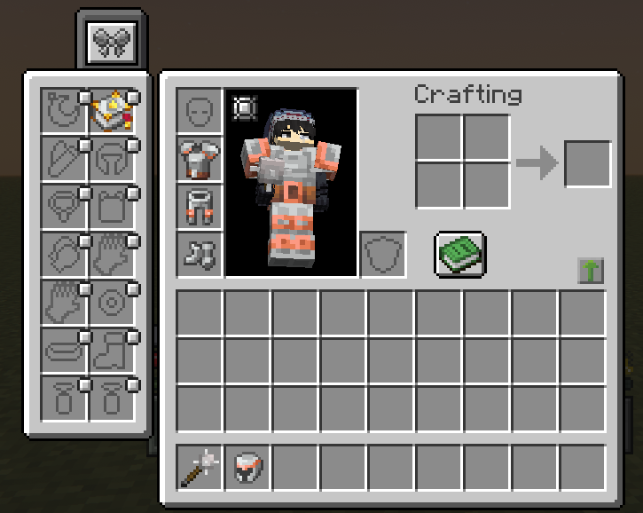

*The Curios panel keeps the spell-book and accessory slots separate from ordinary armor and inventory slots.*

#### Acquisition and upgrade paths

- Class equipment is the practical starting point because it establishes the intended weapon, spell, and attribute combination.
- Jewelry spans several material tiers. Gems can be found underground and crafted into accessories, while village trades and dungeon loot provide alternative sources.
- Relics are primarily adventure rewards from dungeon chests and major enemies, with a smaller craftable selection connected to Jewelry materials. They are build-changing accessories, not ordinary armor upgrades.
- Arsenal weapons are rare loot rather than normal crafting goals. Look for them in major boss rewards and valuable dungeon chests; every Arsenal weapon carries at least one built-in passive spell.
- Armory sets upgrade existing RPG class armor with materials obtained from rare structure loot and bosses. Their set and spell-modifier bonuses reward keeping the build focused instead of mixing pieces only by armor value.

#### Included equipment systems

- **Alex's Caves equipment** — Exploration rewards support new combat options. See [Alex's Caves](#alexs-caves).
- **Stellarity equipment** — End progression includes additional equipment systems. See [Stellarity](#stellarity).

- **Arsenal** — Places legendary RPG weapons behind exploration and combat rewards instead of ordinary crafting.
- **Armory** — Adds RPG armor sets with distinct designs and set bonuses.
- **Jewelry** — Adds Curios-equipped rings and necklaces with combat attributes, supported by mining, crafting, trading, and loot.
- **Relics** — Adds Curios-equipped trinkets with active or passive mechanics that can reshape a build.
- **Artifacts** — Adds powerful Curios artifacts as exploration rewards from structure chests and archaeology; rare finds can also come from worn mob loot. Underground campsites may contain Mimics, so approach unfamiliar camps with care.
- **Nameless Trinkets** — Adds a broad collection of trinkets with distinct abilities. Find them in structure chests or craft them, then hold `Shift` over a trinket to inspect its effect before choosing a build slot.
- **Scalar RPG Utils** — Turns materials into components with Burnishers, then uses those components to craft Curios gloves, necklaces, and rings with material-dependent buffs. Compare the resulting bonuses before committing a loadout slot.
- **Tool Belt** — Stores tools and other eligible non-stackable items in a wearable belt, then lets you select them from a radial menu. Upgrade the belt with pouches for more slots; the belt-slot inventory shortcut is unbound in this profile, while `Q` swaps tools.
- **Dedicated Elytra Slot** — Adds a separate inventory slot for an Elytra so it can be equipped alongside a chestplate. Put the Elytra in that slot through the inventory; flight remains the familiar vanilla Elytra workflow.
- **Too Many Bows** — Expands ranged builds with bows that have different abilities and combat attributes.
- **Arrow+** — Adds craftable arrow tiers with different damage levels using familiar materials.
- **Fletching Recipe** — Gives the fletching table a crafting interface for efficient ordinary-arrow production and explosive arrows.
- **Shield Upgrades** — Adds durable specialized shields whose attributes or defensive effects support different situations.
- **Enchantments collection** — Adds focused enchantment families: Air Jump Enchantment, Attack Speed Enchantment, Double Hit Enchantment, Downfall Enchantment, Ice Enchantments, Life Steal Enchantment, Ly-Fangs Enchantment, Max Protection, Spiky Enchantment, Thunder Strike Enchantment, Toughness Enchantment, and True Shot Enchantment. Their effects include an extra falling jump, faster attacks, additional hits, landing shockwaves, freezing, life steal, combat effects, compatible protection combinations, armor toughness, shield retaliation, lightning strikes, and arrows that ignore gravity. Read each tooltip for its exact trigger, level, and equipment rules.

#### Ranged and defensive equipment

Too Many Bows changes more than appearance: bow damage, draw speed, ranged scaling, and unique abilities can make two bows behave very differently. Better Combat supplies the shared ranged-combat handling, while Arrow+ and Fletching Recipe expand ammunition and crafting. Use JEI rather than guessing which bow and arrow mechanics can be combined.

Shield Upgrades provides side-grades with different attributes and reactive effects. Choose a shield for the expected hazard instead of treating every new shield as a direct replacement for the previous one.

#### Testing and changing equipment

- **Armor Quick Swap** — Swaps complete armor sets quickly from an inventory or armor stand.

Use a Target Dummy and Floating Damage Indicators to compare complete attack sequences, not only a single hit. Test with the same buffs, distance, runes, arrows, armor, and accessories each time; attack speed, cooldowns, area effects, and passive triggers can make the largest displayed number misleading.

Armor Quick Swap has no required hotkey: right-click an armor piece in the inventory to equip or exchange it, or sneak and right-click an armor stand to swap the full worn set. This is useful for keeping separate combat, travel, or utility sets without manually moving four slots.

### Enchanting and equipment improvement

#### Penchant

- **Type:** Core progression system
- **Primary topic:** Enchanting and equipment improvement
- **Also affects:** Equipment, Combat, Loot
- **Core idea:** Enchantments begin at level 1 and eligible enchantments gain levels as their enchanted item is used.
- **Player guidance:** Hold `Left Ctrl` over enchanted gear to see its progress bars. Check the current world's Data Packs screen before relying on optional table, durability, loot, or anvil changes.

Penchant's core progression loop is use-based: enchantments begin at level 1, then actions that normally wear down the enchanted item—such as mining, attacking, or taking armor damage—fill a progress bar for each eligible enchantment. When a bar fills, that enchantment gains one level and its bar resets until it reaches its maximum. Hold `Left Ctrl` over enchanted gear to inspect progress. This makes using equipped gear part of its advancement; most modded enchantments can also level unless their data disables it. Items without durability may not gain progress.

The original mod organizes its extra behavior into optional datapack modules that can be enabled per world. This pack's defaults for new worlds enable **Durability Rework**, **Bookshelf Placement**, **Table Rework**, **No Anvil Books**, **Loot Rework**, and **Guaranteed Drops**; **Randomized Librarians** is off. Existing worlds keep their saved selections, so check that world's Data Packs screen before relying on a module.

With **Table Rework**, the enchanting table lists selectable enchantments instead of offering the usual random choices. Each option has an XP cost and bookshelf requirement, and applying it costs 1 lapis lazuli. **Bookshelf Placement** lets shelves count in a 7×4×7 area around the table (one block below and two above), without requiring a clear line of sight; three books in a chiseled bookshelf or lectern count as one ordinary bookshelf. Place enchanted books in nearby shelves to unlock additional table options. A grindstone within the bookshelf area can extract enchantments from gear onto books. The table module includes advancements that guide this reworked setup.

**Durability Rework** makes Mending stop repairing equipment and gives Unbreaking five levels; reaching its final level makes the item unbreakable. Existing Mending enchantments remain on items but no longer work. With **No Anvil Books**, enchanted books cannot be applied to equipment in an anvil, although tools can still be combined. **Loot Rework** redistributes enchantments by rarity and source: basic options are available early, while specialized and powerful ones require trades, loot, or particular structures. **Guaranteed Drops** helps recover enchanted mob equipment for extraction; the 26.2 NeoForge port narrows this to equipment with a non-common enchantment. If enabled, **Randomized Librarians** sell a different enchanted book with each purchase.

**Easy Anvils** changes anvil repair and rename handling; it does not cancel the No Anvil Books module when that module is enabled. **Universal Enchants** widens equipment compatibility, subject to server configuration. **Max Protection** allows different Protection enchantments to coexist on one armor piece, and **Toughness Enchantment** adds a three-level armor-toughness enchantment. Use Enchantment Insights and the current item tooltip to check an unfamiliar effect or compatibility.

#### Included improvement systems

- **Easy Anvils** — Keeps items in anvils and makes combining, repairing, and renaming equipment less punitive.
- **Universal Enchants** — Broadens which equipment can accept existing enchantments and improves selected vanilla enchantment behavior.
- **Max Protection** — Allows the different Protection enchantments to coexist on one armor piece.
- **Toughness Enchantment** — Adds an armor-toughness enchantment with three levels.
- **DarkSmithing** — Adds custom ways to craft smithing templates.
- **Elytra Trims** — Allows elytra to receive armor trims, dyes, banner patterns, and other visual treatments.
- **Naturally Trimmed** — Applies trims to some equipment generated through mobs, loot, and trades, making found gear visually distinct.
- **Armor Trim Item Fix** — Makes inventory icons show the applied trim pattern instead of a generic trimmed texture.

DarkSmithing makes smithing templates craftable through custom recipes; use JEI for the installed recipes rather than assuming vanilla duplication rules. Trims remain cosmetic unless another item explicitly states otherwise. Naturally Trimmed affects generated equipment, Armor Trim Item Fix changes inventory presentation, and Elytra Trims extends decoration to elytra.

#### Sources for equipment and enchanting

- [Arsenal](https://modrinth.com/mod/arsenal-rpg-series), [Armory](https://modrinth.com/mod/armory-rpg-series), [Jewelry](https://modrinth.com/mod/jewelry), and [Relics](https://modrinth.com/mod/relics-rpg)
- [Artifacts](https://www.curseforge.com/minecraft/mc-mods/artifacts), [Nameless Trinkets](https://www.curseforge.com/minecraft/mc-mods/nameless-trinkets), and [Scalar RPG Utils](https://www.curseforge.com/minecraft/mc-mods/scalar-rpg-utils)
- [Tool Belt](https://www.curseforge.com/minecraft/mc-mods/tool-belt) and [Dedicated Elytra Slot](https://www.curseforge.com/minecraft/mc-mods/dedicated-elytra-slot)
- [Too Many Bows](https://www.curseforge.com/minecraft/mc-mods/too-many-bows), [Arrow+](https://www.curseforge.com/minecraft/mc-mods/arrow), and [Shield Upgrades](https://www.curseforge.com/minecraft/mc-mods/shield-upgrades)
- [Penchant, the original mod page](https://modrinth.com/mod/penchant), and its [official wiki](https://github.com/ThePotatoArchivist/Penchant/wiki) for the core system and modules; [Penchant Reforged, the unofficial NeoForge port](https://www.curseforge.com/minecraft/mc-mods/penchant-reforged) and its [NeoForge source](https://github.com/WoXayZ/PenchantNeoforged) for 26.2-specific behavior; [Easy Anvils](https://modrinth.com/mod/easy-anvils) and [Universal Enchants](https://modrinth.com/mod/universal-enchants)
- [Curios API](https://www.curseforge.com/minecraft/mc-mods/curios) and [SimpleHats Lite](https://www.curseforge.com/minecraft/mc-mods/simplehats-lite)
- [Max Protection](https://www.curseforge.com/minecraft/mc-mods/max-protection) and [Toughness Enchantment](https://modrinth.com/datapack/toughness-enchantment)
- [DarkSmithing](https://modrinth.com/mod/darksmithing), [Armor Quick Swap](https://modrinth.com/mod/armor-quick-swap), and [Target Dummy](https://modrinth.com/datapack/target-dummy)
- [Elytra Trims](https://modrinth.com/mod/elytra-trims), [Naturally Trimmed](https://modrinth.com/mod/naturally-trimmed), [Armor Trim Item Fix](https://modrinth.com/mod/armor-trim-item-fix), and [Fletching Recipe](https://modrinth.com/mod/fletching-recipe)

### Death, revival, graves, and respawning

- **PlayerRevive** — Gives downed players a short rescue window before normal death handling completes.
- **Better Revive** — Protects items and experience in graves, supports consent-based or item-assisted revival, and provides grave recovery tools.
- **Better Respawn** — Normally respawns a player near their death location, with exceptions for nearby spawn points, dimension changes, and returning from the End.
- **Charm of Undying: Reborn** — Lets a Totem of Undying sit in the Curios Charm slot and automatically consumes it to save you on death. Equip the totem before an expedition and remember that it is spent when it activates.
- **Harder Natural Healing** — Changes how quickly natural healing restores health and how much hunger it uses; waking healing and other rules are configurable. The server's current settings determine the actual recovery pace, so carry food and do not assume vanilla regeneration timing.

The installed compatibility bridge connects PlayerRevive and Better Revive so their downed states hand off cleanly instead of repeating. See [Parties, downed players, and death](#feature-better-party) for the player flow.

### Parties and multiplayer cooperation

- **Better Party** — Adds public and private parties, roles, shared nearby experience, friendly-fire protection, party chat, and a party HUD.

Open the party menu with `B`; use `/p <message>` for party chat. Adjust the roster's position and scale in Better Party's settings. Party roles, shared experience, protection, and revival coordination are covered in [Parties, downed players, and death](#feature-better-party).

## Part IV — Adventure and Challenge

This pack rewards exploration, but unfamiliar landmarks can begin boss fights, raids, or persistent threats. Before a long trip, open the world map with `M`, confirm that Coordinates Display can be toggled with `N`, record the route home, and carry supplies for both the journey out and the return.

Treat new terrain as a collection of overlapping systems. A biome can contain a structure from another mod, seasonal effects can change crops or temperature, and each dimension has its own equipment and enemy progression. Identify the destination first, then pack for its likely hazards instead of carrying every tool you own.

### Expedition checklist

- Place or activate a return point before entering a new dimension or beginning a major encounter.
- Carry food, ordinary combat supplies, and any runes or arrows required by the current build.
- Keep one inventory route available for unexpected loot instead of leaving every slot full.
- In multiplayer, form the party with `B` before combat so the HUD, friendly-fire rules, shared experience, and revive flow are already working.
- Treat unfamiliar structures as active encounters. Observe the site, identify exits, and avoid opening containers or activating blocks until the group is ready.
- Watch the sky and chat at night. Blood Moons and other environmental threats can make an otherwise routine return trip unsafe.

### Travel, maps, compasses, and teleportation

- **Waystones** — Adds discoverable and craftable travel points that must be activated before they can be selected as destinations.
- **Bifrost Teleport** — Adds named-marker teleportation using mythic weapons and cinematic Bifrost effects.
- **Explorer's Compass** — Searches for vanilla and modded structures through an item interface.
- **Nature's Compass** — Searches for vanilla and modded biomes and displays information about the selected result.
- **Xaero's Map Multiplayer** — Adds multiplayer-oriented features to Xaero's maps.

#### Xaero's World Map

- **Type:** Interface feature
- **Primary topic:** Travel, maps, compasses, and teleportation
- **Also affects:** Exploration, Travel
- **Core idea:** Builds a full-screen map from terrain the player has explored.
- **Player guidance:** In the installed profile, `M` opens the map. Use it to review known routes and landmarks, then keep Coordinates Display (`N`) visible for the return trip.

The map fills in as you explore; a blank area is unknown terrain, not a promise that the area is empty or safe. It does not reveal unexplored terrain or replace a structure/biome search. Pan by dragging and zoom with the wheel, and compare the map with the current dimension before following a route.

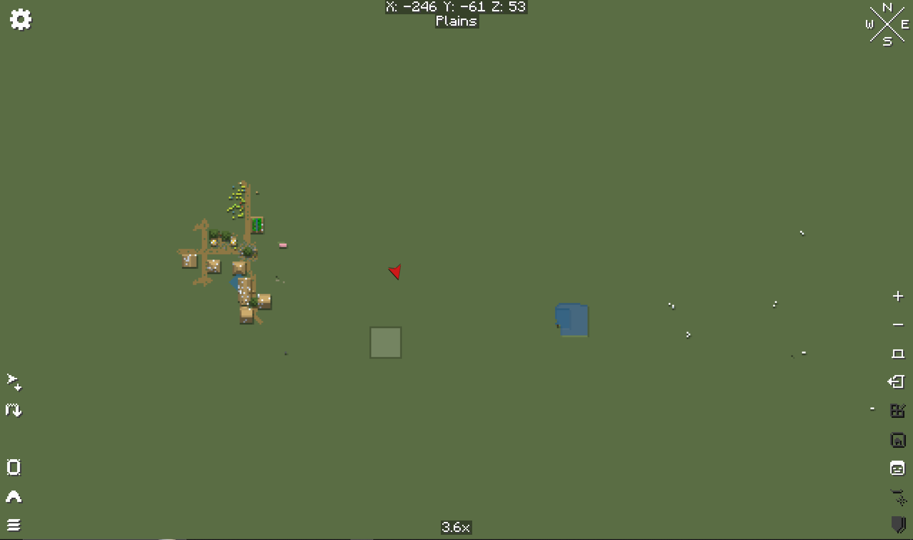

*The map records explored terrain; its blank regions still need to be explored.*

#### Finding destinations and getting home

The **Explorer's Compass** searches for structures; the **Nature's Compass** searches for biomes. Right-click to select a target, and sneak-right-click the Nature's Compass to reset it. A compass gives a direction and distance, not a safe route. Mark a return point before leaving, verify that a destination belongs to the current dimension, and use activated **Waystones** or **Bifrost Teleport** markers only after confirming the destination.

### Integrated world and dimension expansions

World-generation changes appear in newly generated terrain. Existing explored chunks normally retain their old layout, so travel beyond familiar borders when searching for a new biome or structure after a pack update.

#### Alex's Caves

- **Type:** Integrated world expansion
- **Primary topic:** Integrated world and dimension expansions
- **Also affects:** Combat, Equipment, World Generation, Creatures
- **Core idea:** Adds six rare underground cave biomes with distinct environments, hazards, creatures, materials, and progression.
- **Player guidance:** Begin by finding an Underground Cabin, which can appear in caves throughout the Overworld. Its Cave Tablet and Spelunkery Table start the route to a Cave Codex and a matching Cave Map.

Use the cabin's Cave Tablet with paper on the Spelunkery Table, then follow the table's rune and lens instructions to translate it. The tablet allows only five attempts, so take care with each one. Complete three translations to create a Cave Codex. The Codex teaches you about its cave biome, and an extra Codex plus paper makes a Cave Map that points to the nearest cave of that type.

Read the Codex before entering and prepare for the specific terrain rather than treating every cave as an ordinary mineshaft. For example, Magnetic Caves pull or repel iron and netherite items and contain dangerous Tesla Bulbs; Toxic Caves have acid that corrodes armor and radioactive hazards that can suppress natural healing; in the Forlorn Hollows, placed light can draw unwanted attention. Carry a return route, healing, food, and suitable combat gear, and use the Codex to check the biome's resources and risks.

#### Better Nether

- **Type:** Integrated dimension expansion
- **Primary topic:** Integrated world and dimension expansions
- **Also affects:** World Generation, Structures, Creatures, Equipment
- **Core idea:** Expands Nether terrain, biomes, vegetation, structures, creatures, and exploration rewards.
- **Player guidance:** Expect the Nether to contain unfamiliar plants, materials, mobs, and large structures. Mark the portal immediately and bring spare ignition because ordinary visual landmarks are less reliable in the denser terrain.

#### Stellarity

- **Type:** Integrated dimension expansion
- **Primary topic:** Integrated world and dimension expansions
- **Also affects:** World Generation, Structures, Creatures, Equipment, Bosses
- **Core idea:** Expands the End with new terrain, structures, enemies, equipment, and progression.
- **Player guidance:** Treat the End as a full adventure dimension rather than a short dragon trip. Strongholds, the dragon, outer-island terrain, End Cities, crafting interactions, and boss encounters are all changed; some Stellarity recipes and rewards do not appear normally in JEI, so preserve written or in-world clues.

- **Biomes O' Plenty** — Adds more than 50 biomes plus matching plants and blocks.
- **Terralith** — Rebuilds Overworld terrain around almost 100 realistic and light-fantasy biomes made from vanilla blocks.
- **William Wythers' Overhauled Overworld** — Reinterprets vanilla biomes with larger, more realistic, and atmospheric terrain.
- **Dungeons Dimensions: Nether** — Brings Minecraft Dungeons-inspired detail and encounters to the Nether.
- **Nullscape** — Reworks End terrain and island generation.
- **Clear End City** — Adds cinematic End structures, void gardens, crashed citadels, and new loot locations.
- **Serene Seasons** — Adds seasonal color, temperature, and environmental changes.
- **Abyssal Ocean** — Generates rare, extremely deep offshore ocean regions that become darker toward bedrock.

Serene Seasons affects more than scenery: weather, temperature, and crop growth can change across the year. Nature's Compass finds a biome; Explorer's Compass finds a structure; neither replaces preparation for the seasonal or dimensional conditions around the target.

The Overworld changes are not one biome pack. Biomes O' Plenty adds its own plants and blocks, Terralith and William Wythers reshape terrain using largely familiar materials, and Serene Seasons changes the calendar across those landscapes. Abyssal Ocean is a rare deep-ocean destination, while Better Nether, Nullscape, and Stellarity alter separate dimensions. To see new generation after an update, travel beyond explored chunks; existing terrain does not retroactively rebuild.

### Fishing and collection systems

#### Starcatcher

- **Type:** Integrated survival or profession expansion
- **Primary topic:** Fishing and collection systems
- **Also affects:** Food, Equipment, Events, Multiplayer
- **Core idea:** Reworks fishing around more than 100 collectible fish, condition-based catches, a skill minigame, rod attachments, trophies, and tournaments.
- **Player guidance:** Use discovered guide entries and the catalogue to plan each catch. This profile hides fish entries until they are caught; species can depend on biome, dimension, weather, time, elevation, and other conditions, so changing the fishing spot may matter more than casting repeatedly.

#### Starcatcher first-catch flow

1. The current profile awards the guide when you join a world. If you still need a Starcatcher rod, fish once with a vanilla rod; the profile also awards the rod on that first catch. Open the guide with `Ctrl + Space` and read its help pages before choosing a destination.
2. Check the guide for a fish's conditions and the catalogue for what you have already caught. Avoid spending a rare first catch before it has been recorded.
3. Set up a rod with the hooks, bobbers, and bait that fit the target. Tackle Boxes store fish and let you organize or change attachments; use JEI for recipes the guide does not show.
4. Cast normally and follow the minigame's on-screen target. The installed profile uses `Space` for **Minigame Hit**; some fish have different minigame patterns and difficulty.
5. Record new catches, then decide whether to keep them for the collection, display them in an aquarium, use them for food, or sell them. Trophies, secrets, and tournaments add longer-term and multiplayer goals.

Starcatcher's settings include ways to adjust or disable the minigame and to change the radar, tracker, and overlay presentation. This profile enables catch sharing for online FTB Team members; offline members do not receive shared discoveries. Server settings decide which options are available. Use the guide's current fish conditions instead of trying to memorize a complete species list.

### Companions, pets, villagers, and settlements

- **Companions: Dogfolk** — Adds dogfolk companions.
- **Wild Pets** — Makes polar bears, pandas, and foxes tameable; tamed bears can also be ridden.
- **Puffsprout** — Adds a small companion that learns over time.
- **Animal Pen** — Stores groups of farm animals in a single block to simplify husbandry and reduce entity load.
- **Compact Villagers** — Lets players carry villagers and trade through compact booths.
- **Name Tag Upgrade** — Allows on-the-go renaming and adds convenience improvements to name-tag use.
- **Pet Status** — Exposes useful health and status information for owned pets.
- **Iron Wolf Armor** — Adds protective equipment for wolves.

#### Pet Vault

- **Type:** Focused companion system
- **Primary topic:** Companions, pets, villagers, and settlements
- **Also affects:** Travel, Multiplayer
- **Core idea:** Stores, summons, and manages owned pets and mounts through the Keeper's Locket radial menu.
- **Player guidance:** This installed profile requires the locket in Curios' Necklace slot: `allowUnequippedLocket` is `false`, and the locket is tagged for that slot.

Right-click a tamed companion you own to register it. Press `R` to open the radial menu, then left-click its slice to summon or store it; the current server config allows ten stored pets. Use Pet Status (`Shift + R`) to check health and location before a trip. If a pet is unloaded, the display may show its last-known position rather than live status.

Be careful with the other mouse button: right-clicking a summoned companion unregisters it permanently from the vault, but leaves the animal in the world. That action does not store it. Use left-click when the goal is to put a pet away.

### Bosses and major encounters

- **Stellarity encounters** — The End expansion includes major combat progression. See [Stellarity](#stellarity).

- **World Bosses** — Adds shrine-based encounters summoned through rituals, with multiplayer scaling, changing attack patterns, and shared reward caches.
- **Bosslike Ender Dragon** — Reworks the dragon into a multi-phase fight that scales with the number of players and becomes stronger after previous victories.
- **Ultimate Warden** — Turns the Warden into a boss encounter with a visible boss bar, dedicated dungeon, and custom rewards.
- **Gateway of Doom** — Opens timed, wave-based arena encounters with an on-screen boss bar, escalating enemies, and rewards for completing every wave.

Each encounter asks for a different kind of preparation. **World Bosses** begin at a shrine and scale for a group, so treat the site as an arena and bring recovery supplies. The **Bosslike Ender Dragon** can ward recalled crystals; stand in the glowing ring at a pillar's base before breaking one. **Ultimate Warden** requires a Dungeon Key held for 30 seconds to enter its contained boss area; keep the exit key awarded afterward and hold it for 10 seconds to leave. **Gateway of Doom** opens when a Devil Eye finds a safe placement, or through an enabled automatic event; watch its boss bar for wave, enemy count, and timer.

For every major encounter, place the respawn and recovery route first, then clear ordinary enemies around the arena. The Shrine Locator Compass can cycle between World Boss shrine targets, which is safer than searching blindly with ritual items already packed. Gateway enemies are kept near their event area, so regroup outside its boundary instead of dragging the wave toward a base. Hell Wards protect complete chunks from every normal Gateway placement method; right-click a placed Ward to inspect its protected chunks on the built-in map.

Both Bosslike Ender Dragon and Stellarity modify the dragon encounter. Expect their mechanics to overlap, follow the telegraphs and boss-bar state shown by the current server, and do not rely on a vanilla dragon walkthrough.

Before using a summoning item, identify the retreat path and agree on a regroup point. Do not place a shrine or Gateway beside storage or a settlement. After victory, check the arena and nearby ground for rewards before leaving; some drops are part of a mod's progression and may not be replaceable through ordinary crafting.

### Invasions and wave events

- **Invasion** — Starts increasingly difficult Nexus-defense events whose attackers can build, dig, and adapt to the terrain.
- **Illager Invasion** — Adds new illager combat and support roles to raids and places others in structures.
- **It Takes a Pillage** — Adds pillager encampments, fortresses, patrol threats, and related rewards.

These systems are not interchangeable. **Invasion** begins around a placed and activated Nexus, while **Illager Invasion** makes village raids and related encounters more varied, and **It Takes a Pillage** adds hostile pillager locations to exploration.

Do not test a Nexus beside an irreplaceable home. Invasion enemies can bridge gaps, place ladders, and destroy blocks while trying to reach it. Use a prepared defense site, provide sight lines and fallback paths, and move valuable storage outside the likely damage area. A Gateway of Doom is also wave-based, but it is a timed arena challenge rather than a Nexus defense.

### Dangerous nights and environmental threats

#### Withered Lands

- **Type:** Integrated adventure expansion
- **Primary topic:** Dangerous nights and environmental threats
- **Also affects:** Combat, Events, Creatures, Structures, Equipment
- **Core idea:** Makes exploration more hostile through wither-themed enemies, behaviors, encounters, and rewards.
- **Player guidance:** Expect its structures, creatures, and rewards to belong to one hostile theme. Scout new sites from a safe distance and use Jade and JEI to identify unfamiliar content without needing an exhaustive enemy list.

#### The Graveyard

- **Type:** Integrated adventure expansion
- **Primary topic:** Dangerous nights and environmental threats
- **Also affects:** Structures, Creatures, Combat, Equipment
- **Core idea:** Adds graveyard-themed locations, enemies, atmosphere, and adventure rewards.
- **Player guidance:** Graveyard structures are adventure locations rather than decoration. Enter with an escape route, light the surrounding ground, and expect their atmosphere, enemies, and loot to be connected.

- **Blood Moon** — Replaces every fourth full moon with an Overworld event that strengthens hostile mobs, increases phantom pressure, and prevents sleeping through the night.
- **The Darkness Will Find You** — Adds a progression-based Deep Dark curse that can make night, sleep, dark dimensions, sculk spread, and hostile events increasingly dangerous until the player pursues its protection and resolution systems.
- **Armored Foes** — Lets more hostile mob families spawn wearing visible equipment and makes illagers equip armor during raids.

- **Somnora** — Replaces the instant night skip with accelerated world time, including visible sky and weather progression, multiplayer-aware sleeping, plant growth, and configurable ambience.

#### When the night changes

During a Blood Moon, sheltering underground or leaving the Overworld avoids the event, but a bed cannot skip it. If the night is ordinary, Somnora still means sleep advances the world instead of cutting instantly to morning. The Darkness Will Find You can separately make sleep unreliable after its curse begins, so read current messages and effects rather than assuming every failed sleep has the same cause.

### Structures and dungeons

- **Integrated-expansion structures** — Several world expansions add structures as part of a larger ecosystem. See [Alex's Caves](#alexs-caves), [Better Nether](#better-nether), [Stellarity](#stellarity), and [The Graveyard](#the-graveyard).

- **Dungeons and Taverns** — Adds taverns, ruins, camps, and dungeons throughout the world.
- **Dungeons and Taverns overhauls** — A collection of standalone structure updates: DnT Ancient City Overhaul, DnT Mineshaft Overhaul, DnT Pillager Outpost Overhaul, and DnT Stronghold Overhaul.
- **Awesome Dungeon collection** — Adds dungeon structures across the Overworld, End, and Ocean through Awesome Dungeon, Awesome Dungeon End Edition, and Awesome Dungeon Ocean Edition.
- **Moog's structure collection** — Adds exploration sites across dimensions through Moog's Bountiful Structures, Moog's End Structures, Moog's Nether Structures, Moog's Ocean Structures, Moog's Temples Reimagined, and Moog's Voyager Structures.
- **Towns and Towers** — Expands villages, pillager outposts, and ships while keeping a vanilla-like style.
- **Explorify** — Adds lightweight exploration structures designed to blend with vanilla generation.
- **ATi Structures: Vanilla Edition** — Adds a collection of custom structures and dungeons built with vanilla materials.
- **Much More Dungeons** — Adds more dungeon layouts and exploration targets.
- **Towers of Chambers** — Turns trial chambers into large, vertical combat towers.
- **Underground Villages** — Generates functioning villages below ground.
- **Ocean Lily Pad Village** — Generates villages built across the ocean surface.
- **Antique Trading Ship** — Places a discoverable villager trading ship in ocean biomes.
- **Hopo Better Underwater Ruins** — Replaces small underwater ruins with larger and more interesting sites.
- **Improved Village Placement** — Chooses terrain that produces more natural village layouts.
- **Gazebos** — Adds village gazebos that contain small spell libraries.

#### Exploring generated structures

Use this same loop for unfamiliar structures without requiring a room-by-room spoiler:

1. Mark the entrance and identify a retreat route before descending or activating anything.
2. Use Jade to identify unfamiliar blocks and entities, then find recovered items in JEI and left-click or right-click them to inspect recipes and uses.
3. Secure one area at a time. Structure mods can overlap with the pack's expanded hostile roster, so a familiar building shape does not guarantee familiar enemies.
4. Keep unique books, maps, templates, keys, and named components until their purpose is understood.
5. Recheck villages for useful services. Gazebos can supply spell libraries, guards can protect settlements, and some structure overhauls change where progression landmarks appear.

### Creatures and hostile mobs

- **Alex's Caves creatures** — Cave-specific creatures belong to the broader cave ecosystem. See [Alex's Caves](#alexs-caves).
- **Better Nether creatures** — Nether creatures are documented with their dimension systems. See [Better Nether](#better-nether).
- **Stellarity creatures** — End creatures are documented with their dimension progression. See [Stellarity](#stellarity).

#### Shroomcraft

- **Type:** Integrated adventure expansion
- **Primary topic:** Creatures and hostile mobs
- **Also affects:** Creatures, Farming, Food, Building
- **Core idea:** Adds mushroom creatures, crops, colorful shroomwood, and connected survival content.
- **Player guidance:** Treat its creatures, cultivation, food, and building materials as one ecosystem. Use observed behavior, Jade identification, and JEI recipes instead of assuming every mushroom creature is either hostile or decorative.

- **Alex's Mobs** — Adds a large roster of real and fantasy creatures with distinct behaviors and rewards.
- **Animal Garden collection** — Adds the Animal Garden: Bull Shark, Animal Garden: Capybara, Animal Garden: Fennec Fox, Animal Garden: Harp Seal, Animal Garden: Hippopotamus, Animal Garden: Lion, Animal Garden: Narwhal, Animal Garden: Owl, Animal Garden: Prairie Dog, Animal Garden: Red Panda, Animal Garden: Red River Hog, Animal Garden: Spotted Hyena, Animal Garden: Springhare, and Animal Garden: Yellow Mongoose wildlife modules.
- **Ender Zoology** — Adds hostile mobs designed to feel like extensions of the vanilla roster.
- **Lullaby's Mobs** — Adds additional custom hostile creatures.
- **Mutants and Zombies** — Adds stronger mutant zombie enemies.
- **Moblets** — Adds small and baby variants of existing mobs.
- **Mounts and Monsters** — Adds rideable creatures and new monsters.
- **Craftable Creatures Evolution** — Makes mobs and mob spawners obtainable through crafting-based progression.
- **Ribbits** — Adds social frog-like villagers to swamps.
- **Guard Ribbits** — Adds armed protectors for Ribbit settlements.
- **Guard Villagers** — Adds armed defenders to ordinary villages.
- **Goblin Traders** — Adds wandering goblins with unusual trades.
- **Party Creepers** — Replaces destructive creeper damage with a decorative party-style explosion.

Do not judge an unfamiliar creature only by its model. Watch whether it is passive, defensive, territorial, tameable, rideable, or openly hostile before approaching. Jade supplies the name and health information; JEI can explain known drops and uses without turning this handbook into a species catalogue. Guard Villagers and Guard Ribbits are settlement defenders, while Goblin Traders and Ribbits are social or trading encounters rather than ordinary hostile spawns.

#### Sources for adventure and exploration

- [World Bosses](https://www.curseforge.com/minecraft/mc-mods/world-bosses), [Bosslike Ender Dragon](https://www.curseforge.com/minecraft/mc-mods/bosslike-ender-dragon), [Ultimate Warden](https://www.curseforge.com/minecraft/mc-mods/ultimate-warden), and [Gateway of Doom](https://modrinth.com/mod/gateway-of-doom)
- [Invasion Mod Fork](https://modrinth.com/mod/invasion-mod-unofficial), [Illager Invasion](https://modrinth.com/mod/illager-invasion), and [It Takes a Pillage Continuation](https://modrinth.com/mod/it-takes-a-pillage-continuation)
- [Withered Lands](https://modrinth.com/mod/withered-lands), [The Graveyard unofficial port](https://www.curseforge.com/minecraft/mc-mods/the-graveyard-unofficial-port), [Blood Moon](https://modrinth.com/datapack/ks-blood-moon), [The Darkness Will Find You](https://modrinth.com/mod/the-darkness-will-find-you), [Armored Foes](https://modrinth.com/mod/armored-foes), and [Somnora](https://www.curseforge.com/minecraft/mc-mods/somnora)
- [Waystones](https://modrinth.com/mod/waystones), [Explorer's Compass](https://www.curseforge.com/minecraft/mc-mods/explorers-compass), [Nature's Compass](https://www.curseforge.com/minecraft/mc-mods/natures-compass), and [Xaero's World Map](https://modrinth.com/mod/xaeros-world-map)
- [Alex's Caves Continued, the installed 26.2 build](https://modrinth.com/mod/alexs-caves-continued), the original [Alex's Caves Getting Started guide](https://alexscaves.wiki.gg/wiki/Guides/Getting_Started), [BetterNether](https://modrinth.com/mod/betternether), [Stellarity](https://modrinth.com/datapack/stellarity), and [Serene Seasons](https://modrinth.com/mod/serene-seasons)
- [Starcatcher](https://www.curseforge.com/minecraft/mc-mods/starcatcher)
- [Pet Status](https://www.curseforge.com/minecraft/mc-mods/pet-status) and [Pet Vault](https://www.curseforge.com/minecraft/mc-mods/pet-vault)

## Part V — Survival and Creation

These systems turn gathered resources into long-term infrastructure. The useful order is simple: establish repeatable food, organize portable and base storage, then add faster building, item routing, vehicles, and player trading as those needs appear.

Think of this part as a set of work loops. Gathering turns tools and time into materials; cooking turns ingredients into food and effects; storage preserves and routes output; building converts materials into infrastructure; trade moves surplus between players. A new feature is most useful when it closes one of these loops for your base or expedition.

### Resource gathering and repetitive actions

- **OneKeyMiner** — Adds vein mining, crop harvesting, and automatic replanting.

Hold the recommended `Grave Accent` key while mining, farming, or planting to chain matching actions. OneKeyMiner still consumes the relevant tool durability and can be limited by hunger, durability thresholds, block limits, and server settings, so inspect the tool before clearing a large group.

Try a short chain on a small vein or crop row before holding the action near valuable blocks. The chain still needs a suitable tool and spends its durability; it can use durability much faster than a single break.

### Farming, food, and cooking

- **Shroomcraft cultivation** — Mushroom crops connect to a wider creature and building ecosystem. See [Shroomcraft](#shroomcraft).
- **Starcatcher food and collection** — See the [Part IV Starcatcher guide](#starcatcher) for fish conditions, rod setup, and collection rewards.

#### Farmer's Delight

- **Type:** Integrated survival or profession expansion
- **Primary topic:** Farming, food, and cooking
- **Also affects:** Farming, Food, Equipment, Building
- **Core idea:** Expands farming, cooking tools, food preparation, meals, and kitchen-centered survival.
- **Player guidance:** Build around preparation, heat, and serving rather than treating every meal as an ordinary crafting-grid recipe. Use JEI to identify the required workstation and container for the food being made.

- **Expanded Delight** — Extends Farmer's Delight with additional crops, blocks, workstations, and functionality. Check JEI for each recipe's exact preparation station rather than assuming a new ingredient uses the vanilla cooking loop.
- **Kaleidoscope Cookery** — Adds more ingredients and recipes around the cooking loop.
- **Better Rotten Flesh** — Adds useful ways to process and consume rotten flesh and new zombie-feeding behavior.
- **Universal Bone Meal** — Makes bone meal work on a wider range of plants.
- **No Crop Destruction** — Prevents farmland and crops from being trampled during normal play.

#### Kitchen workflow

The kitchen has several distinct jobs. **Prepare ingredients** on cutting boards and other stations shown by JEI; preparation can improve yield or create an ingredient for the next step. **Cook** on the required heated cookware or stove. **Batch meals** use pots and may require a serving container. **Kaleidoscope Cookery** adds its own chopping, milling, cooking, and steaming recipe categories, so similarly named stations are not interchangeable. Some feast and display blocks serve portions in the world instead of behaving like ordinary food items.

Farmer's Delight and Kaleidoscope Cookery overlap in theme but do not make every workstation interchangeable. Search the desired result in JEI, left-click it to open its recipe, and follow the station shown there. Better Rotten Flesh provides a use for a normally poor food source, but its processed results and zombie interactions should still be tested away from villagers and livestock.

Serene Seasons can change crop growth across the year. Universal Bone Meal broadens which plants accept bone meal, while No Crop Destruction protects the farm from ordinary trampling; neither guarantees that every crop will grow equally well in every season or environment.

When a crop is slow, check light, hydration, season, and the plant's own growth conditions before replacing the farm. Use bone meal only after confirming that the plant accepts it, and protect paths around farmland even though the pack prevents ordinary trampling.

### Potions and alchemy

#### Alchemia

- **Type:** Integrated survival or profession expansion
- **Primary topic:** Potions and alchemy
- **Also affects:** Magic, Equipment, Food
- **Core idea:** Reimagines potion brewing as a simplified, Potion Craft-inspired alchemy system.
- **Player guidance:** Alchemia is an ingredient-navigation system rather than a replacement skin for the Brewing Stand. Learn it at an Alchemical Cauldron and keep ordinary brewing recipes as a separate workflow.
- **FF Bandage** — Adds a consumable bandage crafted from 2 paper and 1 stick. It restores 1 or 2 hearts, depending on the mod's configuration, as a small direct-healing option.
- **Potion Time Stacker** — Lets repeated potion effects extend their remaining duration.
- **Potions Stack** — Allows ordinary potions to stack in small groups.

#### Alchemia workflow

1. Place an ordinary cauldron over a campfire to create the Alchemical Cauldron setup.
2. Add discovered alchemy ingredients. Each one moves the mixture's bias in a direction on the radial effect map.
3. Continue adjusting the mixture until the water changes to the desired effect. Combining paths can produce a potion with more than one effect; the last effect added is generally the strongest.
4. Use glass bottles on the completed cauldron to collect the result. One full cauldron can fill four bottles.
5. Record useful ingredient paths and confirm unfamiliar ingredients or outputs with JEI before consuming the result.

Potion Time Stacker changes repeated use: drinking another potion with the same active effect adds duration instead of simply replacing the old timer. Splash-potion stacking and the maximum duration are server-configurable, so check the actual effect timer after use. Potions Stack changes inventory capacity only; potions still stack only when their item data matches.

Keep a note of successful Alchemia ingredient paths for effects you use often. Ingredient positions matter, and a small adjustment can move the route away from the intended result. Make one experimental batch at a time, confirm the result in the tooltip, then scale up ingredients for a supply run.

### Building and decoration

#### Macaw's building collection

- **Type:** Integrated building expansion
- **Primary topic:** Building and decoration
- **Also affects:** Building, Storage
- **Core idea:** Adds coordinated bridges, doors, fences, furniture, decorations, lights, paintings, paths, roofs, stairs, trapdoors, and windows.
- **Player guidance:** Treat the collection as coordinated block families. Search by the source mod in JEI or filter by the material being used instead of browsing every decorative variant individually.

- **Installed modules:** Macaw's Bridges, Macaw's Doors, Macaw's Fences and Walls, Macaw's Furniture, Macaw's Holidays, Macaw's Lights and Lamps, Macaw's Paintings, Macaw's Paths and Pavings, Macaw's Roofs, Macaw's Stairs, Macaw's Trapdoors, and Macaw's Windows.

- **Display Delight** — Adds decorative ways to display food and related items.
- **Functional Sculptures** — Adds a collection of craftable statues, monuments, and memorials for decorative builds.
- **Armor Statues** — Unlocks detailed posing and customization for armor stands.
- **Stoneworks** — Adds building variants for vanilla stone families.
- **Effortless Building** — Adds tools for placing and editing large shapes and repeated structures quickly.
- **Pro Placer** — Improves precise placement, reach-based building, and bridging.
- **Stonecutting Upgrade** — Expands the stonecutter interface, remembers recipes, and supports quick material refills.
- **Arcane Lanterns** — Uses catalysts to give lanterns different magical area effects.
- **Barricades** — Adds defensive barricades, contact-damage obstacles, and resettable traps.

#### Bulk-building workflow

1. Prototype a small section with ordinary placement and confirm the palette, orientation, and block count.
2. Hold `Alt` to open Effortless Building's radial menu, choose a shape, and review its fill and replacement options.
3. With the building block selected, right-click the first position, aim at the endpoint, and right-click again to place the previewed shape. Survival use consumes the correct blocks from inventory.
4. Undo and Redo are unbound in this profile; assign their controls in Controls before relying on keyboard recovery. Server limits still control reach, shape size, breaking, and replacement behavior.
5. Use mirrors or arrays for repeated sections only after one section is correct. Pro Placer supports precise single-block work and bridging where a bulk shape would be excessive.

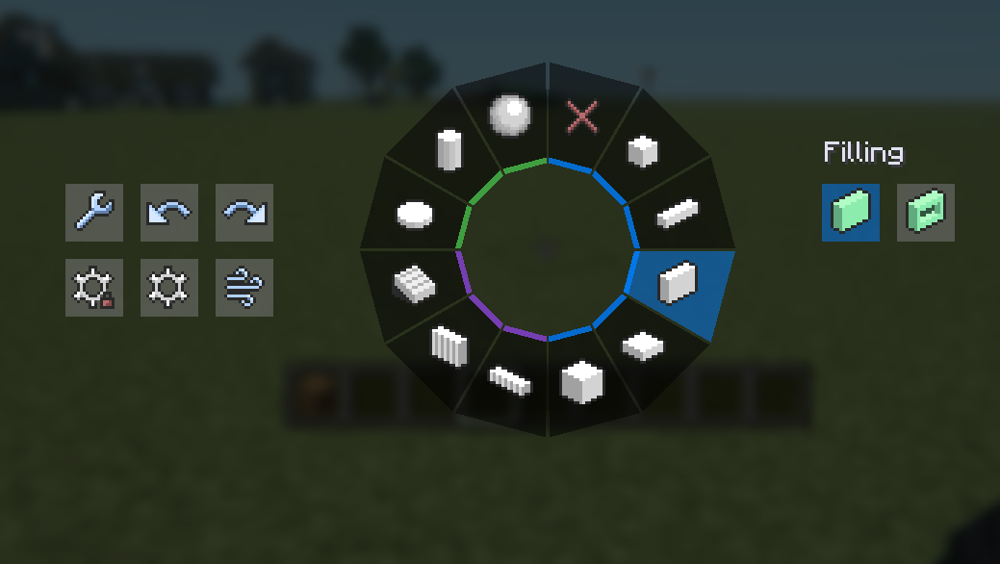

*Hold `Alt` to choose a building shape and configure whether it is filled or hollow.*

Effortless Building can place, break, or apply tool interactions across a selected shape. Check the preview before confirming, especially near storage, redstone, or irreplaceable blocks. The Randomizer tool can vary a palette, while an empty weighted slot can intentionally leave gaps.

Stonecutting Upgrade expands the stonecutter recipe area and remembers the previous selection. Press `Space` inside the stonecutter to refill one input item, or hold `Shift` with `Space` to refill a stack. These are interface actions, not global building keybinds.

Armor Statues provides a dedicated interface for poses, body-part rotation, visibility, alignment, and display options. Arcane Lanterns uses a Lantern Maker and catalysts to create area effects; read the JEI description before placement because some effects help farms or movement while others repel, contain, debuff, or damage entities. Barricades and traps are functional defenses, so test their reset and contact behavior before placing them on a shared path.

### Storage and inventory management

- **Sophisticated Backpacks** — Adds upgradeable portable storage with functional upgrade slots.
- **Tom's Simple Storage** — Joins ordinary containers into one searchable storage network.
- **Linked Chests** — Lets separate chests share an inventory.
- **Easy Shulker Boxes** — Allows shulker boxes to be used directly from the inventory.

Choose the storage system by the job. **Sophisticated Backpacks** provide portable capacity and configurable upgrades; `V` opens an equipped pack. **Tom's Simple Storage** connects nearby containers to one searchable network, accessed at a placed terminal. **Linked Chests** share inventories between locations through matching dye channels, with personal channels and a portable pouch available. **Easy Shulker Boxes** lets you browse a packed shulker without placing it.

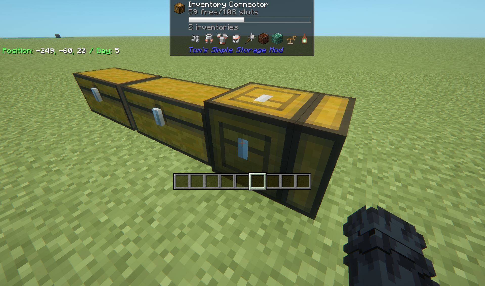

*The connector indexes linked inventories; Jade reports their combined capacity and connected-container count.*

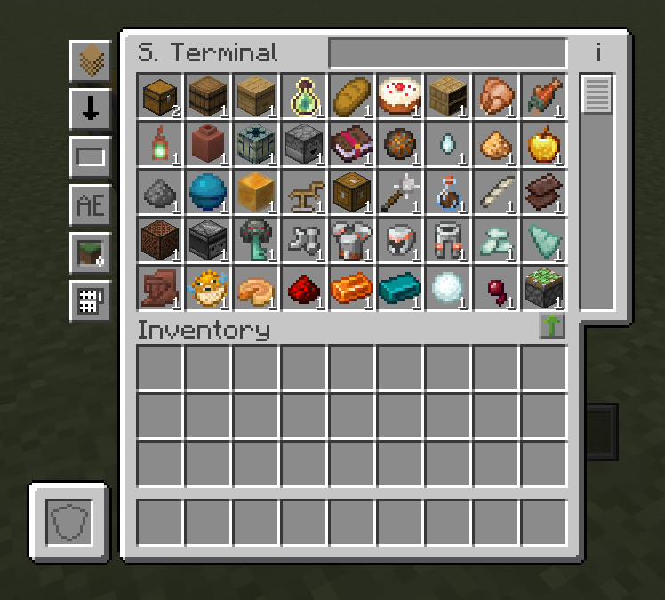

*The terminal browses the network as one inventory while the items remain in their connected containers.*

Sophisticated Backpacks can also be placed as blocks and used with hoppers or other inventory automation. Keep its role distinct from a Tom's network: a backpack is a portable container with upgrades, while Tom's Simple Storage indexes connected inventories rather than moving everything into one giant chest.

Linked Chests share data by channel, not by physical adjacency. Label the three-color combination, decide whether the channel is shared or personal, and test a second chest before trusting it with important materials. Easy Shulker Boxes are an inventory convenience; they do not expand a storage network.

Set a Linked Chest channel with dyes on its three color controls; any chest using the same ordered combination opens that channel's shared inventory. Use a diamond on the latch to convert it to a larger player-specific channel. To configure portable access, sneak-use a Linked Pouch on the target chest so the pouch copies that channel.

### Item transport and logistics

- **Golden Hopper** — Adds a hopper with configurable filtering behavior.
- **Hopper Gadgetry** — Adds more capable hopper controls and item-routing tools.
- **Sophisticated Inventory Interactions** — Brings search, sorting, and transfer controls to eligible container screens.
- **Sophisticated Item Actions** — Finds nearby inventories containing an item and supports direct restocking or depositing.

#### Choosing a transport tool

Use a **Golden Hopper** when one physical filter item should control what it pulls and pushes; that filter consumes a real item slot. A **Grated Hopper** uses configured filter slots, so confirm that its filters match the items you expect. **Ducts** push items along connected routes but do not pull or collect loose drops. **Chutes** collect loose items and move them downward without storing them. **Sophisticated Inventory Interactions** adds search, sorting, and transfer actions to supported screens; filtered transfers depend on what is already in the destination. **Sophisticated Item Actions** can highlight matching nearby storage or transfer items directly, so test its filters with disposable stacks before using bulk actions.

The Sophisticated interaction and item-action keybinds are intentionally left unbound in the recommended profile. Assign only the actions you will use, then test them with disposable items: deposit and transfer operations can affect many stacks at once.

### Vehicles and travel equipment

- **Seaworthy Boats** — Gives boats health and armor, then adds faster and tougher reinforcement tiers plus a shipyard repair loop.
- **Vehicle Upgrade** — Improves mount and vehicle behavior, including swimming, terrain handling, rider inventory access, mounted mining, and reduced wandering.

Use a Shipyard near the boat to switch between repair and upgrade work. Repairs consume planks; reinforcement consumes the configured material and normally advances through the available tiers in sequence. The riding HUD shows boat health when enabled, so return for repairs before a damaged boat breaks far from shore.

Vehicle Upgrade affects many rideable entities rather than supplying a new vehicle family. Saddled mounts can stay where they are left, mounts can handle water and leaves more reliably, and passengers interact with nearby blocks more safely. Some features are configurable, so observed server behavior takes precedence over the full feature list.

### Trading and multiplayer economy

- **Market Board** — Provides a shared multiplayer marketplace where players can list, buy, remove, and collect proceeds from item sales.

Right-click a placed board to browse and buy; sneak-right-click it to open the management interface for selling items, removing listings, or collecting sale proceeds. Use its search, sorting, and scrolling controls to review existing listings before creating one. When selling, verify the item, quantity, accepted server currency, and price before confirming. The ordinary Market Board uses one configured currency, while Market Board Plus can accept multiple registered currencies in one price. The server administrator controls which currencies are registered, and currency items themselves cannot be sold through the system.

Market Board is for asynchronous player listings. Goblin Traders and other unusual traders remain direct creature interactions and are documented under [Creatures and hostile mobs](#creatures-and-hostile-mobs).

For a clear listing, compare similar offers, account for the server's registered currency, and state the exact quantity. A player must find the board and accept the displayed terms; collect proceeds separately through its management screen.

#### Sources for survival and creation

- [OneKeyMiner](https://modrinth.com/mod/onekeyminer_nf)
- [Farmer's Delight](https://www.curseforge.com/minecraft/mc-mods/farmers-delight), [Expanded Delight](https://www.curseforge.com/minecraft/mc-mods/expanded-delight), and [Kaleidoscope Cookery](https://modrinth.com/mod/kaleidoscope-cookery)
- [Alchemia](https://modrinth.com/mod/alchemia), [FFBandage](https://www.curseforge.com/minecraft/mc-mods/ffbandage), [Potion Time Stacker](https://modrinth.com/mod/potion-time-stacker), and [Potions Stack](https://www.curseforge.com/minecraft/mc-mods/potions-stack)
- [Macaw's building mods](https://www.curseforge.com/members/sketch_macaw/projects), [Effortless Building](https://modrinth.com/mod/effortless-building), [Armor Statues](https://modrinth.com/mod/armor-statues), [Stonecutting Upgrade](https://www.curseforge.com/minecraft/mc-mods/stonecutting-upgrade), [Arcane Lanterns](https://modrinth.com/mod/arcane-lanterns), and [Traps and Barricades](https://www.curseforge.com/minecraft/mc-mods/traps-and-brricades)
- [Sophisticated Backpacks](https://modrinth.com/mod/sophisticated-backpacks), [Tom's Simple Storage](https://modrinth.com/mod/toms-storage), [Linked Chests](https://modrinth.com/mod/new-linked-chests), and [Easy Shulker Boxes](https://modrinth.com/mod/easy-shulker-boxes)
- [Golden Hopper](https://www.curseforge.com/minecraft/mc-mods/golden-hopper), [Hopper Gadgetry](https://modrinth.com/mod/hopper-gadgetry), [Sophisticated Inventory Interactions](https://modrinth.com/mod/sophisticated-inventory-interactions), and [Sophisticated Item Actions](https://modrinth.com/mod/sophisticated-item-actions)
- [Seaworthy Boats](https://modrinth.com/mod/seaworthy-boats), [Vehicle Upgrade](https://modrinth.com/mod/vehicle-upgrade), and [The Market Board](https://www.curseforge.com/minecraft/mc-mods/market-board)

## Part VI — Interface and Reference

The pack exposes far more information than vanilla Minecraft, but every overlay does a different job. Use Jade for the thing in front of you, JEI for items and recipes, tooltips for details already in your inventory, and the permanent HUD only for information needed while moving. The recommended layout below keeps those layers readable without turning the screen into a dashboard.

Use the interface in layers: a tooltip answers an immediate question, JEI helps plan a craft or search a mod, and the HUD stays visible for information needed while moving. Turn on extra overlays only when they solve a current problem; overlapping panels make combat and building harder to read.

### Information overlays and tooltips

- **AppleSkin** — Visualizes hunger, saturation, exhaustion, and the food value of held items without changing those mechanics.
- **Jade** — Identifies the block or entity being looked at and displays relevant state information in an on-screen overlay.
- **Effect Insights** — Adds readable descriptions to potion and food effects, including active effects viewed from the inventory.
- **Enchantment Insights** — Adds enchantment descriptions, levels, and optional technical details to tooltips and enchanting hints.
- **Food Effect Tooltips** — Shows the status effects supplied by a food before it is eaten.
- **Floating Damage Indicators** — Displays configurable, color-coded damage numbers for dealt and received damage.
- **Controlling** — Adds keybind search, conflict filtering, and a view of currently available keys to the Controls screen.

#### Sources for interface and client features

[Jade](https://modrinth.com/mod/jade), [AppleSkin](https://modrinth.com/mod/appleskin), [Effect Insights](https://modrinth.com/mod/effect-insights), [Enchantment Insights](https://modrinth.com/mod/enchantment-insights), [Food Effect Tooltips](https://modrinth.com/mod/foodeffecttooltips), [Floating Damage Indicators](https://modrinth.com/mod/floating-damage-indicators), and [Controlling](https://modrinth.com/mod/controlling); [Just Enough Items](https://modrinth.com/mod/jei), [JEI Trades](https://modrinth.com/mod/jei-trades), [Just Enough Filters](https://modrinth.com/mod/just-enough-filters), [Advanced Loot Info](https://modrinth.com/mod/advanced-loot-info), and [Advanced Worldgen Info](https://modrinth.com/mod/advanced-worldgen-info); [Coordinates Display](https://modrinth.com/mod/coordinates-display), [Paper Doll](https://modrinth.com/mod/paper-doll), [Hovering Hotbar](https://modrinth.com/mod/hovering-hotbar), and [Overflowing Bars](https://modrinth.com/mod/overflowing-bars); [SimpleHats Lite](https://www.curseforge.com/minecraft/mc-mods/simplehats-lite), [Distinct Potions](https://modrinth.com/mod/distinct-potions), [Quick Skin](https://modrinth.com/mod/quick-skin), and [PatPat](https://modrinth.com/plugin/patpat); [Charm of Undying: Reborn](https://www.curseforge.com/minecraft/mc-mods/charm-of-undying-reborn), [Harder Natural Healing](https://modrinth.com/mod/harder-natural-healing), [Iris](https://modrinth.com/mod/iris), and [Sodium](https://modrinth.com/mod/sodium).

#### Reading the information layers

To identify a block or creature, aim at it and read **Jade**; the default overlay toggle is `Numpad 1`, while the Mods screen opens its configuration if your keyboard lacks a numpad. In **JEI**, left-click an item in the list to view its recipe or right-click it to view its uses; those keyboard shortcuts are unbound in this profile. **Effect Insights** and **Enchantment Insights** explain status effects and enchantments in their tooltips; hold `Left Shift` when LibTooltips indicates more text. Before eating, read **AppleSkin** for hunger and saturation and **Food Effect Tooltips** for status effects. **Floating Damage Indicators** shows damage over the target, with colors and prefixes for configured damage types.

Jade's `Numpad 2` toggles its fluid display and `Numpad 5` narrates the current target. Its recipe and usage shortcuts are left unchanged; JEI uses left-click for recipes and right-click for uses, with the keyboard shortcuts unbound. Players without a numpad can open the mod's configuration through the Mods screen or rebind only the Jade actions they actually use.

The recommended profile assigns `F2` to advanced tooltips, so the normal screenshot action is intentionally unbound. Advanced tooltips are best used temporarily when an item ID, durability value, or other technical detail is needed. Controlling's search and conflict views should be the first place to check when a shortcut does nothing.

### Recipe and loot information

- **Just Enough Items** — Provides searchable item, recipe, and usage views.
- **JEI Trades** — Adds villager trade information to the recipe browser.
- **Just Enough Filters** — Adds more ways to filter the item browser.
- **Advanced Loot Info** — Shows detailed loot-table and trade information in the recipe browser.
- **Advanced Worldgen Info** — Shows where world-generation features and resources can appear.
- **Show My Recipes** — Unlocks crafting recipes in the recipe book so players can discover what is available.

#### JEI everyday workflow

1. Open an inventory and use the search field to narrow the item list. Press `Ctrl + F` to focus the field quickly.
2. In the JEI item list, left-click an ingredient or result for its recipe, or right-click it for uses. The corresponding keyboard shortcuts are unbound in this profile.
3. Scroll to move between item-list or recipe pages. Click a recipe-category name to see every recipe in that category.
4. When a recipe supports transfer, use its `+` button to place available ingredients into the crafting area; a transfer does not create missing ingredients.
5. Show/Hide JEI Overlays is unbound in this profile; assign its control in Controls if you want to hide or restore the item list with a key.

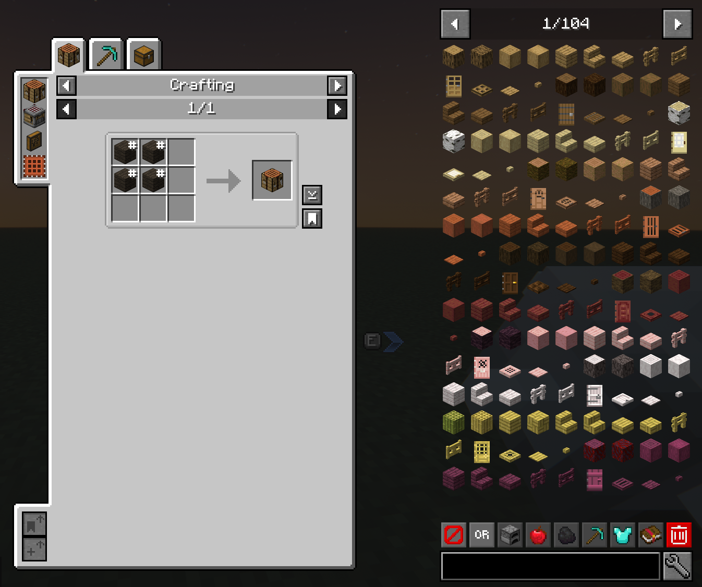

*Recipe and usage views keep the selected process visible beside JEI's filtered item browser.*

JEI search can combine ordinary words with filters. Prefix a term with `@` to search by source mod, prefix an unwanted term with `-` to exclude it, and wrap a phrase in quotation marks when its words must stay together. This is the quickest way to browse one large content mod without listing every item in this handbook.

JEI's companion features answer different questions: **JEI Trades** reads current registered villager trades; **Just Enough Filters** narrows large item lists; **Advanced Loot Info** shows loot tables and trades; **Advanced Worldgen Info** describes where configured features and resources can generate; **Show My Recipes** makes the vanilla recipe book a broader discovery aid. Availability still depends on what the current world and server register.

JEI's cheat, edit, and developer controls are reference entries rather than normal-player tools. They remain unbound in the recommended profile. On a survival server, use JEI for information and recipe transfer only; permissions and server rules remain authoritative.

### HUD changes and customization

#### Recommended HUD arrangement

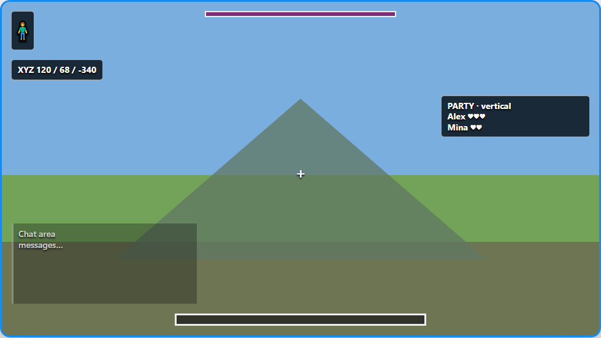

*Layout diagram: stack personal information on the upper-left and reserve the right edge for the party roster.*

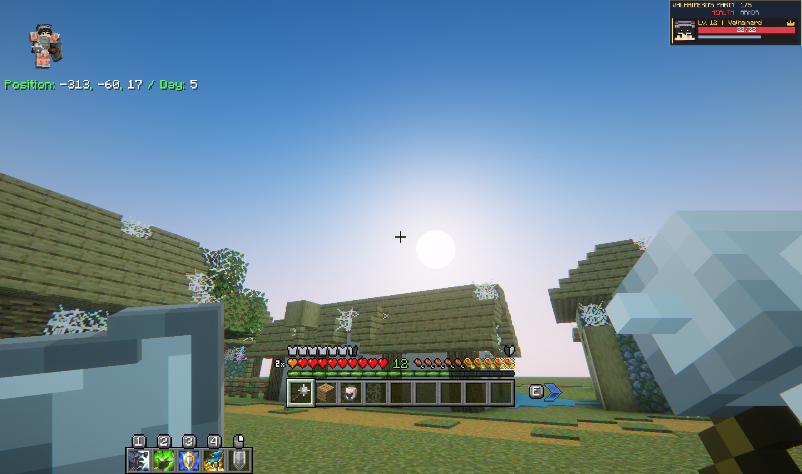

*In-game example: the arrangement preserves the center while keeping character, location, and party information visible.*

This is the pack recommendation, not a locked layout. It gives personal status elements a consistent upper-left stack, leaves the center clear for combat, and gives a multiplayer roster enough vertical space on the right.

1. Open Better Party with `B`, set its roster to a vertical arrangement, and place it on the right.
2. Open Paper Doll's configuration and place the model in the upper-left. Adjust its scale and action-based visibility before positioning the coordinates beneath it.
3. Press `Ctrl + N` to open Coordinates Display, then use `Alt + N` for HUD positioning. Place the coordinate panel directly below Paper Doll.
4. Use `Shift + N` to cycle coordinate display modes and choose the amount of navigation information that remains readable at the current GUI scale.
5. Test the result with status effects visible, the chat open, and a full party. Move the right-side roster if a server scoreboard or effect list competes for the same edge.

Recheck the layout after changing GUI scale or resolution. The image shows the relationship between elements; it is not a pixel-perfect requirement for every display.

#### Coordinates Display configuration

Coordinates Display can show precise position, chunk position, facing direction, biome, and other navigation information. Its display modes offer different densities: a minimal mode keeps the footprint small, a compass-oriented mode emphasizes direction, and a hotbar-oriented mode moves the readout closer to the lower center of the screen. Use the mode that fits the current activity; the upper-left arrangement above is simply the most balanced general setup.

The recommended coordinate group is `N` to toggle the HUD, `Shift + N` to cycle modes, `Alt + N` to reposition it, and `Ctrl + N` to open its GUI. `Y` sends the current position in chat and `H` toggles the 3D compass. Marking, clipboard, and `/tp` actions remain unbound unless a player needs them.

#### Better Party configuration

Better Party's HUD is most useful when it shows the roster without obscuring the player's own status information. Keep it vertical on the right and scale it for the usual party size. If status effects or a server scoreboard also occupy that side, move or reduce the party panel rather than stacking interfaces on top of one another. Party creation, roles, chat, friendly fire, XP sharing, and revival coordination are covered under [Parties and multiplayer cooperation](#parties-and-multiplayer-cooperation).

#### Paper Doll configuration

Paper Doll shows a small player model during configured actions such as sprinting, swimming, crouching, flying, or gliding. Its position, size, display duration, head movement, and visibility rules are configurable. Place it first because its model needs more vertical space than a coordinate line; then position Coordinates Display directly beneath it.

- **Hovering Hotbar** — Raises the hotbar from the screen edge with a configurable offset and optional experience-level placement.
- **Overflowing Bars** — Compresses health, armor, and armor-toughness values beyond vanilla limits into layered bars with readable counters.
- **Paper Doll** — Adds a configurable, action-aware player model to the HUD.

Hovering Hotbar uses `Up Arrow` and `Down Arrow` in the recommended profile for quick positioning. Overflowing Bars becomes important when RPG equipment raises defensive or health values beyond the normal display range; its layers and counters represent additional capacity rather than a second, separate health pool.

### Cosmetic and animation changes

- **SimpleHats Lite** — Wear hats in functional or cosmetic Curios Head, Face, or Hat slots; the pack's fix allows layered vanity looks. Grab bags and dyes add variants.
- **Distinct Potions** — Gives potion categories clearer names, colors, and bottle appearances so they are easier to distinguish.
- **Quick Skin** — Adds in-game skin, model, and cape management without returning to the launcher.
- **PatPat** — Adds a friendly player-to-player and player-to-creature pat interaction.
- **Kingdom Cats Replacer** — Replaces vanilla cat visuals with seven animated models while preserving vanilla cat behavior.

Hold `C` and right-click a supported player or creature to pat it; the contextual interaction leaves ordinary use actions intact.

### Optional client features

- **Coordinates Display** — Shows the player's coordinates and related navigation information on a configurable HUD.
- **Iris** — Enables shader-pack support.
- **Sodium** — Replaces the renderer to improve frame rate and reduce rendering stutter.

These client-only options affect the interface and rendering. Sodium improves rendering; manage Iris shader packs in Video Settings, use `Alt + R` to reload them, and disable shaders first when troubleshooting.

### Alphabetical mod index

- [Abyssal Ocean](#integrated-world-and-dimension-expansions)
- [Advanced Loot Info](#recipe-and-loot-information)
- [Advanced Worldgen Info](#recipe-and-loot-information)
- [Adventurer Skills](#skill-trees-and-character-progression)
- [Alchemia](#alchemia)
- [Alex's Caves](#alexs-caves)
- [Alex's Mobs](#creatures-and-hostile-mobs)
- [Animal Garden collection](#creatures-and-hostile-mobs)
- [Animal Pen](#companions-pets-villagers-and-settlements)
- [Antique Trading Ship](#structures-and-dungeons)
- [AppleSkin](#information-overlays-and-tooltips)
- [Arcane Lanterns](#building-and-decoration)
- [Armor Quick Swap](#weapons-armor-jewelry-and-relics)
- [Armor Statues](#building-and-decoration)
- [Armor Trim Item Fix](#enchanting-and-equipment-improvement)
- [Armored Foes](#dangerous-nights-and-environmental-threats)
- [Armory](#weapons-armor-jewelry-and-relics)
- [Arrow+](#weapons-armor-jewelry-and-relics)
- [Arsenal](#weapons-armor-jewelry-and-relics)
- [Artifacts](#weapons-armor-jewelry-and-relics)
- [ATi Structures: Vanilla Edition](#structures-and-dungeons)
- [Awesome Dungeon collection](#structures-and-dungeons)
- [Barricades](#building-and-decoration)
- [Better Combat](#combat-controls-and-dodge-rolling)
- [Better Nether](#better-nether)
- [Better Party](#parties-and-multiplayer-cooperation)
- [Better Respawn](#death-revival-graves-and-respawning)
- [Better Revive](#death-revival-graves-and-respawning)
- [Better Rotten Flesh](#farming-food-and-cooking)
- [Bifrost Teleport](#travel-maps-compasses-and-teleportation)
- [Biomes O' Plenty](#integrated-world-and-dimension-expansions)
- [Blood Moon](#dangerous-nights-and-environmental-threats)
- [Bosslike Ender Dragon](#bosses-and-major-encounters)
- [Charm of Undying: Reborn](#death-revival-graves-and-respawning)
- [Clear End City](#integrated-world-and-dimension-expansions)
- [Combat Roll](#combat-controls-and-dodge-rolling)
- [Compact Villagers](#companions-pets-villagers-and-settlements)
- [Companions: Dogfolk](#companions-pets-villagers-and-settlements)
- [Controlling](#information-overlays-and-tooltips)
- [Coordinates Display](#optional-client-features)
- [Craftable Creatures Evolution](#creatures-and-hostile-mobs)
- [DarkSmithing](#enchanting-and-equipment-improvement)
- [Dedicated Elytra Slot](#weapons-armor-jewelry-and-relics)
- [Display Delight](#building-and-decoration)
- [Distinct Potions](#cosmetic-and-animation-changes)
- [Dungeons and Taverns](#structures-and-dungeons)
- [Dungeons and Taverns overhauls](#structures-and-dungeons)
- [Dungeons Dimensions: Nether](#integrated-world-and-dimension-expansions)
- [Easy Anvils](#enchanting-and-equipment-improvement)
- [Easy Shulker Boxes](#storage-and-inventory-management)
- [Effect Insights](#information-overlays-and-tooltips)
- [Effortless Building](#building-and-decoration)
- [Elytra Trims](#enchanting-and-equipment-improvement)
- [Enchantment Insights](#information-overlays-and-tooltips)
- [Enchantments collection](#weapons-armor-jewelry-and-relics)
- [Ender Zoology](#creatures-and-hostile-mobs)
- [Expanded Delight](#farmers-delight)
- [Explorer's Compass](#travel-maps-compasses-and-teleportation)
- [Explorify](#structures-and-dungeons)
- [Farmer's Delight](#farmers-delight)
- [FF Bandage](#potions-and-alchemy)
- [Fletching Recipe](#weapons-armor-jewelry-and-relics)
- [Floating Damage Indicators](#information-overlays-and-tooltips)
- [Food Effect Tooltips](#information-overlays-and-tooltips)
- [Functional Sculptures](#building-and-decoration)
- [Gateway of Doom](#bosses-and-major-encounters)
- [Gazebos](#structures-and-dungeons)
- [Goblin Traders](#creatures-and-hostile-mobs)
- [Golden Hopper](#item-transport-and-logistics)
- [Guard Ribbits](#creatures-and-hostile-mobs)
- [Guard Villagers](#creatures-and-hostile-mobs)
- [Harder Natural Healing](#death-revival-graves-and-respawning)
- [Hopo Better Underwater Ruins](#structures-and-dungeons)
- [Hopper Gadgetry](#item-transport-and-logistics)
- [Hovering Hotbar](#hud-changes-and-customization)
- [Illager Invasion](#invasions-and-wave-events)
- [Improved Village Placement](#structures-and-dungeons)
- [Invasion](#invasions-and-wave-events)
- [Iourus Races](#races-and-racial-traits)
- [Iris](#optional-client-features)
- [Iron Wolf Armor](#companions-pets-villagers-and-settlements)
- [It Takes a Pillage](#invasions-and-wave-events)
- [Jade](#information-overlays-and-tooltips)
- [JEI Trades](#recipe-and-loot-information)
- [Jewelry](#weapons-armor-jewelry-and-relics)
- [Just Enough Filters](#recipe-and-loot-information)
- [Just Enough Items](#recipe-and-loot-information)
- [Kaleidoscope Cookery](#farming-food-and-cooking)
- [Kingdom Cats Replacer](#cosmetic-and-animation-changes)
- [Linked Chests](#storage-and-inventory-management)
- [Lullaby's Mobs](#creatures-and-hostile-mobs)
- [Macaw's building collection](#macaws-building-collection)
- [Market Board](#trading-and-multiplayer-economy)
- [Moblets](#creatures-and-hostile-mobs)
- [Moog's structure collection](#structures-and-dungeons)
- [Mounts and Monsters](#creatures-and-hostile-mobs)
- [Much More Dungeons](#structures-and-dungeons)
- [Mutants and Zombies](#creatures-and-hostile-mobs)
- [Name Tag Upgrade](#companions-pets-villagers-and-settlements)
- [Nameless Trinkets](#weapons-armor-jewelry-and-relics)
- [Naturally Trimmed](#enchanting-and-equipment-improvement)
- [Nature's Compass](#travel-maps-compasses-and-teleportation)
- [No Crop Destruction](#farming-food-and-cooking)
- [Nullscape](#integrated-world-and-dimension-expansions)
- [Ocean Lily Pad Village](#structures-and-dungeons)
- [OneKeyMiner](#resource-gathering-and-repetitive-actions)
- [Overflowing Bars](#hud-changes-and-customization)
- [Paper Doll](#hud-changes-and-customization)
- [Party Creepers](#creatures-and-hostile-mobs)
- [PatPat](#cosmetic-and-animation-changes)
- [Penchant](#penchant)
- [Pet Status](#companions-pets-villagers-and-settlements)
- [Pet Vault](#pet-vault)
- [PlayerRevive](#death-revival-graves-and-respawning)
- [Potion Time Stacker](#potions-and-alchemy)
- [Potions Stack](#potions-and-alchemy)
- [Pro Placer](#building-and-decoration)
- [Pufferfish's Skills](#skill-trees-and-character-progression)
- [Puffsprout](#companions-pets-villagers-and-settlements)
- [Quick Skin](#cosmetic-and-animation-changes)
- [Relics](#weapons-armor-jewelry-and-relics)
- [Ribbits](#creatures-and-hostile-mobs)
- [RPG classes](#rpg-classes)
- [Runes](#abilities-spells-runes-and-resources)
- [Scalar RPG Utils](#weapons-armor-jewelry-and-relics)
- [Seaworthy Boats](#vehicles-and-travel-equipment)
- [Serene Seasons](#integrated-world-and-dimension-expansions)
- [Shield Upgrades](#weapons-armor-jewelry-and-relics)
- [Show My Recipes](#recipe-and-loot-information)
- [Shroomcraft](#shroomcraft)
- [SimpleHats Lite](#cosmetic-and-animation-changes)
- [Skill Tree (RPG Series)](#skill-trees-and-character-progression)
- [Sodium](#optional-client-features)
- [Somnora](#dangerous-nights-and-environmental-threats)
- [Sophisticated Backpacks](#storage-and-inventory-management)
- [Sophisticated Inventory Interactions](#item-transport-and-logistics)
- [Sophisticated Item Actions](#item-transport-and-logistics)
- [Spell Engine](#abilities-spells-runes-and-resources)
- [Starcatcher](#starcatcher)
- [Stellarity](#stellarity)
- [Stonecutting Upgrade](#building-and-decoration)
- [Stoneworks](#building-and-decoration)
- [Stronger Skill Tree](#skill-trees-and-character-progression)
- [Target Dummy](#combat-controls-and-dodge-rolling)
- [Terralith](#integrated-world-and-dimension-expansions)
- [The Darkness Will Find You](#dangerous-nights-and-environmental-threats)
- [The Graveyard](#the-graveyard)
- [Tom's Simple Storage](#storage-and-inventory-management)
- [Too Many Bows](#weapons-armor-jewelry-and-relics)
- [Tool Belt](#weapons-armor-jewelry-and-relics)
- [Towers of Chambers](#structures-and-dungeons)
- [Towns and Towers](#structures-and-dungeons)
- [Ultimate Warden](#bosses-and-major-encounters)
- [Underground Villages](#structures-and-dungeons)
- [Universal Bone Meal](#farming-food-and-cooking)
- [Universal Enchants](#enchanting-and-equipment-improvement)
- [Vehicle Upgrade](#vehicles-and-travel-equipment)
- [Waystones](#travel-maps-compasses-and-teleportation)
- [Wild Pets](#companions-pets-villagers-and-settlements)
- [William Wythers' Overhauled Overworld](#integrated-world-and-dimension-expansions)
- [Withered Lands](#withered-lands)
- [World Bosses](#bosses-and-major-encounters)
- [Xaero's Map Multiplayer](#travel-maps-compasses-and-teleportation)
- [Xaero's World Map](#xaeros-world-map)

### Gameplay-tag index

#### Combat

- [FF Bandage](#potions-and-alchemy)
- [Better Combat](#combat-controls-and-dodge-rolling)
- [Combat Roll](#combat-controls-and-dodge-rolling)
- [Target Dummy](#combat-controls-and-dodge-rolling)
- [RPG classes](#rpg-classes)
- [World Bosses](#bosses-and-major-encounters)
- [Invasion](#invasions-and-wave-events)

#### Character

- [Adventurer Skills](#skill-trees-and-character-progression)
- [Iourus Races](#races-and-racial-traits)
- [Pufferfish's Skills](#skill-trees-and-character-progression)
- [RPG classes](#rpg-classes)
- [Skill Tree (RPG Series)](#skill-trees-and-character-progression)
- [Stronger Skill Tree](#skill-trees-and-character-progression)

#### Skills

- [Adventurer Skills](#skill-trees-and-character-progression)
- [Pufferfish's Skills](#skill-trees-and-character-progression)
- [Skill Tree (RPG Series)](#skill-trees-and-character-progression)
- [Stronger Skill Tree](#skill-trees-and-character-progression)

#### Magic

- [RPG classes](#rpg-classes)
- [Spell Engine](#abilities-spells-runes-and-resources)
- [Runes](#abilities-spells-runes-and-resources)
- [Alchemia](#alchemia)
- [Arcane Lanterns](#building-and-decoration)

#### Equipment

- [Artifacts](#weapons-armor-jewelry-and-relics)
- [Arsenal](#weapons-armor-jewelry-and-relics)
- [Armory](#weapons-armor-jewelry-and-relics)
- [Charm of Undying: Reborn](#death-revival-graves-and-respawning)
- [Dedicated Elytra Slot](#weapons-armor-jewelry-and-relics)
- [Enchantments collection](#weapons-armor-jewelry-and-relics)
- [Jewelry](#weapons-armor-jewelry-and-relics)
- [Penchant](#penchant)
- [Nameless Trinkets](#weapons-armor-jewelry-and-relics)
- [Relics](#weapons-armor-jewelry-and-relics)
- [SimpleHats Lite](#cosmetic-and-animation-changes)
- [Starcatcher](#starcatcher)
- [Scalar RPG Utils](#weapons-armor-jewelry-and-relics)
- [Tool Belt](#weapons-armor-jewelry-and-relics)
- [Alex's Caves](#alexs-caves)
- [Stellarity](#stellarity)

#### Bosses

- [World Bosses](#bosses-and-major-encounters)
- [Bosslike Ender Dragon](#bosses-and-major-encounters)
- [Ultimate Warden](#bosses-and-major-encounters)
- [Gateway of Doom](#bosses-and-major-encounters)

#### Events

- [Invasion](#invasions-and-wave-events)
- [Blood Moon](#dangerous-nights-and-environmental-threats)
- [Illager Invasion](#invasions-and-wave-events)
- [It Takes a Pillage](#invasions-and-wave-events)
- [Starcatcher](#starcatcher)

#### World Generation

- [Alex's Caves](#alexs-caves)
- [Biomes O' Plenty](#integrated-world-and-dimension-expansions)
- [Terralith](#integrated-world-and-dimension-expansions)
- [Better Nether](#better-nether)
- [Nullscape](#integrated-world-and-dimension-expansions)
- [Stellarity](#stellarity)

#### Structures

- [Artifacts](#weapons-armor-jewelry-and-relics)
- [Awesome Dungeon collection](#structures-and-dungeons)
- [Dungeons and Taverns](#structures-and-dungeons)
- [Dungeons and Taverns overhauls](#structures-and-dungeons)
- [Moog's structure collection](#structures-and-dungeons)
- [Towns and Towers](#structures-and-dungeons)
- [The Graveyard](#the-graveyard)

#### Creatures

- [Alex's Mobs](#creatures-and-hostile-mobs)
- [Animal Garden collection](#creatures-and-hostile-mobs)
- [Party Creepers](#creatures-and-hostile-mobs)
- [Shroomcraft](#shroomcraft)
- [Ender Zoology](#creatures-and-hostile-mobs)

#### Companions

- [Companions: Dogfolk](#companions-pets-villagers-and-settlements)
- [Wild Pets](#companions-pets-villagers-and-settlements)
- [Puffsprout](#companions-pets-villagers-and-settlements)
- [Pet Vault](#pet-vault)
- [Pet Status](#companions-pets-villagers-and-settlements)

#### Farming

- [Expanded Delight](#farmers-delight)
- [Farmer's Delight](#farmers-delight)
- [Kaleidoscope Cookery](#farming-food-and-cooking)
- [OneKeyMiner](#resource-gathering-and-repetitive-actions)
- [Shroomcraft](#shroomcraft)
- [Universal Bone Meal](#farming-food-and-cooking)

#### Food

- [Expanded Delight](#farmers-delight)
- [Farmer's Delight](#farmers-delight)
- [Kaleidoscope Cookery](#farming-food-and-cooking)
- [Starcatcher](#starcatcher)
- [Better Rotten Flesh](#farming-food-and-cooking)
- [Harder Natural Healing](#death-revival-graves-and-respawning)

#### Building

- [Macaw's building collection](#macaws-building-collection)
- [Effortless Building](#building-and-decoration)
- [Stoneworks](#building-and-decoration)
- [Pro Placer](#building-and-decoration)

#### Storage

- [Sophisticated Backpacks](#storage-and-inventory-management)
- [Tom's Simple Storage](#storage-and-inventory-management)
- [Linked Chests](#storage-and-inventory-management)

#### Travel

- [Waystones](#travel-maps-compasses-and-teleportation)
- [Bifrost Teleport](#travel-maps-compasses-and-teleportation)
- [Xaero's World Map](#xaeros-world-map)
- [Seaworthy Boats](#vehicles-and-travel-equipment)
- [Vehicle Upgrade](#vehicles-and-travel-equipment)
- [Dedicated Elytra Slot](#weapons-armor-jewelry-and-relics)

#### Multiplayer

- [Better Party](#parties-and-multiplayer-cooperation)
- [Market Board](#trading-and-multiplayer-economy)
- [PlayerRevive](#death-revival-graves-and-respawning)
- [Better Revive](#death-revival-graves-and-respawning)

#### Controls

- [Better Combat](#combat-controls-and-dodge-rolling)
- [Combat Roll](#combat-controls-and-dodge-rolling)
- [Spell Engine](#abilities-spells-runes-and-resources)
- [OneKeyMiner](#resource-gathering-and-repetitive-actions)
- [Effortless Building](#building-and-decoration)
- [Tool Belt](#weapons-armor-jewelry-and-relics)

#### HUD

- [Paper Doll](#hud-changes-and-customization)
- [Coordinates Display](#optional-client-features)
- [Better Party](#parties-and-multiplayer-cooperation)
- [Hovering Hotbar](#hud-changes-and-customization)
- [Overflowing Bars](#hud-changes-and-customization)
